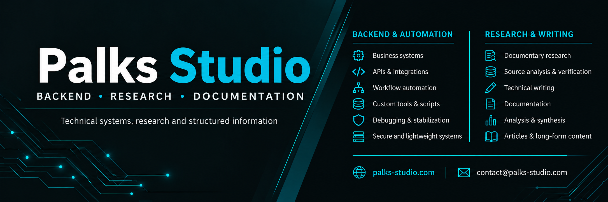

  

  

# Palks Studio | Technical Articles

## 🇫🇷 Articles techniques

Ce dépôt rassemble les articles techniques de Palks Studio, studio indépendant de développement logiciel.

Ces publications présentent les choix d'architecture, les problématiques rencontrées et les solutions mises en œuvre dans la conception de systèmes backend, d'outils métier, d'automatisations et de ressources numériques.

Les articles abordent notamment :

- Architecture logicielle et développement backend  
- Automatisation et traitement des données  
- Facturation électronique et systèmes financiers  
- Infrastructure autonome et systèmes sans SaaS  
- Conception d'outils et de ressources numériques

Les articles en français sont disponibles dans ce dépôt.

Les versions anglaises sont publiées sur DEV.to.

👉 [Découvrir les articles techniques en anglais sur DEV.to](https://dev.to/palks_studio)

## Sommaire des articles techniques

- [Architecture d'un moteur de facturation automatisé en PHP](articles/automation-system.md)  
- [Architecture d'un système financier autonome](articles/billing-system.md)  
- [Architecture d'un système de recrutement en PHP](articles/candidate-system.md)  
- [Architecture d'un système de collecte de données en Python](articles/data-collection-system.md)  
- [Architecture d'un chatbot Flask local](articles/flask_chatbot_advanced_2.0.md)  
- [Concevoir un générateur Factur-X EN16931](articles/free-facturx-generator.md)  
- [Architecture d'un générateur de devis en JavaScript](articles/free-quote-generator.md)  
- [Concevoir des expériences interactives en JavaScript natif](articles/interactive-experiences.md)  
- [Architecture d'un moteur d'acquittement de factures PDF](articles/invoice-stamper.md)  
- [Développer sans framework à l'ère de l'IA](articles/palks-studio.md)  
- [Architecture d'un scanner de projets en Python](articles/project-inventory.md)  
- [Architecture d'un environnement VS Code local](articles/vs-code-environment-pack.md)

---

## 🇬🇧 Technical Articles

This repository brings together the French-language technical articles by Palks Studio, an independent software development studio.

These publications explore architectural decisions, technical challenges, and solutions implemented in the design of backend systems, business tools, automation workflows, and digital resources.

Topics include:

- Software architecture and backend development  
- Automation and data processing  
- Electronic invoicing and financial systems  
- Autonomous infrastructure and SaaS-free systems  
- Digital tools and resource design

French articles are available in this repository.

English versions are published on DEV.to.

👉 [Explore the technical articles in English on DEV.to](https://dev.to/palks_studio)

---

© Palks Studio — see LICENSE.md  
https://palks-studio.com