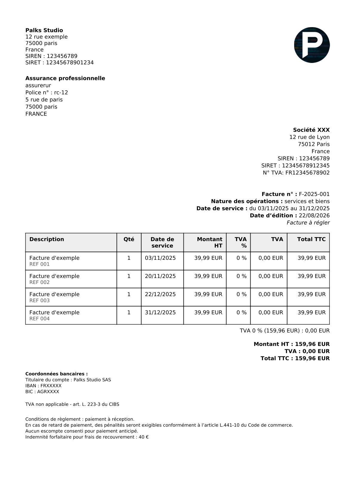

<p align="center">
  
</p>

[](https://www.php.net/)


[← Retour au sommaire](../README.md)

# Architecture d'un moteur de facturation automatisé en PHP : Factur-X, gestion des états et traçabilité sans base de données

La génération d'une facture électronique ne se résume pas à produire un document PDF et à y intégrer un fichier XML. Dans un système automatisé, le document final représente l'aboutissement d'une chaîne de traitements qui doit garantir la cohérence des données, la numérotation, la gestion des périodes facturées et la traçabilité des opérations.

La difficulté augmente lorsqu'un même moteur doit prendre en charge des factures récurrentes, des traitements batch, plusieurs taux de TVA ou des prestations couvrant plusieurs mois.

Cet article présente une architecture de facturation développée en PHP, reposant sur des scripts CLI, des fichiers structurés et une séparation explicite des responsabilités, sans serveur de base de données.

---

## 1. Architecture générale du moteur

Le système est organisé autour de plusieurs composants indépendants. La génération des factures, les règles métier, la validation des données, les paiements et les exports comptables possèdent chacun leur propre responsabilité.

La structure publique du projet est la suivante :

```text
automation-system/
│
├── engine/
├── data/
├── tools/
├── exports/
├── downloads/
├── clients/
├── contracts/
│
├── LICENCE.md
├── LICENSE.md
│
└── docs/
    ├── README_FR.md
    ├── README.md
    ├── SERVICE_MEMO_FR.md
    ├── SERVICE_MEMO.md
    ├── README_DEPLOY_FR.md
    ├── README_DEPLOY_EN.md
    ├── VUE_DENSEMBLE_AUTOMATION.md
    └── SYSTEM_OVERVIEW_AUTOMATION.md
```

Cette arborescence représente l'organisation logique du système. Les noms des scripts internes et les fichiers de production ne sont pas exposés dans la documentation publique.

Chaque répertoire possède une responsabilité distincte :

| Répertoire   | Responsabilité                                         |
|--------------|--------------------------------------------------------|
| `engine/`    | Exécution des traitements et logique de facturation    |
| `data/`      | Stockage des données, factures et états opérationnels  |
| `tools/`     | Maintenance, diagnostic et traitements complémentaires |
| `exports/`   | Production des données comptables                      |
| `downloads/` | Distribution des documents générés                     |
| `clients/`   | Configuration des clients                              |
| `contracts/` | Documents contractuels                                 |
| `docs/`      | Documentation technique                                |

Les règles tarifaires, les regroupements de lignes, les taux de TVA et les périodes de service sont centralisés dans la couche métier.

Cette séparation évite de disperser les règles de facturation dans les composants chargés de produire les documents. Une évolution tarifaire peut ainsi être traitée indépendamment de la génération des PDF et des fichiers XML.

---

## 2. Deux pipelines de facturation

Le moteur distingue deux modes de génération.

### Facturation directe

Le premier mode repose sur des fichiers de configuration propres à chaque client. Il permet de générer des factures récurrentes ou ponctuelles à partir de règles de facturation prédéfinies.

Le moteur détermine si une facture doit être produite pour la période concernée, vérifie les états d'exécution existants et applique les règles métier avant de générer le document.

```text
Configuration client
         │
         ▼
  Moteur de facturation
         │
         ▼
    Règles métier
         │
         ▼
  Génération Factur-X
         │
         ▼
Archivage et journalisation
```

### Facturation batch

Le second mode permet de traiter des sources CSV contenant les données nécessaires à la génération de plusieurs factures.

Le CSV n'est pas considéré comme une facture. Il constitue une source de données à partir de laquelle le moteur construit les documents selon les règles métier.

```text
Source CSV
    │
    ▼
Validation des données
    │
    ▼
Archivage de la source
    │
    ▼
Composition des factures
    │
    ▼
Calculs et règles métier
    │
    ▼
Génération Factur-X
    │
    ▼
Archivage des factures
```

Le moteur prend en charge des factures composées, contenant plusieurs lignes, différents taux de TVA ou plusieurs périodes de service.

La complexité du document final ne modifie pas le cycle général d'exécution. Une facture simple et une facture composée passent par les mêmes étapes de validation, de génération et d'archivage.

---

## 3. Validation stricte des données d'entrée

Dans un moteur de facturation, une donnée incorrecte ne doit pas être corrigée silencieusement.

La couche d'import contrôle la structure des fichiers CSV, les colonnes attendues et les formats des données avant leur traitement.

Lorsqu'une donnée obligatoire est absente ou invalide, le traitement du batch concerné est interrompu et une alerte est générée.

Cette approche privilégie l'intégrité des données plutôt que la production d'un résultat partiellement correct.

Un fichier CSV peut notamment contenir des informations relatives aux prestations, aux montants, aux taux de TVA et à l'identification des destinataires.

Le flux de préparation reste indépendant du moteur :

```text
Données de facturation
          │
          ▼
       Fichier CSV
          │
          ▼
    Validation stricte
          │
          ├── Invalide → Arrêt et alerte
          │
          └── Valide
                │
                ▼
          Archivage source
                │
                ▼
            Facturation
```

Le fichier source est archivé avant sa consommation. Cette copie figée permet de conserver les données utilisées lors de l'exécution, indépendamment des modifications ultérieures apportées au fichier de travail.

L'arrêt du traitement à la première erreur évite de poursuivre avec des données dont la cohérence n'est pas établie. Il ne constitue toutefois pas, à lui seul, une garantie de restauration automatique des opérations déjà effectuées.

---

## 4. La facturation multipériode comme problème de gestion des états

Une facture couvrant plusieurs mois ne présente pas uniquement une difficulté de calcul. Elle introduit également une question de cohérence entre les périodes de service et les documents déjà émis.

Prenons un exemple conceptuel :

```text
Client A

Janvier  : prestation de 100 €
Février  : prestation de 100 €
Mars     : prestation de 100 €
```

Ces trois prestations peuvent être regroupées dans une facture unique de 300 € hors taxes.

Une fois cette facture émise, les prestations correspondantes doivent être identifiées comme déjà facturées. Une nouvelle exécution ne doit pas produire une seconde facture pour les mêmes opérations.

Le moteur s'appuie sur des marqueurs d'exécution et des archives pour conserver les informations nécessaires à ces contrôles.

Une représentation simplifiée des états pourrait être :

```text
Client A
├── 2026-01 → facturé
├── 2026-02 → facturé
└── 2026-03 → facturé
```

Ce schéma illustre le principe métier, indépendamment du format exact des fichiers utilisés.

La période de service, la date d'émission et le numéro de facture représentent des informations distinctes. Une facture émise en avril peut couvrir des prestations réalisées entre janvier et mars, sans que ces prestations soient considérées comme de nouvelles opérations lors du traitement suivant.

Une correction éventuelle doit faire l'objet d'une opération comptable explicite, et non d'une modification silencieuse du document original.

---

## 5. Génération native des factures électroniques Factur-X

La génération Factur-X est intégrée directement aux deux pipelines de facturation.

Factur-X est un format hybride associant un document PDF/A-3 lisible par une personne et un fichier XML structuré exploitable par un système informatique.

Le moteur cible le profil Comfort, correspondant aux exigences de la norme européenne EN 16931.

La chaîne de génération repose sur plusieurs étapes :

- Construction des données métier de la facture
- Génération de sa représentation PDF
- Construction du XML structuré
- Validation du XML par XSD et Schematron
- Intégration du XML dans le document PDF/A-3

Le flux peut être représenté ainsi :

```text
Données métier validées
          │
          ├───────────────────┐
          ▼                   ▼
  Génération PDF       Génération XML
          │                   │
          │            Validation XML
          │            XSD / Schematron
          │                   │
          └─────────┬─────────┘
                    ▼
            Intégration XML
                    │
                    ▼
          PDF/A-3 + XML embarqué
                    │
                    ▼
              Facture Factur-X
```

Les deux représentations de la facture sont construites à partir des mêmes données métier. Cette organisation réduit le risque d'incohérence entre les montants affichés dans le PDF et ceux présents dans le XML.

La validation XSD contrôle notamment la structure du document XML, tandis que Schematron permet de vérifier des règles qui dépassent la simple validité syntaxique.

Le moteur utilise notamment mPDF 8.3 pour la génération documentaire.

Le résultat final est un document hybride unique, dans lequel le XML structuré est intégré au PDF.

La génération d'un document conforme au format Factur-X doit toutefois être distinguée de sa transmission dans un dispositif réglementaire de facturation électronique. La conformité du document et son acheminement constituent deux responsabilités différentes.

---

## 6. Numérotation et prévention des doubles traitements

La génération d'une facture constitue une opération qui ne doit pas être répétée involontairement.

Une nouvelle exécution du moteur ne doit pas entraîner la création d'une nouvelle facture pour une opération déjà traitée, ni la réutilisation incorrecte d'un numéro.

L'architecture repose sur plusieurs mécanismes complémentaires :

- Des compteurs séquentiels annuels pour la numérotation
- Des marqueurs d'exécution explicites
- Des archives immuables
- Des contrôles de cohérence
- Des mécanismes de prévention des doubles traitements
- Une journalisation des opérations

Le principe de fonctionnement est de consulter les états existants avant de décider si une opération doit être exécutée.

```text
Nouvelle exécution
        │
        ▼
Vérification de l'état
        │
        ├── Déjà traité → Ignorer
        │
        └── À traiter
                │
                ▼
          Génération
                │
                ▼
          Archivage
                │
                ▼
      Enregistrement de l'état
```

Ce mécanisme répond à un objectif d'idempotence : répéter une opération déjà terminée ne doit pas produire un nouvel effet métier.

Il faut néanmoins distinguer la prévention des doubles traitements successifs de la protection contre les exécutions concurrentes.

Un simple test d'existence d'un fichier ne constitue pas un verrou atomique. Si deux processus consultent simultanément le même état avant sa mise à jour, ils peuvent tous deux considérer l'opération comme disponible.

Dans une architecture PHP sans base de données, un verrou exclusif peut notamment être implémenté avec `flock()`.

```php
$lock = fopen($lockPath, 'c');

if ($lock === false) {
    throw new RuntimeException(
        'Unable to open lock file'
    );
}

if (!flock($lock, LOCK_EX | LOCK_NB)) {
    fclose($lock);
    exit;
}

try {
    // Vérifier l'état de l'opération.
    // Générer uniquement si nécessaire.
    // Enregistrer le résultat et l'état final.
} finally {
    flock($lock, LOCK_UN);
    fclose($lock);
}
```

Cet exemple illustre une protection possible contre les exécutions concurrentes. Il ne constitue pas un extrait du moteur présenté.

Le verrou d'exécution et le marqueur métier répondent à deux besoins différents. Le premier contrôle l'accès concurrent à une opération, tandis que le second conserve la trace durable de son traitement.

Cette distinction devient particulièrement importante lorsqu'un même compteur ou un même ensemble de périodes peut être utilisé par plusieurs processus.

---

## 7. Une exécution CLI pilotée par cron

Le moteur ne repose pas sur un processus permanent. Les scripts PHP sont exécutés en ligne de commande, notamment par des tâches cron.

Chaque exécution démarre, consulte les données et les états disponibles, traite les opérations nécessaires, journalise les résultats puis se termine.

```text
Cron
  │
  ▼
Démarrage du processus
  │
  ▼
Lecture des configurations
  │
  ▼
Contrôle des états
  │
  ▼
Traitement des opérations
  │
  ▼
Archivage et logs
  │
  ▼
Fin du processus
```

La planification et les décisions métier restent séparées. Cron déclenche le traitement, mais le moteur détermine lui-même si une opération doit être exécutée.

La génération et la transmission des factures constituent également deux opérations distinctes.

Une facture peut être générée et archivée sans être immédiatement transmise. La distribution des documents relève d'une étape supplémentaire, soumise à ses propres conditions d'exécution.

Cette organisation permet de conserver des garde-fous métier indépendamment de la fréquence d'exécution des tâches planifiées.

Elle évite également de maintenir un service permanent dont le seul rôle serait d'attendre la prochaine opération de facturation.

---

## 8. Reprise ciblée et gestion des erreurs

L'absence de processus permanent simplifie le modèle d'exécution, mais ne supprime pas la nécessité de gérer les interruptions.

Une erreur peut survenir après la génération d'un document, avant l'enregistrement de son état final ou pendant sa transmission.

Le moteur conserve des archives, des marqueurs d'exécution et des journaux permettant d'identifier les opérations réalisées et celles qui nécessitent une vérification.

Certains composants CLI acceptent également un paramètre permettant de cibler un seul client :

```text
--client=<client_id>
```

Ce mode permet d'effectuer un diagnostic ou une reprise ciblée sans relancer le traitement de l'ensemble des clients.

Il ne modifie pas les règles métier et conserve les contrôles anti-doublons et les états d'exécution.

Une reprise fiable nécessite toutefois de vérifier la cohérence des différents artefacts. La présence d'un PDF ne signifie pas nécessairement que l'ensemble de l'opération a été terminé.

Dans une architecture fondée sur des fichiers, la gestion des interruptions entre plusieurs écritures constitue donc un point important à prendre en compte.

L'absence de base de données ne dispense pas de définir des règles de cohérence et de reprise.

---

## 9. Séparer la facturation des paiements

La génération d'une facture et l'enregistrement d'un paiement correspondent à deux opérations métier distinctes.

Le moteur conserve séparément les documents émis, les données de facturation, les paiements enregistrés et les soldes calculés.

```text
Factures émises       Paiements enregistrés
       │                       │
       └───────────┬───────────┘
                   ▼
         Réconciliation des données
                   │
                   ▼
             Soldes clients
```

Les paiements sont enregistrés manuellement à partir des virements reçus. Le moteur ne déclenche pas d'encaissement automatique et ne dépend pas d'un prestataire de paiement.

La couche de réconciliation compare les montants facturés aux paiements enregistrés afin de calculer le solde restant dû.

Un exemple simplifié :

```text
Total facturé : 1 200 €
Total payé    :   800 €
Solde dû      :   400 €
```

La mise à jour du solde ne modifie pas les factures existantes.

Un outil complémentaire permet également de produire des documents acquittés après confirmation du paiement.

Cet outil accepte notamment des archives ZIP contenant plusieurs factures PDF et permet d'ajouter un marquage explicite avec la date du paiement. La bibliothèque FPDI intervient dans la lecture et la superposition des documents PDF.

Les documents acquittés constituent des versions dérivées des factures originales, qui restent inchangées.

Cette séparation permet de faire évoluer les mécanismes de suivi financier sans intervenir sur la génération documentaire.

---

## 10. Traçabilité, archivage et exports comptables

Le stockage repose sur des fichiers structurés plutôt que sur un serveur de base de données.

Chaque catégorie de données possède une responsabilité distincte. Les sources CSV archivées, les factures émises, les journaux et les enregistrements de paiement constituent les éléments nécessaires pour retracer les opérations.

Les exports comptables sont générés à partir de ces données sources.

```text
Factures + Paiements + Archives
                │
                ▼
          Couche d'export
                │
                ▼
        CSV mensuel ou annuel
```

Les exports peuvent être régénérés sans modifier les documents originaux.

Il est toutefois important de distinguer les archives des états opérationnels. Une facture émise ou une source CSV archivée est destinée à rester inchangée, tandis qu'un compteur ou un solde client évolue nécessairement au fil des opérations.

L'utilisation de fichiers n'offre pas automatiquement les garanties transactionnelles d'une base de données.

La fiabilité repose sur la discipline des écritures, la gestion des accès concurrents, les sauvegardes et la cohérence entre les différents artefacts.

Cette architecture privilégie la lisibilité et la traçabilité, mais ne prétend pas remplacer les mécanismes transactionnels d'une base de données dans tous les contextes.

---

## 11. Séparation entre les interfaces web et le moteur

Le moteur de facturation est conçu pour fonctionner exclusivement en CLI côté serveur.

Des interfaces web distinctes permettent néanmoins d'alimenter le système, notamment pour préparer les configurations clients, déposer les fichiers CSV et distribuer les documents générés.

La structure publique de cette couche est la suivante :

```text
web/
│
├── library/
│   ├── onboarding-client-fr.html
│   ├── onboarding-client-en.html
│   ├── service-agreement-fr.html
│   ├── service-agreement-en.html
│   ├── import-clients-fr.html
│   ├── import-clients-en.html
│   └── invoice-layout.html
│
├── contract-builder.php
├── process-import.php
│
├── secure_downloads/
│   └── access.php
│
└── temp_tokens/
    ├── activity.log
    └── secure_tokens.json
```

Ces composants possèdent une responsabilité limitée à la préparation des données, à leur collecte ou à la distribution des documents.

Ils ne constituent pas une interface d'exécution directe du moteur financier.

```text
Interface web contrôlée
          │
          ▼
Données d'entrée structurées
          │
          ▼
    Zone de dépôt
          │
          ▼
   Moteur CLI / cron
          │
          ▼
  Données et documents privés
```

Cette séparation réduit la surface d'attaque du moteur en évitant d'exposer directement ses scripts d'exécution et ses données financières au navigateur.

Elle ne supprime pas pour autant les risques liés aux interfaces publiques, qui doivent conserver leurs propres contrôles d'accès, de validation et de protection des données.

---

## Conclusion

La conception d'un moteur de facturation automatisé implique bien davantage que la production d'un PDF et d'un fichier XML.

La gestion des périodes, la prévention des doubles traitements, la numérotation, la validation des données et la séparation entre facturation et paiements constituent les principaux enjeux architecturaux.

Une organisation fondée sur PHP, des scripts CLI et des fichiers structurés permet de construire une chaîne de facturation sans serveur de base de données ni dépendance critique à une plateforme SaaS.

Cette approche présente des avantages en matière de lisibilité et de traçabilité, mais elle impose également de traiter explicitement les questions de concurrence, de reprise après interruption et de cohérence des états.

La génération Factur-X devient alors une étape intégrée à un système plus large, dont la fiabilité dépend avant tout de la maîtrise de son cycle d'exécution.

## Pour aller plus loin

Retrouvez également cet article technique en anglais sur DEV.to, où Palks Studio publie ses articles consacrés à l'architecture logicielle, au développement backend et à l'automatisation.

👉 [Self-Hosted PHP Billing System Architecture: From Signed Quotes to Payment Confirmation Without a Database](https://dev.to/palks_studio/building-a-factur-x-en16931-engine-from-scratch-what-actually-took-time-2bg2) (DEV.to, en anglais)

---

https://palks-studio.com
