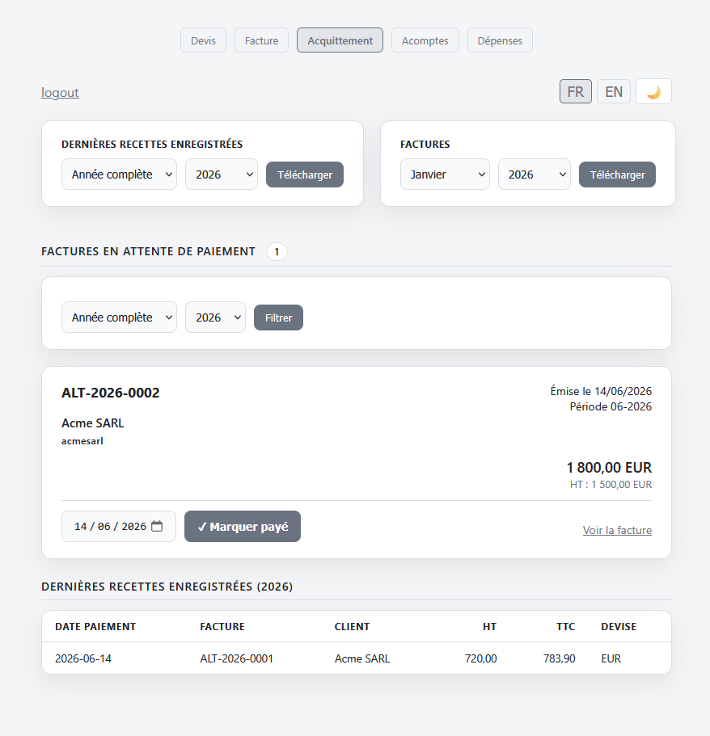

<p align="center">
  
</p>

[](https://www.php.net/)


[← Retour au sommaire](../README.md)

# Architecture d'un système de facturation auto-hébergé en PHP : du devis signé à l'acquittement sans base de données

Un système de facturation ne se limite pas à générer des documents PDF. Il doit également gérer les relations entre ces documents, conserver leur historique, contrôler les changements d'état et garantir la cohérence des données financières.

Lorsqu'un devis signé devient une facture, puis une facture acquittée après réception du paiement, chaque étape doit conserver un lien avec les opérations précédentes.

Ces contraintes sont généralement prises en charge par une application connectée à une base de données. Une autre approche consiste à construire le système autour de fichiers structurés, de métadonnées et de composants PHP indépendants.

Cet article présente l'architecture d'un système de facturation web auto-hébergé, couvrant le cycle complet d'une prestation ou d'une vente de biens, de la génération du devis jusqu'à l'archivage des recettes, avec génération Factur-X et mises à jour sécurisées du moteur.

---

## 1. Une architecture web auto-hébergée

Le système repose sur un environnement PHP 8.1 ou supérieur, un serveur web compatible, des bibliothèques de génération documentaire et un stockage local des données.

Contrairement à un générateur de devis entièrement client-side, cette architecture dispose d'un backend. Celui-ci assure la persistance des données, la génération des documents, l'authentification et les transitions entre les différents états métier.

La structure publique du projet peut être représentée ainsi :

```text
private/
│
├── web/
│   ├── admin/
│   ├── quote-entry.php
│   ├── billing-entry.php
│   ├── instant-bill.php
│   ├── payment-proof.php
│   ├── deposit-entry.php
│   ├── expenses-entry.php
│   ├── quote-space.php
│   ├── billing-space.php
│   ├── payment-check.php
│   ├── expenses-check.php
│   ├── payments.php
│   ├── payments-close.php
│   ├── approval.php
│   ├── archive-export.php
│   ├── revenue-export.php
│   ├── expense-export.php
│   ├── deposit-export.php
│   ├── index.php
│   ├── countries.php
│   ├── client-search.php
│   ├── secure-access.php
│   ├── download-access.php
│   ├── deposits.php
│   ├── attachment.php
│   ├── manifest.json
│   └── archive-save.php
│
├── update-server/
├── assets/
├── dependencies/
├── templates/
│   └── document-layout.php
│
├── pa.php
├── system-config.php
├── auth.php
├── facturx-builder.php
├── facturx-injector.py
├── mail-service.php
├── document-engine.php
│
├── contracts/
├── counters/
├── logs/
│
├── data/
│   ├── pending-bills/
│   ├── staged-payments/
│   ├── paid-bills/
│   ├── temp-facturx/
│   └── revenue-ledger/
│
├── updater/
├── temp/
└── docs/
```

Cette arborescence reprend les noms utilisés dans la documentation publique. Les répertoires liés aux mises à jour seront détaillés séparément.

Les responsabilités principales sont réparties entre plusieurs composants :

| Composant             | Responsabilité |
|-----------------------|--------------------------------------------|
| `web/`                | Interfaces, formulaires et points d'entrée |
| `document-engine.php` | Calculs, génération et archivage           |
| `facturx-builder.php` | Construction du XML Factur-X               |
| `facturx-injector.py` | Intégration du XML dans le PDF             |
| `auth.php`            | Authentification des utilisateurs          |
| `mail-service.php`    | Envoi des documents et notifications       |
| `contracts/`          | Archivage des devis et signatures          |
| `counters/`           | Numérotation des documents                 |
| `data/`               | Factures, paiements et journaux financiers |
| `updater/`            | Gestion des mises à jour du moteur         |

Le moteur documentaire reste distinct des interfaces utilisateur. Les différents modules peuvent ainsi partager les mêmes règles de génération sans dupliquer la logique métier.

---

## 2. Cinq modules reliés par un même cycle documentaire

Le système regroupe cinq modules principaux :

- Génération des devis
- Facturation directe
- Acquittement et suivi des paiements
- Suivi des acomptes
- Gestion des dépenses professionnelles

Ces modules ne constituent pas cinq applications indépendantes. Ils exploitent des données et des composants communs.

Le cycle principal peut être représenté ainsi :

```text
Création du devis
        │
        ▼
Archivage du devis
        │
        ▼
Consultation et signature
        │
        ▼
Devis accepté
        │
        ▼
Génération de la facture
        │
        ▼
Facture en attente
        │
        ▼
Confirmation du paiement
        │
        ├── Facture acquittée
        ├── Journal des recettes
        └── Archivage
```

Les acomptes peuvent intervenir avant la facturation, tandis que les dépenses professionnelles suivent leur propre cycle de traitement.

La difficulté architecturale réside dans la conservation des relations entre ces opérations.

Une facture doit pouvoir retrouver les données du devis associé. Un paiement doit être rattaché à une facture identifiable. Un acompte doit conserver son lien avec le devis d'origine.

Sans base de données, ces relations sont représentées par des références, des métadonnées et des fichiers organisés de manière structurée.

---

## 3. Du devis à la signature électronique

La génération du devis commence par la saisie des informations de l'émetteur, du client, des prestations ou biens vendus, des montants et des paramètres fiscaux.

L'interface calcule les totaux en temps réel avant la validation du document.

Une fois le devis validé, le système conserve le document et ses métadonnées côté serveur. Un jeton individuel permet ensuite au destinataire de consulter et de signer le devis en ligne.

```text
Formulaire de devis
         │
         ▼
Validation des données
         │
         ▼
Génération du PDF
         │
         ├── Archivage du document
         ├── Enregistrement des métadonnées
         └── Création du jeton
                     │
                     ▼
              Email au client
                     │
                     ▼
              Interface de signature
```

Le point d'entrée `approval.php` permet au destinataire de consulter le document et d'apposer une signature.

La capture repose sur un canvas HTML compatible avec la souris et les écrans tactiles.

Le traitement de la signature comprend notamment :

- La validation des données reçues
- L'enregistrement de l'image de signature
- La mise à jour des métadonnées
- L'horodatage de l'opération
- La protection contre une seconde signature
- L'envoi des confirmations aux deux parties

Le lien de signature possède une durée de validité de 30 jours.

### Un document et un état métier distincts

La présence d'un fichier PDF ne suffit pas à déterminer si un devis a été accepté.

Le système doit également conserver un état permettant de distinguer un devis généré d'un devis signé.

Une représentation conceptuelle pourrait être :

```json
{
    "quote_reference": "QUOTE-2026-0042",
    "status": "signed",
    "signed_at": "2026-06-12T14:30:00Z"
}
```

Cet exemple illustre le principe de conservation d'un état métier. Il ne reproduit pas le format interne des métadonnées du système.

La signature capturée, l'horodatage et le document associé constituent des éléments de traçabilité complémentaires.

Cette architecture ne doit toutefois pas être confondue avec un service de signature électronique qualifiée. Une image de signature et des métadonnées ne suffisent pas, à elles seules, à établir ce niveau de garantie.

---

## 4. Réutilisation des données sans base de données

Lors de la création d'une facture, les informations du client et du devis existent souvent déjà dans les archives.

Les ressaisir introduirait un risque d'erreur et de divergence entre les documents.

Le système utilise un endpoint JSON, `client-search.php`, chargé de rechercher les informations existantes à partir de plusieurs critères :

- SIREN ou SIRET
- Numéro de TVA
- Adresse email
- Nom du client
- Numéro de devis

Le résultat permet de préremplir les formulaires et de retrouver les documents associés.

```text
Recherche utilisateur
         │
         ▼
   client-search.php
         │
         ▼
Lecture des archives
         │
         ▼
Normalisation et recherche
         │
         ▼
     Réponse JSON
         │
         ▼
Préremplissage du formulaire
```

Cette couche permet de réutiliser les données sans maintenir une table clients dans une base SQL.

Un exemple conceptuel de réponse pourrait être :

```json
{
    "client": {
        "name": "Example Company",
        "country": "FR",
        "type": "business"
    },
    "quotes": [
        {
            "reference": "QUOTE-2026-0042",
            "currency": "EUR",
            "status": "signed"
        }
    ]
}
```

Ce modèle est volontairement simplifié et ne correspond pas à la réponse réelle de l'endpoint.

La recherche dans les archives présente néanmoins un compromis. Elle évite de maintenir une base de données supplémentaire, mais son coût peut augmenter avec le nombre de documents.

À mesure que le volume grandit, une architecture de ce type peut nécessiter des index dérivés ou des mécanismes de recherche optimisés.

---

## 5. De la référence du devis à la facture Factur-X

Le moteur de facturation peut générer une facture à partir d'un devis existant ou à partir de données saisies directement.

Lorsqu'un devis est sélectionné, les informations correspondantes sont réutilisées : identité du client, lignes de prestations, montants, paramètres fiscaux et éventuels acomptes.

La référence du devis constitue également un élément de contrôle contre la double facturation.

```text
Devis existant
       │
       ▼
Récupération des données
       │
       ▼
Contrôles métier
       │
       ├── Référence déjà facturée ?
       ├── Données valides ?
       └── Montants cohérents ?
       │
       ▼
Attribution du numéro
       │
       ▼
Génération de la facture
```

La numérotation annuelle des factures repose sur des compteurs séquentiels protégés contre les collisions.

Dans la version européenne du système, la génération documentaire intègre Factur-X.

Le document associe un PDF/A-3 lisible par une personne à un XML structuré exploitable par un système informatique.

Les composants publics de cette chaîne sont :

```text
document-engine.php
        │
        ├── Calculs et données métier
        │
        ├── Génération PDF avec mPDF
        │
        └── facturx-builder.php
                     │
                     ▼
                XML Factur-X
                     │
                     ▼
             facturx-injector.py
                     │
                     ▼
              PDF/A-3 + XML
```

La construction des deux représentations à partir des mêmes données métier contribue à maintenir leur cohérence.

Le PDF présente les informations à l'utilisateur, tandis que le XML permet leur traitement automatisé.

Les documents générés disposent également d'une empreinte SHA-256 permettant de contrôler leur intégrité.

Un exemple générique en PHP :

```php
$hash = hash_file('sha256', $pdfPath);

if ($hash === false) {
    throw new RuntimeException(
        'Unable to calculate document hash'
    );
}
```

L'empreinte peut être conservée avec les métadonnées du document et comparée ultérieurement à celle du fichier archivé.

Elle permet de détecter une modification du contenu, à condition que l'empreinte de référence soit elle-même protégée. Elle ne constitue pas une signature numérique du document.

---

## 6. Pré-générer la facture acquittée sans confirmer le paiement

Une particularité du système est la préparation de deux documents lors de la facturation :

- La facture normale
- Une version acquittée pré-générée, conservée en attente

La seconde version n'est pas destinée à être remise au client avant confirmation du règlement.

La structure de stockage distingue ces états :

```text
data/
│
├── pending-bills/
│   └── Factures à régler
│
├── staged-payments/
│   └── Versions acquittées préparées
│
├── paid-bills/
│   └── Factures acquittées archivées
│
└── revenue-ledger/
    └── Journal des recettes
```

Cette séparation permet de distinguer la préparation d'un document de la validation de l'événement financier correspondant.

```text
Facture émise
       │
       ├── Facture normale
       │
       └── Version acquittée préparée
                    │
                    ▼
             Attente du paiement
                    │
                    ▼
           Confirmation utilisateur
                    │
                    ├── Archivage
                    ├── Envoi du document
                    └── Journal des recettes
```

La pré-génération ne doit pas être interprétée comme une preuve de paiement. Le document reste dans un état intermédiaire tant que le règlement n'a pas été confirmé.

Cette distinction évite de confondre un artefact technique disponible avec une opération financière effectivement réalisée.

---

## 7. Confirmation du paiement et prévention des doublons

Le module `payment-check.php` présente les factures en attente de règlement.

L'utilisateur sélectionne la facture concernée, renseigne la date du paiement et confirme l'opération.

Le système doit alors effectuer plusieurs actions liées :

1. Vérifier que la facture n'a pas déjà été acquittée
2. Mettre à jour son état
3. Archiver le document acquitté
4. Enregistrer la recette dans le journal CSV
5. Envoyer le document au client

Ces actions constituent une transition métier unique, même si elles impliquent plusieurs écritures distinctes.

Une représentation simplifiée des états :

```text
PENDING
   │
   │ Confirmation du paiement
   ▼
PAID
   │
   ├── Document acquitté archivé
   ├── Recette enregistrée
   └── Notification envoyée
```

Le système intègre des contrôles contre la double soumission des formulaires, des protections anti-doublons dans le journal des recettes et des mécanismes de verrouillage des écritures.

Sans ces protections, deux requêtes simultanées pourraient enregistrer deux fois le même paiement.

Un verrou exclusif PHP peut illustrer le principe :

```php
$lock = fopen($lockPath, 'c');

if ($lock === false) {
    throw new RuntimeException('Lock unavailable');
}

if (!flock($lock, LOCK_EX)) {
    fclose($lock);
    throw new RuntimeException('Lock failed');
}

try {
    // Vérifier si le paiement est déjà enregistré.
    // Appliquer la transition si nécessaire.
    // Mettre à jour les données financières.
} finally {
    flock($lock, LOCK_UN);
    fclose($lock);
}
```

Cet exemple est pédagogique. Il ne reproduit pas le code interne du système.

Un verrou permet de contrôler les accès concurrents, mais ne rend pas automatiquement transactionnelles plusieurs écritures sur des fichiers différents.

Si une interruption survient après la mise à jour des métadonnées, mais avant l'enregistrement de la recette, une incohérence peut subsister.

Une architecture financière fondée sur des fichiers doit donc prévoir des contrôles de cohérence et des mécanismes de reprise adaptés à ce type de situation.

---

## 8. Gestion des acomptes et états calculés

Les acomptes introduisent une relation supplémentaire entre le devis, les sommes reçues et la facture finale.

Le système permet d'enregistrer plusieurs acomptes associés à un même devis. Les montants sont cumulés et récupérés automatiquement lors de la facturation.

Un exemple conceptuel :

```text
Montant du devis : 2 000 €

Acompte 1        :   300 €
Acompte 2        :   500 €

Total acomptes   :   800 €
Solde restant    : 1 200 €
```

Le suivi des acomptes repose sur trois états :

```text
Non facturé
     │
     ▼
En attente de paiement
     │
     ▼
Payé
```

Ces états sont calculés à partir des archives de contrats et des factures en attente ou acquittées.

Le module de suivi ne nécessite donc pas de maintenir un état indépendant pour chaque affichage. Il exploite les données existantes afin de déterminer la situation de l'acompte.

Les résultats peuvent être filtrés par statut et sont paginés par groupes de 20 entrées.

### Clôture mensuelle

Une clôture mensuelle permet d'archiver les acomptes associés à des factures payées.

Le traitement produit un export CSV, conserve une archive JSON et ajoute un marqueur dans les métadonnées du contrat :

```json
{
    "archived": true
}
```

Les entrées clôturées disparaissent alors de la vue active.

Cette opération illustre la différence entre un état calculé dynamiquement et un état de clôture enregistré durablement.

---

## 9. Gestion des dépenses et justificatifs

Le système intègre également un module de suivi des dépenses professionnelles.

Cette couche reste indépendante de la génération des factures clients, tout en participant à la consolidation des données financières.

Elle permet notamment d'enregistrer des dépenses, d'associer des justificatifs et de consulter leur historique par mois ou par année.

Les justificatifs peuvent être fournis sous plusieurs formats :

```text
PDF
JPG
PNG
```

Le composant `attachment.php` intervient dans la consultation des justificatifs, tandis que `expense-export.php` permet de produire les exports correspondants.

La séparation entre recettes et dépenses évite de mélanger des événements financiers dont les origines et les règles de traitement sont différentes.

Les données peuvent ensuite être exportées pour être exploitées dans un processus comptable externe.

---

## 10. Fiscalité internationale et séparation des règles métier

Le moteur adapte les documents selon plusieurs paramètres : localisation du client, type de client, nature de l'opération et statut fiscal de l'émetteur.

La version européenne prend notamment en charge les prestations de services et les ventes de biens.

Le système distingue trois zones fiscales :

```text
fr     → France
eu     → Union européenne
world  → Hors Union européenne
```

Ces zones sont également représentées dans le journal des recettes par le champ `zone_tva`.

La liste des pays est centralisée dans `countries.php`, avec 249 entrées et une distinction entre le nom affiché dans l'interface et le code ISO utilisé par le backend.

Cette normalisation permet d'éviter que différentes représentations textuelles d'un pays produisent des comportements incohérents.

```text
Pays sélectionné
        │
        ▼
Normalisation ISO
        │
        ▼
Zone fiscale
        │
        ├── Type de client
        ├── Nature de l'opération
        └── Statut fiscal
                    │
                    ▼
            Traitement fiscal
                    │
                    ├── Calcul de la taxe
                    └── Mentions documentaires
```

Le système contrôle également le format et la cohérence des numéros de TVA intracommunautaire, notamment le préfixe du pays et la longueur attendue.

Ces vérifications sont réalisées côté interface et côté serveur.

Une validation de format ne constitue toutefois pas une vérification de l'existence ou de la validité fiscale effective d'un numéro de TVA.

De même, la localisation du client ne suffit pas, à elle seule, à déterminer le traitement fiscal applicable à toutes les opérations internationales.

### Une version américaine distincte

Une version dédiée aux États-Unis reprend le principe d'un système de facturation auto-hébergé, mais sans Factur-X ni exigences européennes de facturation électronique.

Elle prend en charge les prestations de services et les ventes de biens, avec une gestion manuelle des paramètres fiscaux.

Cette séparation permet de conserver un socle architectural commun sans imposer les contraintes documentaires européennes à une installation américaine.

---

## 11. Transmission des factures et intégration des Plateformes Agréées

La génération d'une facture et sa transmission constituent deux responsabilités différentes.

Le moteur européen intègre un connecteur `pa.php`, chargé de gérer la transmission vers la Plateforme Agréée configurée pour l'installation.

Le routage documenté distingue plusieurs situations :

| Configuration                    | Transmission                               |
|----------------------------------|--------------------------------------------|
| PA désactivée                    | Envoi au client par email                  |
| PA activée, client professionnel | Transmission vers la PA                    |
| PA activée, client particulier   | Email au client et transmission vers la PA |

Le connecteur reste indépendant du moteur documentaire.

```text
Facture générée
       │
       ▼
Règles de transmission
       │
       ├── Email
       │
       └── Connecteur PA
                 │
                 ▼
          Plateforme Agréée
```

Cette organisation permet de faire évoluer le moteur Factur-X sans remplacer l'intégration propre à chaque installation.

Le routage présenté décrit le comportement du système. Il ne signifie pas que toutes les transmissions B2C relèvent du même dispositif réglementaire que la facturation électronique B2B.

La transmission réglementaire, le e-reporting et l'envoi d'un document au client doivent rester des responsabilités clairement identifiées.

L'auto-hébergement ne signifie donc pas l'absence absolue de communications externes. Le système conserve son moteur et ses données localement, mais peut communiquer avec des services de messagerie, une Plateforme Agréée ou le serveur de mises à jour.

---

## 12. Stockage par fichiers et cohérence des données

L'ensemble du système fonctionne sans base de données.

Les données persistantes sont réparties entre plusieurs types de fichiers :

| Donnée               | Format             |
|----------------------|--------------------|
| Devis                | PDF et métadonnées |
| Signatures           | PNG                |
| Factures             | PDF et métadonnées |
| Factures acquittées  | PDF                |
| Journal des recettes | CSV                |
| Compteurs            | Entiers            |
| Archives d'acomptes  | JSON et CSV        |
| Journaux système     | Texte horodaté     |

Cette organisation permet de consulter et d'archiver les documents sans dépendre d'un serveur SQL.

Elle impose néanmoins de définir précisément les responsabilités de chaque fichier.

Un compteur est un état mutable. Une facture archivée est un document destiné à rester inchangé. Un journal financier est une succession d'événements enregistrés.

Ces données ne doivent pas être traitées de la même manière.

### Numérotation et concurrence

La numérotation séquentielle repose sur des compteurs protégés par verrouillage.

Le principe consiste à empêcher deux processus d'attribuer simultanément le même numéro.

```text
Processus A              Processus B
     │                        │
     ▼                        ▼
Acquisition du verrou     Attente
     │                        │
Lecture du compteur           │
     │                        │
Incrémentation                │
     │                        │
Écriture                      │
     │                        │
Libération du verrou          │
                              ▼
                     Acquisition du verrou
```

La protection doit couvrir l'ensemble de la lecture et de la modification du compteur, et pas uniquement l'écriture finale.

Elle doit également être compatible avec les autres contrôles métier, notamment la prévention de la double facturation d'un même devis.

L'absence de base de données réduit certaines dépendances d'infrastructure, mais reporte sur l'application la responsabilité de la cohérence des écritures, des sauvegardes et de la reprise après interruption.

---

## 13. Authentification et accès aux documents

Contrairement à un générateur de devis sans inscription, ce système conserve des informations financières et expose des interfaces de gestion.

Il nécessite donc une couche d'authentification.

Le système prend en charge plusieurs utilisateurs disposant d'identifiants individuels et de sessions indépendantes.

Les mécanismes documentés comprennent notamment :

- La protection des sessions
- La régénération des identifiants de session après authentification
- La protection contre les tentatives de brute force
- Le contrôle d'accès aux endpoints
- La validation des données côté serveur
- Les jetons d'accès aux documents sensibles

Les documents destinés aux clients peuvent être accessibles via un jeton, sans exposer directement leur emplacement physique.

```text
Lien de consultation
         │
         ▼
Vérification du jeton
         │
         ├── Invalide → Refus
         │
         └── Valide
               │
               ▼
       Lecture du document
               │
               ▼
        Réponse HTTP PDF
```

Le composant `secure-access.php` représente cette couche d'accès aux PDF.

La possession d'un lien valide ne doit pas donner accès aux autres documents ou aux interfaces internes.

La séparation entre les utilisateurs authentifiés et les destinataires de documents constitue donc une frontière importante de l'architecture.

La présence de ces mécanismes ne constitue pas, à elle seule, une garantie de sécurité globale. Leur efficacité dépend notamment de la configuration du serveur, de la gestion des droits d'accès et de la qualité de leur implémentation.

---

## 14. Un moteur de mise à jour sécurisé pour les installations autonomes

L'un des enjeux d'un logiciel auto-hébergé est sa maintenance après installation.

Dans le cas d'un moteur Factur-X, les règles documentaires et réglementaires peuvent évoluer. Il faut donc pouvoir mettre à jour certains composants sans remplacer l'ensemble de l'application ni altérer les données financières existantes.

Le système distingue deux ensembles : le serveur de publication des versions et le module de mise à jour installé chez le client.

La structure publique du serveur de mises à jour est la suivante :

```text
update-server/
│
├── releases/
│   ├── engine-release-1.0.0.zip
│   ├── engine-release-1.0.0.sig
│   ├── engine-release-1.0.1.zip
│   └── engine-release-1.0.1.sig
│
├── api/
│   └── version-endpoint.php
│
├── manifests/
│   └── release-manifest.json
│
├── private/
│   ├── server-config.php
│   ├── signing-private.key
│   └── signing-public.key
│
├── source/
│   └── engine-source/
│       ├── xml-handler.py
│       ├── invoice.php
│       ├── engine-module.py
│       └── document-generator.php
│
└── tools/
    ├── release-builder.php
    └── release-signer.php
```

Les versions sont distribuées sous forme d'archives accompagnées d'une signature cryptographique.

Du côté de l'installation cliente :

```text
updater/
│
├── update-check-module.php
├── update-deployment-module.php
├── update-alert-module.php
├── version-cache.json
├── verification.key
├── installation-state.json
└── operations.log
```

Le serveur de publication conserve les composants nécessaires à la préparation et à la signature des versions.

L'installation cliente dispose de la clé publique nécessaire à leur vérification, sans avoir besoin de la clé privée de signature.

### Cycle de mise à jour

```text
Vérification de la version
            │
            ▼
Nouvelle version disponible
            │
            ▼
Notification utilisateur
            │
            ▼
Validation de l'installation
            │
            ▼
Téléchargement de la release
            │
            ▼
Vérification cryptographique
            │
            ├── Invalide → Arrêt
            │
            └── Valide
                  │
                  ▼
               Sauvegarde
                  │
                  ▼
       Remplacement des composants
                  │
                  ▼
       Mise à jour de l'état installé
```

Les installations vérifient quotidiennement la disponibilité d'une nouvelle version.

Lorsqu'une mise à jour est disponible, une notification apparaît dans les interfaces. L'installation reste soumise à la validation de l'utilisateur.

Le traitement télécharge les composants concernés, vérifie la signature, effectue une sauvegarde et remplace les fichiers nécessaires.

Les configurations locales, les documents clients et les données financières restent distincts des composants mis à jour.

Cette séparation permet de faire évoluer le moteur sans redéployer l'ensemble du système.

### Signature et intégrité des releases

La signature cryptographique répond à un besoin différent d'une simple empreinte SHA-256.

Une empreinte permet de comparer le contenu d'un fichier à une référence. Une signature vérifiée avec une clé publique de confiance permet également de contrôler que le fichier a été signé par le détenteur de la clé privée correspondante.

Le processus doit refuser l'installation si la vérification échoue.

La documentation publique ne précise pas l'algorithme de signature utilisé. Le principe architectural repose néanmoins sur une séparation claire entre la création des releases et leur vérification côté client.

Une mise à jour signée ne garantit pas automatiquement que son contenu est exempt de défauts. La sauvegarde, la validation des composants et la gestion des interruptions restent des éléments importants du processus.

---

## 15. Exports et indépendance des données financières

Les différents modules produisent des exports permettant d'exploiter les données en dehors de l'application.

Le système prend notamment en charge :

- L'export mensuel des factures dans une archive ZIP
- L'export mensuel ou annuel des recettes en CSV
- L'export mensuel ou annuel des dépenses en CSV
- L'export mensuel ou annuel des acomptes en CSV

Les composants correspondants sont séparés :

```text
archive-export.php
revenue-export.php
expense-export.php
deposit-export.php
```

Cette couche d'export ne doit pas devenir une seconde source de vérité.

Les fichiers exportés représentent les données conservées dans les archives et les journaux du système. Ils peuvent être utilisés pour les sauvegardes, les contrôles ou l'intégration avec des processus comptables externes.

L'objectif est de conserver des données exploitables indépendamment de l'interface web.

---

## Conclusion

Construire un système de facturation complet sans base de données ne consiste pas simplement à remplacer des tables SQL par des fichiers JSON ou CSV.

Il faut définir les relations entre les documents, gérer les changements d'état, protéger les écritures concurrentes, contrôler la numérotation et conserver des éléments de traçabilité.

Dans cette architecture, PHP assure les traitements métier, les interfaces web et la persistance des données. La génération Factur-X, les signatures, les paiements, les acomptes et les dépenses sont organisés autour de composants distincts, reliés par des références et des états explicites.

Le mécanisme de mise à jour signé ajoute une autre dimension : la possibilité de maintenir un moteur documentaire évolutif tout en conservant une installation autonome et ses données locales.

Cette approche réduit la dépendance à une infrastructure centralisée, mais elle exige une attention particulière à la cohérence des fichiers, à la sécurité des accès et à la reprise après interruption.

L'enjeu principal n'est donc pas de supprimer une base de données. Il est de construire un système dont les responsabilités, les états et les transitions restent compréhensibles, contrôlables et maintenables dans le temps.

---

## Pour aller plus loin

Retrouvez également cet article technique en anglais sur DEV.to, consacré à la conception d'un système financier autonome pour les indépendants, à son architecture et aux choix techniques permettant de gérer la facturation sans dépendre d'une plateforme SaaS.

👉 [A Self-Hosted Financial System for Freelancers](https://dev.to/palks_studio/a-self-hosted-financial-system-for-freelancers-4b27) (DEV.to, en anglais)

---

https://palks-studio.com
