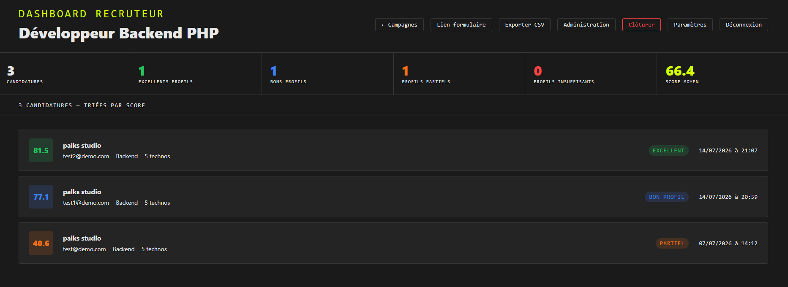

<p align="center">
  
</p>

[](https://www.php.net/)


[← Retour au sommaire](../README.md)

# Architecture d'un système de recrutement en PHP : scoring configurable, gestion multi-campagnes et stockage sans base de données

Un système de recrutement peut rapidement devenir une application complexe. Il doit gérer des formulaires, des profils de poste, des candidatures, des documents, des règles de sélection et des données personnelles, tout en permettant au recruteur de comparer les profils.

Pourtant, ces fonctionnalités ne nécessitent pas systématiquement une base de données relationnelle, un framework applicatif ou une plateforme SaaS.

Le système de recrutement développé par Palks Studio repose sur une architecture autonome en PHP 8.x, avec JavaScript natif et un stockage JSON. Son moteur de scoring déterministe permet d'évaluer les réponses des candidats selon des critères configurés par le recruteur, sans intelligence artificielle ni analyse automatisée des CV.

L'intérêt technique de cette architecture réside dans la séparation entre la configuration des campagnes, le traitement des candidatures, le calcul des scores et la gestion des données.

---

## 1. Architecture générale

Le système repose sur deux espaces distincts :

- Une couche publique contenant les interfaces et les points d'entrée HTTP
- Une couche privée contenant les configurations, le moteur de scoring et les données des candidats

Cette séparation permet de rendre le formulaire de candidature accessible publiquement sans exposer les fichiers de configuration, les documents transmis ou les données personnelles.

Voici la structure documentée du projet :

```text
candidate-system/
│
├── public/
│   ├── panel.php
│   ├── record.php
│   ├── finalize.php
│   ├── success.php
│   ├── overview.php
│   ├── file.php
│   ├── extract.php
│   ├── form.php
│   ├── campaign.php
│   └── process.php
│
└── core/
    ├── settings/
    │   ├── init.php
    │   └── profile.php
    │
    ├── presets/
    │   ├── fields.json
    │   └── template.php
    │
    ├── storage/
    │   └── batch_1/
    │       ├── settings/
    │       │   ├── fields.json
    │       │   └── template.php
    │       │
    │       └── records/
    │           ├── entries/
    │           ├── files/
    │           ├── archives/
    │           ├── logs/
    │           └── closed.lock
    │
    ├── engine.php
    ├── notify.php
    ├── LICENCE.md
    └── docs/
```

Le dossier `public/` contient notamment le formulaire candidat, le dashboard recruteur, les interfaces d'administration et les endpoints de traitement.

Le dossier `core/` regroupe les composants internes, les modèles de configuration, les campagnes et les données persistantes.

Les fichiers de production et les données privées ne sont pas exposés dans la documentation publique.

---

## 2. Le cycle de traitement d'une candidature

Le fonctionnement général repose sur une chaîne de traitement relativement courte.

```text
Formulaire candidat
         │
         ▼
     process.php
         │
         ├── Vérification de la campagne
         ├── Validation des réponses
         ├── Contrôle des champs conditionnels
         ├── Contrôle des doublons
         ├── Validation des documents
         │
         ▼
      engine.php
         │
         ├── Calcul des scores par question
         ├── Agrégation par section
         ├── Application des pondérations
         └── Application des malus
         │
         ▼
  Sauvegarde JSON + fichiers
         │
         ├── Accusé de réception
         │
         ▼
    Dashboard recruteur
```

Le formulaire collecte des réponses structurées. Le backend valide les informations reçues, puis transmet les réponses au moteur de scoring.

Le résultat est enregistré avec la candidature, ce qui permet au dashboard de consulter les scores sans avoir à recalculer systématiquement l'ensemble des candidatures.

La logique métier reste indépendante de l'interface de présentation.

---

## 3. Le moteur de scoring à trois niveaux

Le moteur constitue le cœur du système.

Il ne cherche pas à interpréter un CV ou à prédire les performances futures d'un candidat. Il calcule un score de correspondance à partir de réponses structurées et de règles définies dans la configuration de la campagne.

Le calcul repose sur trois niveaux de pondération.

| Niveau   | Paramètre       | Rôle                                         |
|----------|-----------------|----------------------------------------------|
| Section  | `global_weight` | Importance de la section dans le score final |
| Question | `weight`        | Importance de la question dans sa section    |
| Réponse  | `scores`        | Valeur attribuée à chaque réponse possible   |

La contribution d'une réponse au score final est calculée selon la formule suivante :

```text
contribution = scores[réponse]
             × (weight / 100)
             × (global_weight / 100)
```

La répartition par défaut du système est la suivante :

| Section       | Poids global |
|---------------|-------------:|
| Études        | 20 %         |
| Expériences   | 60 %         |
| Compétences   | 15 %         |
| Disponibilité | 5 %          |
| Total         | 100 %        |

Ces valeurs sont entièrement configurables depuis l'interface d'administration.

Une campagne destinée à recruter un profil expérimenté peut ainsi accorder davantage de poids à l'expérience professionnelle, tandis qu'une autre peut privilégier des compétences techniques spécifiques.

### Exemple de calcul d'une section

Prenons une section « Expériences » représentant 60 % du score final, avec trois questions :

| Question                              | Poids interne | Score obtenu |
|---------------------------------------|--------------:|-------------:|
| Années d'expérience                   | 50 %          | 80           |
| Expérience sur des projets similaires | 30 %          | 100          |
| Autonomie professionnelle             | 20 %          | 60           |

Le score de la section est calculé ainsi :

```text
(80 × 0.50) + (100 × 0.30) + (60 × 0.20)

= 40 + 30 + 12

= 82
```

La section contribue ensuite au score final selon son poids global :

```text
82 × 0.60 = 49.2
```

Le même calcul est effectué pour chaque section.

### Exemple de score final

| Section       | Score obtenu | Poids global | Contribution |
|---------------|-------------:|-------------:|-------------:|
| Études        | 75           | 20 %         | 15           |
| Expériences   | 82           | 60 %         | 49,2         |
| Compétences   | 90           | 15 %         | 13,5         |
| Disponibilité | 100          | 5 %          | 5            |
| Total         | -            | 100 %        | 82,7         |

Le candidat obtient un score de 82,7 avant application des éventuels malus.

Cette méthode permet de conserver une distinction entre le résultat obtenu dans une section et sa contribution réelle au classement final.

---

## 4. Implémentation du calcul en PHP

Le moteur de scoring est centralisé dans `engine.php`.

Il exploite la configuration des questions, les pondérations des sections, les réponses du candidat et les règles associées au profil de poste.

L'exemple suivant illustre le principe du calcul. Il s'agit d'une représentation pédagogique, et non du code source de production.

```php
function calculateScore(
    array $sections,
    array $rawScores,
    float $penalty = 0
): array {
    $finalScore = 0.0;
    $details = [];

    foreach ($sections as $sectionId => $section) {
        $sectionScore = 0.0;

        foreach ($section['questions'] as $question) {
            $questionId = $question['id'];

            $rawScore = $rawScores[$questionId] ?? 0;

            $sectionScore +=
                $rawScore * ($question['weight'] / 100);
        }

        $contribution =
            $sectionScore * ($section['global_weight'] / 100);

        $details[$sectionId] = [
            'score_section' => $sectionScore,
            'contribution' => $contribution
        ];

        $finalScore += $contribution;
    }

    return [
        'score_final' => round(
            max(0, $finalScore + $penalty),
            1
        ),
        'score_detail' => $details
    ];
}
```

Dans cet exemple, les scores bruts sont supposés avoir déjà été calculés et validés à partir des réponses.

Le moteur réel doit également tenir compte des différents types de questions, des valeurs autorisées et des règles de configuration.

La séparation entre le calcul des scores bruts et leur agrégation permet de conserver une logique de pondération commune, même lorsque les questions utilisent des mécanismes d'évaluation différents.

### Gestion des malus

Le système permet d'associer des pénalités à certaines réponses.

Par exemple, une campagne peut prévoir un malus de 10 points lorsqu'une réponse ne correspond pas à une contrainte essentielle du poste.

```text
Score initial : 82.7

Malus : -10

Score final : 72.7
```

Le résultat est borné à zéro dans l'exemple de calcul présenté.

Les malus permettent de distinguer une pondération ordinaire d'une pénalité spécifique. Une réponse peut ainsi avoir une conséquence sur le score final au-delà de sa contribution à une section.

Cette souplesse nécessite toutefois de vérifier que les règles restent cohérentes, pertinentes pour le poste et compréhensibles par le recruteur.

---

## 5. Configuration dynamique des questions et des compétences

Les questions ne sont pas intégrées directement dans le moteur sous forme de conditions spécifiques à chaque poste.

Elles sont définies dans les fichiers de configuration de la campagne.

Cette séparation permet de modifier un formulaire, les réponses proposées et leurs scores sans modifier le moteur PHP.

Une configuration pédagogique simplifiée pourrait prendre cette forme :

```json
{
    "id": "experience",
    "section": "experiences",
    "weight": 50,
    "type": "radio",
    "scores": {
        "junior": 30,
        "intermediate": 70,
        "senior": 100
    }
}
```

Le moteur exploite alors la valeur associée à la réponse sélectionnée.

Les questions à choix multiples, notamment celles portant sur les compétences techniques, nécessitent un traitement spécifique.

Chaque technologie sélectionnée peut être comparée aux valeurs définies dans la configuration de la question.

```json
{
    "id": "technical_stack",
    "type": "checkbox",
    "scores": {
        "PHP": 100,
        "JavaScript": 80,
        "Python": 70,
        "SQLite": 60
    }
}
```

L'intérêt de cette approche est de ne pas intégrer une liste de technologies directement dans le code métier.

Une campagne peut évaluer une stack PHP, tandis qu'une autre peut être configurée pour un environnement Python ou JavaScript.

Le moteur reste identique. Les critères changent.

Pour les réponses multiples, la méthode d'agrégation doit néanmoins être définie de manière explicite afin d'éviter qu'une accumulation de réponses dépasse la contribution maximale prévue pour la question.

---

## 6. Champs conditionnels : synchroniser frontend et backend

Les formulaires ne présentent pas nécessairement les mêmes champs à tous les candidats.

Certaines réponses déclenchent l'affichage de champs supplémentaires.

Par exemple :

- Une réponse positive à une question sur le portfolio déclenche un champ URL
- Une réponse positive à une question sur les certifications peut déclencher un champ de téléversement PDF

La configuration d'un champ conditionnel peut être représentée ainsi :

```json
{
    "id": "portfolio",
    "trigger": {
        "value": "Oui",
        "field_id": "portfolio_url",
        "field_type": "url",
        "field_label": "URL du portfolio",
        "required": true
    }
}
```

Le frontend utilise JavaScript natif pour afficher ou masquer le champ en fonction de la réponse.

Mais cette logique d'affichage ne constitue pas une protection.

Un utilisateur peut désactiver JavaScript, modifier le DOM ou envoyer directement une requête HTTP au backend.

Le serveur doit donc vérifier indépendamment si le champ conditionnel est attendu et obligatoire.

Exemple pédagogique :

```php
$portfolio = $responses['portfolio'] ?? null;
$portfolioUrl = $responses['portfolio_url'] ?? '';

if ($portfolio === 'Oui') {
    if (!filter_var(
        $portfolioUrl,
        FILTER_VALIDATE_URL
    )) {
        throw new InvalidArgumentException(
            'URL du portfolio invalide'
        );
    }

    $scheme = parse_url(
        $portfolioUrl,
        PHP_URL_SCHEME
    );

    if (!in_array($scheme, ['http', 'https'], true)) {
        throw new InvalidArgumentException(
            'Protocole non autorisé'
        );
    }
}
```

Dans une implémentation complète, le serveur doit également vérifier les réponses autorisées et décider du traitement des champs reçus alors que leur condition d'affichage n'est pas satisfaite.

La règle fondamentale reste la même : le frontend améliore l'expérience utilisateur, mais le backend détermine quelles données peuvent être acceptées.

---

## 7. Architecture multi-campagnes

Chaque campagne dispose de ses propres paramètres, de son profil de poste et de son espace de stockage.

```text
core/storage/
│
├── batch_1/
│   ├── settings/
│   │   ├── fields.json
│   │   └── template.php
│   └── records/
│       ├── entries/
│       └── files/
│
└── batch_2/
    ├── settings/
    │   ├── fields.json
    │   └── template.php
    └── records/
        ├── entries/
        └── files/
```

Cette organisation permet de conserver plusieurs recrutements indépendants sans introduire une structure relationnelle complexe.

La création d'une campagne repose sur les modèles disponibles dans `core/presets/`.

Le système génère un nouvel espace de configuration et de stockage, puis associe un formulaire spécifique à la campagne.

Chaque campagne possède ainsi :

- Son propre profil de poste
- Ses questions et réponses
- Ses pondérations et malus
- Ses candidatures et documents
- Son état d'ouverture ou de fermeture

L'isolation est importante, car deux campagnes peuvent utiliser des critères complètement différents.

Un candidat obtenant 80 points dans une campagne ne présente pas nécessairement le même niveau de correspondance dans une autre.

Les scores doivent toujours être interprétés dans le contexte du profil de poste auquel ils se rapportent.

### Isolation des chemins et des accès

Une architecture fondée sur des répertoires impose une vigilance particulière concernant les identifiants de campagne.

Un identifiant transmis par une requête HTTP ne doit pas être utilisé directement pour construire un chemin arbitraire sur le serveur.

La campagne doit être identifiée à partir d'une valeur autorisée, puis résolue dans un espace de stockage connu.

Cette précaution permet notamment de limiter les risques de traversée de répertoires et d'accès aux fichiers d'une autre campagne.

---

## 8. Le stockage JSON des candidatures

Chaque candidature est enregistrée sous forme de fichier JSON.

La documentation publique présente une structure de ce type :

```json
{
    "id": "20260514_143000_abc123",
    "date": "2026-05-14 14:30:00",
    "poste": "Intitulé du poste",
    "prenom": "Prénom",
    "nom": "Nom",
    "email": "email@candidat.com",
    "score_final": 74.5,
    "score_label": "Bon profil",
    "score_detail": {},
    "reponses": {},
    "trigger_fields": {}
}
```

Les documents transmis sont conservés séparément dans le répertoire dédié aux fichiers de la campagne.

Cette structure présente plusieurs avantages :

- Chaque candidature constitue un enregistrement indépendant
- Les réponses et les résultats du scoring restent associés
- Les données peuvent être lues sans ORM ni serveur de base de données
- Les documents ne sont pas intégrés directement dans le JSON
- Les campagnes peuvent être isolées au niveau du système de fichiers

Le dashboard peut charger les enregistrements d'une campagne, les trier selon leur score final et afficher les résultats.

### Classement des candidatures

Le principe du classement peut être illustré en PHP :

```php
usort(
    $applications,
    static function (array $a, array $b): int {
        return $b['score_final'] <=> $a['score_final'];
    }
);
```

Le système utilise également des catégories de score :

| Score | Catégorie   |
|-------|-------------|
| ≥ 80  | Excellent   |
| ≥ 60  | Bon profil  |
| ≥ 40  | Partiel     |
| < 40  | Insuffisant |

Ces catégories constituent une aide à la lecture des résultats. Elles ne doivent pas être interprétées comme une mesure absolue de la valeur professionnelle d'un candidat.

### Limites du stockage fichier

Le stockage JSON est adapté à des campagnes de taille modérée, notamment lorsque les opérations restent centrées sur la lecture, le classement et la consultation des candidatures.

L'article initial présente un volume d'usage typique de 20 à 200 candidatures par campagne.

À cette échelle, une architecture fichier peut rester simple à exploiter. Cela ne constitue toutefois pas une garantie de performance pour tous les environnements d'hébergement.

Lorsque le volume augmente, plusieurs opérations deviennent plus coûteuses :

- Chargement de nombreux fichiers
- Recherche et filtrage multicritères
- Tri de l'ensemble des candidatures
- Écritures simultanées
- Gestion des index et des relations entre données

Une évolution vers SQLite pourrait devenir pertinente si ces contraintes dépassaient les capacités raisonnables du stockage fichier.

L'absence de base de données est donc un choix adapté à un périmètre, et non un objectif à maintenir indépendamment de l'évolution du système.

---

## 9. Concurrence, doublons et cohérence des données

Le système bloque les candidatures multiples utilisant la même adresse email au sein d'une campagne.

Ce contrôle soulève une question importante dans une architecture sans base de données : comment garantir l'unicité lorsque deux requêtes arrivent simultanément ?

Une simple vérification suivie d'une sauvegarde ne suffit pas nécessairement.

```text
Requête A : email absent
Requête B : email absent

Requête A : sauvegarde
Requête B : sauvegarde

Résultat : deux candidatures
```

Ce scénario illustre une condition de concurrence entre la vérification et l'écriture.

Une approche possible consiste à utiliser un verrou partagé par les opérations d'écriture de la campagne.

```php
$lock = fopen($lockPath, 'c');

if ($lock === false) {
    throw new RuntimeException(
        'Impossible d’ouvrir le verrou'
    );
}

try {
    if (!flock($lock, LOCK_EX)) {
        throw new RuntimeException(
            'Impossible de verrouiller la campagne'
        );
    }

    // Vérifier l'état de la campagne.
    // Vérifier l'unicité de l'adresse email.
    // Enregistrer la candidature.

} finally {
    flock($lock, LOCK_UN);
    fclose($lock);
}
```

Cet exemple illustre une stratégie de protection possible. La documentation publique ne détaille pas le mécanisme interne exact de synchronisation utilisé par le système.

Il faut également distinguer le verrouillage d'une opération de la cohérence globale d'un ensemble de fichiers.

Si une candidature comporte un JSON et plusieurs documents PDF, une interruption peut survenir entre leurs différentes écritures.

Une architecture robuste doit prévoir le traitement des sauvegardes incomplètes, des fichiers temporaires et des erreurs d'écriture.

---

## 10. Administration et configuration métier

Le système permet au recruteur de configurer les campagnes depuis une interface d'administration, sans modifier directement les fichiers JSON ou PHP.

Les paramètres concernent notamment :

- Le profil du poste
- Les questions et réponses proposées
- Les scores associés aux réponses
- Les poids des questions
- Les poids globaux des sections
- Les règles de malus
- Les paramètres de communication

L'interface affiche également le total des pondérations.

Lorsque les poids globaux ne totalisent pas 100 %, le recruteur dispose d'un indicateur visuel lui permettant d'identifier l'incohérence.

Cette validation doit également être effectuée côté serveur.

Un indicateur JavaScript ne garantit pas qu'une configuration enregistrée respecte les contraintes du moteur.

Pour conserver un score interprétable sur 100, les pondérations doivent respecter les règles définies pour chaque niveau de calcul.

### Évolution des critères pendant une campagne

Une autre question concerne la modification des critères après réception des premières candidatures.

Si les scores sont enregistrés au moment de la soumission, modifier les pondérations peut rendre les anciens et les nouveaux résultats difficilement comparables.

Plusieurs stratégies sont envisageables :

- Conserver la configuration initiale jusqu'à la clôture de la campagne
- Versionner les configurations et associer chaque score à sa version
- Recalculer les candidatures existantes lorsque les critères évoluent

La documentation publique ne précise pas la stratégie retenue pour ce scénario.

Il s'agit néanmoins d'un point important dans tout moteur de scoring configurable : la traçabilité ne concerne pas uniquement le résultat, mais aussi les règles qui ont permis de l'obtenir.

---

## 11. Le dashboard recruteur et les exports

Le dashboard `overview.php` présente les candidatures classées par score.

Le recruteur peut consulter une candidature individuelle via `record.php`, avec ses réponses, ses résultats par section et les compétences techniques identifiées.

Cette distinction entre vue globale et vue détaillée permet de conserver deux niveaux de lecture.

```text
Dashboard recruteur
         │
         ├── Liste des candidatures
         ├── Classement par score
         ├── Catégories de matching
         │
         ▼
  Détail d'une candidature
         │
         ├── Informations du candidat
         ├── Réponses au formulaire
         ├── Scores par section
         ├── Compétences correspondantes
         └── Documents transmis
```

Les documents sont accessibles via un endpoint dédié, `file.php`, plutôt que par exposition directe du répertoire de stockage.

Le système propose également un export CSV via `extract.php`, avec encodage UTF-8 BOM et séparateur point-virgule pour faciliter l'ouverture dans Excel.

L'export doit conserver les mêmes exigences de contrôle d'accès que le dashboard.

Il faut également prendre en compte les risques d'injection de formules dans les fichiers CSV lorsque des valeurs saisies par les utilisateurs sont exportées vers un tableur.

Une donnée acceptable dans un formulaire web n'est pas nécessairement sûre lorsqu'elle est interprétée dans un autre environnement.

---

## 12. Cycle de vie d'une campagne

Le système permet d'ouvrir, de fermer et de rouvrir une campagne depuis le dashboard.

L'état de fermeture est matérialisé par le fichier `closed.lock`.

```text
Création de campagne
         │
         ▼
       Ouverte
         │
         ├── Réception des candidatures
         ├── Scoring
         └── Consultation des résultats
         │
         ▼
       Fermée
         │
         ├── Blocage des nouvelles candidatures
         ├── Clôture du recrutement
         ├── Notification des candidats
         └── Purge des données
         │
         ▼
  Réouverture éventuelle
```

La fermeture est gérée par `finalize.php`.

Le système prévoit également l'envoi d'un email de clôture aux candidats et la purge des données de candidature.

Le fichier `closed.lock` représente ici un état métier. Il ne doit pas être confondu avec un verrou de concurrence utilisé pour synchroniser plusieurs processus PHP.

La vérification de cet état doit être réalisée au moment du traitement serveur, et pas uniquement lors de l'affichage du formulaire.

Un candidat ayant ouvert le formulaire avant la fermeture ne doit pas pouvoir contourner l'état de la campagne en envoyant sa candidature après celle-ci.

### Fermeture et suppression des données

La purge des candidatures constitue une opération sensible.

Dans un système de recrutement, les données peuvent comprendre des coordonnées, des réponses personnelles, des CV et des documents justificatifs.

Une fermeture de campagne doit donc tenir compte de plusieurs éléments :

- La politique de conservation applicable
- Les éventuelles obligations légales
- Les documents associés aux candidatures
- Les exports déjà générés
- Les sauvegardes et journaux techniques
- Les erreurs pouvant survenir pendant la suppression

La réouverture d'une campagne après purge ne signifie pas que les candidatures précédentes peuvent être restaurées.

La distinction entre fermeture, archivage et suppression doit rester explicite.

---

## 13. Sécurité applicative sans framework

Le système utilise PHP 8.x et JavaScript natif, sans framework applicatif ni dépendance Composer ou npm.

Cette approche implique de prendre directement en charge les mécanismes de sécurité.

La documentation publique présente notamment les protections suivantes :

| Protection                                | Objectif                                              |
|-------------------------------------------|-------------------------------------------------------|
| Séparation public / privé                 | Empêcher l'accès direct aux configurations et données |
| Protection CSRF                           | Sécuriser les soumissions du formulaire               |
| Sessions d'administration                 | Restreindre l'accès aux interfaces recruteur          |
| Validation des entrées                    | Contrôler les données reçues                          |
| Validation des uploads                    | Limiter les documents aux PDF de 5 Mo maximum         |
| Blocage des doublons                      | Limiter les candidatures répétées par email           |
| Protection anti-flood                     | Réduire les soumissions abusives                      |
| En-têtes HTTP de sécurité                 | Renforcer la protection côté navigateur               |
| `Options -Indexes`                        | Désactiver le listing des répertoires                 |
| Code d'accès aux exports de configuration | Restreindre l'accès aux paramètres exportés           |

La présence de ces mécanismes ne dispense pas d'évaluer leur mise en œuvre ni de vérifier qu'ils couvrent tous les points d'entrée sensibles.

### Protection des sessions et des autorisations

Le dashboard, les vues détaillées, les téléchargements, les exports et les opérations de fermeture doivent être protégés côté serveur.

Masquer un lien dans l'interface ne constitue pas un contrôle d'accès.

Chaque endpoint sensible doit vérifier la session et les autorisations nécessaires à l'opération demandée.

Les opérations modifiant l'état du système doivent également disposer d'une protection adaptée contre les requêtes forgées.

### Validation des fichiers PDF

Les téléversements représentent une surface d'attaque particulière.

Une validation fondée uniquement sur l'extension du fichier est insuffisante.

Le type MIME, la taille et les conditions de stockage doivent également être contrôlés.

Un exemple de validation élémentaire :

```php
if ($file['error'] !== UPLOAD_ERR_OK) {
    throw new RuntimeException(
        'Erreur de téléversement'
    );
}

if ($file['size'] > 5 * 1024 * 1024) {
    throw new RuntimeException(
        'Fichier trop volumineux'
    );
}

$finfo = new finfo(FILEINFO_MIME_TYPE);

$mime = $finfo->file($file['tmp_name']);

if ($mime !== 'application/pdf') {
    throw new RuntimeException(
        'Format non autorisé'
    );
}
```

Ce contrôle constitue une première étape. Un fichier identifié comme PDF peut néanmoins contenir des éléments malveillants.

Une stratégie complète doit également prendre en compte le nom de stockage, les permissions, l'absence d'exécution côté serveur, les contrôles d'accès et, selon le contexte, l'analyse des documents.

### Protection des données lors de l'affichage

Les informations saisies par les candidats sont ensuite affichées dans le dashboard.

L'encodage des valeurs doit être adapté au contexte de sortie afin de limiter les risques XSS.

```php
echo htmlspecialchars(
    $candidate['prenom'],
    ENT_QUOTES | ENT_SUBSTITUTE,
    'UTF-8'
);
```

La validation des données à l'entrée et leur encodage à la sortie constituent deux opérations différentes.

Une architecture sans framework doit conserver cette distinction dans l'ensemble de ses interfaces.

---

## 14. Scoring déterministe et décision humaine

Le système fonctionne sans intelligence artificielle.

Cette caractéristique est importante, car le moteur ne génère pas d'évaluation à partir d'une interprétation probabiliste du parcours professionnel.

Il applique des règles configurées à des réponses structurées.

```text
Configuration du poste
          +
Réponses du candidat
          +
Pondérations et malus
          │
          ▼
   Score déterministe
```

À configuration et réponses identiques, le calcul doit produire le même résultat.

Cette approche facilite la compréhension du score, notamment grâce à la conservation des contributions par section.

Elle ne garantit toutefois pas que les critères sélectionnés soient pertinents, équitables ou exempts de biais.

Un moteur déterministe peut reproduire des biais introduits dans ses règles de configuration, tout comme un système fondé sur l'intelligence artificielle peut reproduire ceux présents dans ses données ou ses modèles.

Les critères doivent donc rester liés aux exigences professionnelles du poste, proportionnés et régulièrement examinés.

Le classement constitue un outil d'aide à la décision. Il ne doit pas remplacer l'analyse humaine ni entraîner automatiquement le rejet d'un candidat sur la seule base de son score.

L'absence d'IA ne dispense pas non plus des obligations applicables en matière de protection des données personnelles, de transparence et de décisions automatisées.

La valeur du système repose autant sur la qualité de ses règles que sur la précision de son calcul.

---

## 15. Déploiement et environnement technique

L'architecture est conçue pour fonctionner sur un environnement Apache / PHP standard.

Les prérequis documentés sont les suivants :

```text
PHP 8.x
Apache avec mod_rewrite
Accès FTP ou SSH
Stockage fichier JSON
JavaScript natif
```

Le système ne nécessite ni serveur de base de données, ni Composer, ni npm.

Cette simplicité réduit le nombre de composants à installer et à maintenir.

Elle ne supprime cependant pas les responsabilités liées à l'hébergement :

- Mise à jour de PHP et du serveur web
- Configuration HTTPS
- Permissions des fichiers et répertoires
- Protection de la couche privée
- Sauvegardes et restauration
- Journalisation et surveillance
- Configuration de l'envoi des emails

L'autonomie de l'architecture implique que ces responsabilités restent maîtrisées au niveau du déploiement.

---

## Conclusion

Cette architecture illustre la manière dont un système de recrutement structuré peut être construit avec PHP natif, JavaScript et des fichiers JSON, sans framework applicatif ni base de données.

Son architecture repose sur un moteur de scoring configurable, des campagnes indépendantes, une séparation entre interfaces et traitements privés, ainsi qu'un cycle de vie explicite des candidatures.

L'intérêt de cette approche ne réside pas uniquement dans la réduction des dépendances.

Il réside également dans la possibilité de comprendre précisément comment un score est calculé, quelles règles sont appliquées et où les données sont conservées.

Cette liberté architecturale implique néanmoins de prendre directement en charge la sécurité, la cohérence des écritures, la protection des données personnelles et la maintenance du système.

Un moteur de scoring peut faciliter le classement des candidatures, mais il ne remplace ni la pertinence des critères de recrutement ni le jugement humain.

L'objectif reste de construire un système dont les règles, les données et les décisions techniques sont compréhensibles, traçables et maîtrisées.

---

## Pour aller plus loin

Retrouvez également cet article technique en anglais sur DEV.to, consacré à la conception d'un système de recrutement autonome en PHP, à la gestion des campagnes et des candidatures, au scoring automatisé des profils et aux choix architecturaux permettant de fonctionner sans base de données ni dépendance à une plateforme SaaS.

👉 [PHP Recruitment System Architecture: Configurable Scoring, Multi-Campaign Management, and File-Based Storage](https://dev.to/palks_studio/i-built-a-full-recruitment-system-in-php-no-database-no-saas-no-subscription-ff1) (DEV.to, en anglais)

---

https://palks-studio.com