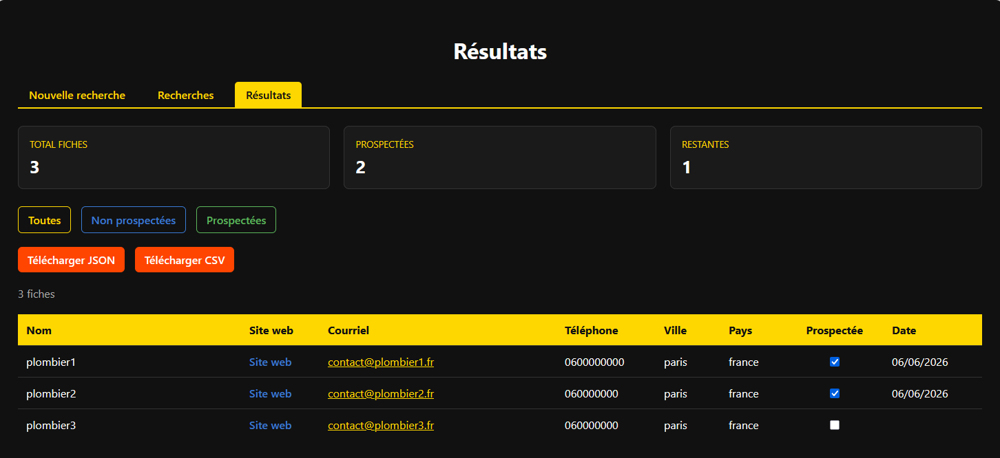

<p align="center">
  
</p>

[](https://www.python.org/)


[← Retour au sommaire](../README.md)

# Architecture d'un système de collecte de données en Python : collecteurs modulaires, pipeline de traitement et stockage local

Collecter des données depuis plusieurs sources ne consiste pas simplement à récupérer des informations sur Internet. Il faut également gérer des formats hétérogènes, des données incomplètes, des erreurs réseau, des doublons et des mécanismes d'export.

À mesure que les sources se multiplient, une difficulté supplémentaire apparaît : comment faire évoluer le système sans modifier l'ensemble de sa logique métier à chaque ajout de collecteur ?

Data Collection System, développé par Palks Studio, repose sur une architecture modulaire en Python, avec une interface Flask locale, des collecteurs indépendants et une chaîne de traitement des données.

Le système permet de définir des recherches, de collecter des informations depuis plusieurs sources, de visiter les sites web identifiés, d'extraire des coordonnées, puis de produire des jeux de données structurés.

Son architecture repose sur un principe central : chaque composant possède une responsabilité précise et peut évoluer indépendamment des autres.

---

## 1. Architecture générale

Le système est organisé autour de plusieurs couches :

- Un moteur principal chargé d'orchestrer les exécutions
- Des collecteurs responsables de la récupération des données
- Des processeurs chargés du nettoyage, de la normalisation et de la validation
- Des exporteurs responsables de la génération des fichiers
- Une interface web locale pour gérer les recherches et les résultats
- Des composants transversaux pour la journalisation et la gestion des erreurs

Voici la structure documentée du projet :

```text
data-collection-system/
│
├── main.py
├── requirements.txt
├── run.bat
│
├── config/
│   ├── __init__.py
│   └── settings.py
│
├── collectors/
│   ├── __init__.py
│   ├── duckduckgo_collector.py
│   ├── bing_collector.py
│   ├── qwant_collector.py
│   ├── source_registry.py
│   └── base_collector.py
│
├── processors/
│   ├── __init__.py
│   ├── cleaner.py
│   ├── validator.py
│   ├── deduplicator.py
│   ├── email_extractor.py
│   ├── phone_extractor.py
│   └── normalizer.py
│
├── exports/
│   ├── __init__.py
│   ├── csv_exporter.py
│   └── json_exporter.py
│
├── core/
│   ├── __init__.py
│   ├── logger.py
│   ├── retry_handler.py
│   ├── error_handler.py
│   └── folder_initializer.py
│
├── models/
│   ├── __init__.py
│   └── company.py
│
├── data/
│   ├── prospected.json
│   └── processed/
│
├── logs/
│   └── app.log
│
├── searches/
│   ├── __init__.py
│   ├── search_manager.py
│   └── searches.json
│
├── web/
│   ├── __init__.py
│   ├── app.py
│   └── templates/
│       ├── edit_searches.html
│       ├── results.html
│       ├── running.html
│       ├── searches.html
│       └── new_search.html
│
├── LICENCE.md
└── docs/
```

Cette structure distingue les composants techniques des données persistantes.

Les collecteurs ne sont pas responsables de l'interface utilisateur. Les exporteurs ne déterminent pas comment les données sont récupérées. Les processeurs ne dépendent pas directement d'un moteur de recherche particulier.

Le fichier `main.py` assure l'orchestration de ces différentes couches.

---

## 2. Gestion des recherches et configuration

Le processus commence par la définition d'une recherche.

Depuis l'interface locale, l'utilisateur peut créer, modifier, supprimer et exécuter des recherches personnalisées.

Une recherche peut notamment contenir un nom, un mot-clé, une ville, un pays et les sources à utiliser.

La documentation présente l'exemple suivant :

```json
{
    "id": 1,
    "name": "Plombiers Paris",
    "keyword": "plombier",
    "city": "Paris",
    "enabled": true
}
```

Les recherches sont conservées dans `searches/searches.json` et gérées par `search_manager.py`.

Cette séparation permet de distinguer deux types de configuration.

| Composant                   | Responsabilité                              |
|-----------------------------|---------------------------------------------|
| `config/settings.py`        | Paramètres techniques du système            |
| `searches/searches.json`    | Recherches enregistrées par l'utilisateur   |
| `search_manager.py`         | Gestion et exécution des recherches         |
| `source_registry.py`        | Identification des collecteurs actifs       |

La configuration technique centralise notamment les chemins de stockage, les délais d'attente, les limites d'exécution, les paramètres d'export et les options de journalisation.

Les critères métier d'une recherche restent ainsi indépendants des paramètres d'exécution du moteur.

Une même recherche peut être réutilisée sans reconfigurer l'ensemble du système.

---

## 3. Une architecture multi-collecteurs

Le système prend en charge plusieurs moteurs de recherche :

- DuckDuckGo
- Bing
- Qwant

Chaque source dispose de son propre collecteur.

```text
Recherche utilisateur
          │
          ▼
   source_registry.py
          │
          ├── duckduckgo_collector.py
          ├── bing_collector.py
          └── qwant_collector.py
          │
          ▼
   Enregistrements structurés
          │
          ▼
   Pipeline de traitement
```

L'objectif est de ne pas intégrer directement dans le moteur principal les particularités de chaque source.

Un moteur de recherche peut modifier sa structure HTML, ses paramètres de pagination ou la présentation de ses résultats. Ces changements doivent idéalement rester localisés dans le collecteur concerné.

### Le contrat commun des collecteurs

Le fichier `base_collector.py` définit le contrat commun que les collecteurs doivent respecter.

L'intérêt de ce contrat est de permettre au moteur principal d'utiliser différents collecteurs sans connaître leurs détails d'implémentation.

Voici un exemple pédagogique de ce principe en Python :

```python
from abc import ABC, abstractmethod
from typing import Dict, List


class BaseCollector(ABC):

    @abstractmethod
    def collect(
        self,
        search: Dict
    ) -> List[Dict]:
        pass
```

Un collecteur spécifique pourrait ensuite implémenter cette interface :

```python
class ExampleCollector(BaseCollector):

    def collect(
        self,
        search: Dict
    ) -> List[Dict]:

        keyword = search["keyword"]
        city = search.get("city", "")

        results = self.fetch_results(
            keyword,
            city
        )

        return [
            self.parse_result(result)
            for result in results
        ]
```

Les méthodes `fetch_results()` et `parse_result()` représentent ici des opérations propres à la source.

Cet exemple illustre le contrat architectural, sans reproduire le code source de production.

Le moteur principal peut alors manipuler des collecteurs différents à travers une interface commune.

### Le registre des sources

Le fichier `source_registry.py` référence les collecteurs disponibles et retourne ceux qui sont actifs pour une exécution.

Un registre simplifié pourrait fonctionner de cette manière :

```python
COLLECTORS = {
    "duckduckgo": DuckDuckGoCollector,
    "bing": BingCollector,
    "qwant": QwantCollector
}


def get_collectors(selected_sources):

    return [
        COLLECTORS[source]()
        for source in selected_sources
        if source in COLLECTORS
    ]
```

Le moteur n'a plus besoin de gérer une succession de conditions spécifiques à chaque source.

L'ajout d'un nouveau collecteur nécessite principalement une implémentation compatible avec le contrat commun et son intégration au registre.

Le pipeline de traitement peut rester inchangé.

---

## 4. Collecte et enrichissement des informations

Les résultats d'un moteur de recherche ne contiennent pas nécessairement toutes les informations utiles.

Un résultat peut fournir un nom d'entreprise, une URL et une description, sans indiquer d'adresse email ni de numéro de téléphone.

Le système peut donc visiter les sites web identifiés afin d'enrichir les enregistrements.

```text
Moteur de recherche
         │
         ▼
  Résultat identifié
         │
         ├── Nom
         ├── URL
         └── Description
         │
         ▼
  Visite du site web
         │
         ├── Extraction des emails
         ├── Extraction des téléphones
         └── Informations complémentaires
         │
         ▼
  Enregistrement structuré
```

Cette distinction est importante.

La découverte d'une entreprise et l'extraction de ses coordonnées constituent deux opérations différentes.

La première permet d'identifier une source potentielle. La seconde enrichit les informations disponibles.

### Requêtes HTTP et automatisation du navigateur

Le système utilise notamment Requests, BeautifulSoup et Playwright.

Ces outils répondent à des besoins complémentaires.

| Technologie     | Responsabilité principale                     |
|-----------------|-----------------------------------------------|
| Requests        | Récupération de ressources HTTP               |
| BeautifulSoup   | Analyse et extraction du contenu HTML         |
| Playwright      | Automatisation et rendu dans un navigateur    |
| Flask           | Interface web locale                          |
| Python          | Orchestration et traitement des données       |

Une requête HTTP classique peut suffire lorsqu'une page contient directement les informations recherchées dans son HTML.

En revanche, certaines pages construisent leur contenu dynamiquement à l'aide de JavaScript.

L'automatisation d'un navigateur peut alors devenir nécessaire pour accéder au contenu effectivement rendu.

Cette capacité introduit toutefois un coût supplémentaire en temps d'exécution, en mémoire et en consommation de ressources.

Une architecture de collecte doit donc distinguer les opérations nécessitant un navigateur de celles pouvant être réalisées avec une simple requête HTTP.

La documentation publique ne précise pas la stratégie exacte utilisée pour sélectionner l'une ou l'autre méthode selon les pages.

---

## 5. Extraction des adresses email et des numéros de téléphone

Les modules `email_extractor.py` et `phone_extractor.py` sont responsables de l'extraction des coordonnées depuis les sites visités.

Ces opérations doivent rester indépendantes du collecteur initial.

Une adresse email extraite depuis un site découvert sur Bing doit pouvoir être traitée de la même manière qu'une adresse provenant d'un résultat DuckDuckGo.

### Extraction des emails

Une première méthode consiste à rechercher les liens utilisant le protocole `mailto:`.

```python
from bs4 import BeautifulSoup


def extract_mailto(html):

    soup = BeautifulSoup(
        html,
        "html.parser"
    )

    emails = set()

    for link in soup.select('a[href^="mailto:"]'):

        href = link.get("href", "")

        email = (
            href.removeprefix("mailto:")
            .split("?", 1)[0]
            .strip()
        )

        if email:
            emails.add(email)

    return sorted(emails)
```

Cet exemple pédagogique utilise un ensemble Python pour éliminer les répétitions à l'intérieur d'une même page.

Il ne couvre pas tous les formats possibles. Une adresse peut être présente dans du texte, être encodée ou être affichée après une interaction JavaScript.

L'extraction peut donc nécessiter plusieurs stratégies complémentaires.

Il faut également distinguer trois notions :

- Une adresse détectée dans une page
- Une adresse syntaxiquement valide
- Une adresse réellement utilisable pour contacter l'entreprise

La présence d'une adresse email dans une page ne garantit ni son existence effective ni sa pertinence pour l'entreprise recherchée.

### Extraction des numéros de téléphone

Les numéros peuvent apparaître dans des liens `tel:`, dans du texte ou dans différents formats nationaux.

```text
01 23 45 67 89
01.23.45.67.89
+33 1 23 45 67 89
+33123456789
```

Ces représentations peuvent correspondre au même numéro.

L'extraction doit donc être suivie d'une étape de normalisation.

Pour les formats internationaux, cette opération nécessite de tenir compte du pays et des règles de numérotation applicables.

Supprimer les espaces et la ponctuation ne suffit pas toujours à produire un numéro international correct.

---

## 6. Un modèle de données commun

Le fichier `models/company.py` définit la structure d'une entreprise au sein du système.

Cette structure commune permet de faire converger les résultats provenant de différentes sources.

La documentation publique présente un enregistrement de ce type :

```json
{
    "name": "Entreprise Exemple",
    "website": "https://example.com",
    "email": "contact@example.com",
    "phone": "+33123456789",
    "city": "Paris",
    "country": "France",
    "sector": "mot clé",
    "source": "Directory",
    "processed": false
}
```

Les champs utilisés ne dépendent plus directement de la présentation du moteur de recherche.

| Champ        | Rôle                                         |
|--------------|----------------------------------------------|
| `name`       | Nom de l'entreprise                          |
| `website`    | Adresse du site web                          |
| `email`      | Adresse email collectée                      |
| `phone`      | Numéro de téléphone                          |
| `city`       | Ville associée à l'entreprise                |
| `country`    | Pays associé à l'entreprise                  |
| `sector`     | Secteur ou mot-clé de recherche              |
| `source`     | Origine de l'enregistrement                  |
| `processed`  | Indicateur d'état du traitement              |

La conservation de la source constitue un élément important de traçabilité.

Elle permet de distinguer les données provenant de différents collecteurs et peut faciliter l'analyse des écarts de qualité entre les sources.

Il convient également de distinguer une information collectée d'une information déduite.

Une recherche effectuée avec le mot-clé « plombier Paris » ne garantit pas que toutes les entreprises retournées exercent réellement cette activité ou soient situées à Paris.

Les critères de recherche ne doivent pas être considérés automatiquement comme des informations vérifiées sur chaque résultat.

---

## 7. Le pipeline de traitement

Le moteur principal orchestre une chaîne de traitement séquentielle.

```text
Chargement de la configuration
              │
              ▼
Initialisation de l'environnement
              │
              ▼
     Chargement des recherches
              │
              ▼
     Exécution des collecteurs
              │
              ▼
       Nettoyage des données
              │
              ▼
          Normalisation
              │
              ▼
           Validation
              │
              ▼
          Déduplication
              │
              ▼
       Génération des exports
              │
              ▼
     Journalisation de l'exécution
```

Chaque étape transforme les données avant leur transmission à la suivante.

Cette organisation permet de séparer les responsabilités et de tester individuellement les opérations de traitement.

Un collecteur peut produire un enregistrement incomplet. Le processeur de nettoyage peut corriger certaines valeurs. Le validateur peut ensuite déterminer si l'enregistrement respecte les contraintes nécessaires à son export.

L'objectif n'est pas seulement de produire davantage de données, mais de produire des données suffisamment cohérentes pour être exploitées.

---

## 8. Nettoyage et normalisation

Le nettoyage et la normalisation sont souvent regroupés, alors qu'ils répondent à deux besoins distincts.

Le nettoyage supprime les éléments inutiles ou corrige certaines incohérences simples.

La normalisation harmonise les représentations afin de faciliter les comparaisons et les traitements ultérieurs.

### Nettoyage

Le module `cleaner.py` prépare les valeurs collectées.

Un exemple simple consiste à supprimer les espaces superflus :

```python
def clean_text(value):

    if value is None:
        return ""

    return " ".join(
        str(value).split()
    )
```

Exemple :

```text
Entrée : "  Entreprise   Exemple  "
Sortie : "Entreprise Exemple"
```

Cette opération améliore la cohérence des chaînes sans modifier leur signification.

### Normalisation

Le module `normalizer.py` uniformise les valeurs.

La documentation présente notamment le cas des villes :

```text
PARIS
Paris
paris
```

Ces trois représentations deviennent :

```text
Paris
```

Les URL constituent un autre exemple important.

```text
https://example.com
https://example.com/
https://EXAMPLE.COM/
```

Ces adresses peuvent être représentées sous une forme commune pour faciliter les comparaisons.

Voici un exemple pédagogique de normalisation limitée aux URL HTTP et HTTPS :

```python
from urllib.parse import (
    urlsplit,
    urlunsplit
)


def normalize_url(value):

    parts = urlsplit(value.strip())

    if parts.scheme.lower() not in {
        "http",
        "https"
    }:
        return ""

    if not parts.hostname:
        return ""

    return urlunsplit((
        parts.scheme.lower(),
        parts.netloc.lower(),
        parts.path or "/",
        parts.query,
        ""
    ))
```

Cet exemple conserve le chemin et les paramètres de requête, tout en harmonisant le protocole et l'hôte.

La normalisation des URL nécessite cependant des précautions.

Deux adresses partageant le même domaine peuvent correspondre à des pages différentes. Les paramètres de requête peuvent également modifier la ressource retournée.

La normalisation ne doit donc pas supprimer arbitrairement les informations nécessaires à l'identification d'une ressource.

---

## 9. Validation des enregistrements

Le module `validator.py` vérifie la présence et la cohérence des informations obligatoires.

La documentation donne notamment le nom et le site web comme exemples de champs requis.

Une validation simplifiée pourrait être représentée ainsi :

```python
def is_valid_company(record):

    name = record.get("name", "").strip()
    website = record.get("website", "").strip()

    if not name:
        return False

    if not website:
        return False

    parts = urlsplit(website)

    return (
        parts.scheme in {"http", "https"}
        and bool(parts.hostname)
    )
```

Ce contrôle vérifie la présence des valeurs et une structure élémentaire de l'URL.

Il ne vérifie pas que le site est accessible, que l'entreprise existe ou que les coordonnées appartiennent réellement à cette entreprise.

Ces différents niveaux de validation doivent rester distincts.

| Niveau de validation | Question traitée                            |
|----------------------|---------------------------------------------|
| Structure            | L'enregistrement contient-il les champs ?   |
| Syntaxe              | Les valeurs ont-elles un format valide ?    |
| Cohérence            | Les informations sont-elles compatibles ?   |
| Accessibilité        | La ressource distante est-elle accessible ? |
| Vérification métier  | Les données correspondent-elles à l'entité ?|

Une architecture de collecte doit définir précisément le niveau de qualité attendu avant l'export.

Un enregistrement syntaxiquement valide n'est pas nécessairement un enregistrement exact.

---

## 10. Déduplication : identifier une même entreprise

La déduplication constitue une étape essentielle dans une architecture multi-sources.

Une entreprise peut apparaître plusieurs fois dans les résultats d'un même moteur de recherche, mais également dans ceux de plusieurs moteurs.

```text
DuckDuckGo : Entreprise Exemple
Bing       : Entreprise Exemple
Qwant      : Entreprise Exemple
```

Sans traitement spécifique, les trois résultats pourraient être exportés comme trois prospects différents.

Le module `deduplicator.py` identifie et supprime les enregistrements redondants.

### Déduplication à partir d'une clé

Une approche pédagogique consiste à utiliser le domaine du site web comme clé de comparaison.

```python
from urllib.parse import urlsplit


def company_key(record):

    website = record.get("website", "")

    host = urlsplit(website).hostname

    if not host:
        return None

    return host.lower().removeprefix("www.")
```

La déduplication peut ensuite être réalisée à l'aide d'un dictionnaire :

```python
def deduplicate(records):

    unique = {}

    for record in records:

        key = company_key(record)

        if key is None:
            continue

        if key not in unique:
            unique[key] = record

    return list(unique.values())
```

Cet exemple conserve le premier enregistrement rencontré pour chaque domaine.

Il illustre une stratégie possible, et non la clé de déduplication exacte utilisée dans le système de production.

Cette méthode présente plusieurs limites.

Un groupe peut posséder plusieurs établissements partageant le même domaine. Plusieurs entreprises indépendantes peuvent être hébergées sur une même plateforme. Une entreprise peut également posséder plusieurs sites web.

La clé de déduplication doit donc correspondre à l'entité que le système cherche réellement à identifier.

### Supprimer ou fusionner les doublons

Deux résultats peuvent représenter la même entreprise tout en contenant des informations complémentaires.

| Source     | Site web    | Email               | Téléphone     |
|------------|-------------|---------------------|---------------|
| DuckDuckGo | example.com | contact@example.com | -             |
| Bing       | example.com | -                   | +33123456789  |
| Qwant      | example.com | contact@example.com | +33123456789  |

Supprimer les deux derniers enregistrements ferait perdre le numéro de téléphone si seul le premier était conservé.

Une autre stratégie consiste à fusionner les informations complémentaires :

```json
{
    "name": "Entreprise Exemple",
    "website": "https://example.com",
    "email": "contact@example.com",
    "phone": "+33123456789",
    "sources": [
        "DuckDuckGo",
        "Bing",
        "Qwant"
    ]
}
```

Ce modèle de fusion constitue une piste d'évolution architecturale.

La documentation publique confirme la suppression des doublons, mais ne précise pas les règles de fusion, de priorité entre sources ou de résolution des valeurs contradictoires.

---

## 11. Orchestration du workflow

Le fichier `main.py` constitue le point d'entrée principal du système.

Il coordonne le chargement des recherches, la sélection des collecteurs, le traitement des données et la génération des exports.

Un exemple simplifié permet de représenter cette orchestration :

```python
def run_search(search, collectors):

    raw_records = []

    for collector in collectors:

        records = collector.collect(search)

        raw_records.extend(records)

    cleaned = [
        clean_record(record)
        for record in raw_records
    ]

    normalized = [
        normalize_record(record)
        for record in cleaned
    ]

    valid = [
        record
        for record in normalized
        if is_valid_company(record)
    ]

    unique = deduplicate(valid)

    export_csv(unique)
    export_json(unique)

    return unique
```

Les fonctions utilisées ici représentent les responsabilités des différents modules.

Le moteur principal ne contient pas nécessairement les détails du nettoyage, de la normalisation ou de l'export.

Il définit principalement l'ordre des opérations et transmet les données entre les composants.

Cette séparation permet de modifier un exporteur ou d'ajouter une règle de validation sans réécrire le fonctionnement général du système.

---

## 12. Gestion des erreurs, réessais et journalisation

Une collecte de données depuis Internet dépend de ressources qui ne sont pas entièrement contrôlées par l'application.

Une requête peut échouer, un site peut être indisponible, une connexion peut dépasser son délai d'attente ou une page peut changer de structure.

Le système dispose de composants dédiés :

| Composant               | Responsabilité                              |
|-------------------------|---------------------------------------------|
| `logger.py`             | Journalisation des événements et erreurs    |
| `retry_handler.py`      | Réessai des opérations en échec             |
| `error_handler.py`      | Gestion centralisée des erreurs             |
| `folder_initializer.py` | Initialisation des répertoires nécessaires  |

### Réessayer uniquement les erreurs temporaires

Toutes les erreurs ne justifient pas un réessai.

| Situation                 | Comportement envisageable                   |
|---------------------------|---------------------------------------------|
| Délai d'attente dépassé   | Réessai limité                              |
| Erreur serveur HTTP 503   | Réessai après temporisation                 |
| Limitation HTTP 429       | Respect du délai demandé par le serveur     |
| Ressource HTTP 404        | Abandon de la ressource concernée           |
| Accès interdit HTTP 403   | Arrêt de la tentative                       |
| Données invalides         | Rejet ou signalement de l'enregistrement    |

Un réessai automatique doit améliorer la robustesse du système, et non provoquer une succession incontrôlée de requêtes.

Voici un exemple pédagogique de temporisation exponentielle :

```python
import time

from requests.exceptions import (
    ConnectionError,
    Timeout
)


def run_with_retry(
    operation,
    attempts=3
):

    for attempt in range(attempts):

        try:
            return operation()

        except (ConnectionError, Timeout):

            if attempt == attempts - 1:
                raise

            delay = 2 ** attempt

            time.sleep(delay)
```

Cette stratégie augmente progressivement le délai entre les tentatives.

Elle ne représente pas l'implémentation exacte de `retry_handler.py`.

Une version complète peut également intégrer une temporisation aléatoire, un plafond de délai, une limite globale d'exécution et le traitement des en-têtes HTTP tels que `Retry-After`.

Les réessais ne doivent pas servir à contourner les restrictions d'accès imposées par une source.

### Journalisation

Les événements sont enregistrés dans :

```text
logs/app.log
```

La documentation présente notamment des événements de ce type :

```text
Application démarrée
Collecte démarrée
250 enregistrements collectés
Export terminé
```

La journalisation permet de suivre le déroulement des exécutions et de faciliter le diagnostic en cas d'erreur.

Dans une architecture multi-collecteurs, elle peut également permettre d'identifier les sources qui produisent des erreurs récurrentes ou des données difficiles à exploiter.

Une journalisation détaillée doit toutefois éviter de conserver inutilement des données personnelles, des secrets ou des informations sensibles.

---

## 13. Une interface Flask locale

Le système intègre une interface web accessible depuis un navigateur.

L'application Flask est définie dans `web/app.py`.

Les templates HTML correspondent aux différentes étapes du workflow utilisateur.

| Template              | Fonction                                    |
|-----------------------|---------------------------------------------|
| `searches.html`       | Liste des recherches enregistrées           |
| `new_search.html`     | Création d'une recherche                    |
| `edit_searches.html`  | Modification des critères                   |
| `running.html`        | Affichage de la progression                 |
| `results.html`        | Consultation et filtrage des résultats      |

L'interface permet de gérer les recherches, de sélectionner les collecteurs, de lancer les exécutions et de consulter les données produites.

```text
Navigateur local
       │
       ▼
 Application Flask
       │
       ├── Gestion des recherches
       ├── Lancement des collectes
       ├── Affichage de la progression
       └── Consultation des résultats
       │
       ▼
 Moteur de traitement
       │
       ▼
 Données locales
```

Flask intervient ici comme couche d'interaction avec l'utilisateur.

Les collecteurs, les processeurs et les exporteurs restent des composants Python indépendants.

Cette séparation évite de rendre la logique de collecte entièrement dépendante de l'interface web.

### Gestion des opérations longues

Une collecte peut nécessiter plusieurs requêtes HTTP, des visites de sites web et des opérations de traitement.

Exécuter l'ensemble du workflow directement dans une requête HTTP peut bloquer la réponse du serveur pendant toute la durée du traitement.

Une architecture locale peut notamment envisager :

- Un processus de collecte indépendant
- Une tâche d'arrière-plan
- Un mécanisme de suivi d'état
- Une interface interrogeant périodiquement la progression

La présence de `running.html` indique que le système prévoit une interface dédiée à l'exécution des recherches.

La documentation publique ne détaille toutefois pas le mécanisme exact utilisé pour gérer les tâches longues, la concurrence ou la remontée de progression.

Il s'agit d'un point d'architecture important dès lors que plusieurs recherches peuvent être lancées ou qu'une collecte peut durer plusieurs minutes.

---

## 14. Suivi des prospects déjà contactés

Le système permet de marquer les prospects comme contactés directement depuis l'interface de résultats.

L'historique est conservé dans :

```text
data/prospected.json
```

Ce fichier enregistre les prospects déjà contactés ainsi que la date de prospection associée.

Cette fonctionnalité introduit une distinction importante entre deux types de données.

| Données collectées           | Données de suivi                    |
|------------------------------|-------------------------------------|
| Nom de l'entreprise          | État de prospection                 |
| Site web                     | Date de prise de contact            |
| Email et téléphone           | Historique des actions              |
| Informations géographiques   | Informations propres à l'utilisateur|

Les données collectées peuvent être renouvelées à chaque exécution.

L'historique de prospection doit, quant à lui, rester disponible indépendamment des nouveaux résultats.

```text
Nouvelle collecte
        │
        ▼
Résultats actualisés
        │
        ├── Comparaison avec l'historique
        │
        ▼
Prospects nouveaux ou déjà contactés
```

Cette séparation permet d'éviter qu'une nouvelle collecte efface l'état de suivi précédent.

Un modèle pédagogique pourrait utiliser une clé stable :

```json
{
    "example.com": {
        "contacted": true,
        "contacted_at": "2026-06-04"
    }
}
```

Cet exemple ne reproduit pas le format interne exact de `prospected.json`.

La difficulté principale consiste à identifier durablement un prospect, même si son nom ou son URL change légèrement entre deux collectes.

La normalisation et la déduplication deviennent donc également importantes pour la continuité de l'historique.

---

## 15. Export CSV et JSON

Les résultats traités sont enregistrés dans :

```text
data/processed/
```

Le système prend en charge deux formats d'export.

| Format | Usage principal                              |
|--------|----------------------------------------------|
| CSV    | Tableurs, imports et traitement tabulaire    |
| JSON   | Intégration applicative et traitement Python |

Les exporteurs sont séparés du moteur de collecte.

Le fichier `csv_exporter.py` génère les données tabulaires, tandis que `json_exporter.py` conserve une représentation structurée.

### Exemple d'export CSV

Python fournit nativement les outils nécessaires à la génération de fichiers CSV.

```python
import csv


def export_csv(records, path):

    fields = [
        "name",
        "website",
        "email",
        "phone",
        "city",
        "country",
        "sector",
        "source"
    ]

    with open(
        path,
        "w",
        encoding="utf-8",
        newline=""
    ) as file:

        writer = csv.DictWriter(
            file,
            fieldnames=fields,
            extrasaction="ignore"
        )

        writer.writeheader()
        writer.writerows(records)
```

Cet exemple pédagogique génère un fichier contenant les principaux champs du modèle de données.

Le séparateur, l'encodage et les règles de représentation des valeurs doivent être adaptés aux logiciels qui exploiteront les exports.

Il faut également prendre en compte les risques d'injection de formules dans les tableurs lorsque des données collectées depuis des sources externes commencent par certains caractères interprétés comme des formules.

L'export ne doit pas être considéré comme une simple opération de mise en forme. Il constitue une nouvelle frontière entre l'application et les systèmes qui consommeront ses données.

---

## 16. Sécurité et limites d'une collecte locale

Une architecture locale permet de conserver les recherches, les résultats et l'historique sur la machine de l'utilisateur.

Elle ne signifie toutefois pas que le système fonctionne entièrement hors ligne.

Les collecteurs communiquent avec des moteurs de recherche et des sites web externes.

```text
Machine locale
     │
     ├── Configuration
     ├── Recherches
     ├── Traitement
     ├── Résultats
     └── Historique
     │
     ▼
Requêtes réseau sortantes
     │
     ├── Moteurs de recherche
     └── Sites web visités
```

La distinction est importante : le stockage et le traitement sont locaux, mais la collecte nécessite des échanges réseau.

Les sources externes peuvent recevoir les requêtes de recherche, l'adresse IP de connexion et certaines informations techniques associées aux visites.

### Sécurité des ressources distantes

Les pages web collectées constituent des données non fiables.

Une architecture de collecte doit notamment prendre en compte les redirections, les réponses volumineuses, les délais d'attente et les contenus potentiellement malveillants.

Les URL découvertes doivent être validées avant leur utilisation.

Une attention particulière doit être portée aux requêtes susceptibles de cibler des adresses locales, des services internes ou des ressources qui ne devraient pas être accessibles depuis le moteur de collecte.

Les protections envisageables comprennent :

- Limitation des protocoles autorisés à HTTP et HTTPS
- Contrôle des destinations et des redirections
- Limitation de la taille des réponses
- Délais d'attente et limites d'exécution
- Isolation du navigateur automatisé
- Encodage des données lors de leur affichage

Ces mesures représentent des exigences de sécurité à considérer pour ce type d'architecture. La documentation publique ne confirme pas leur implémentation complète dans la version actuelle.

### Sécurité de l'interface locale

Une application Flask locale ne doit pas être exposée inutilement au réseau.

Un serveur destiné à un usage individuel peut être limité à l'interface de boucle locale.

```python
app.run(
    host="127.0.0.1",
    port=5000,
    debug=False
)
```

Cet exemple illustre une configuration locale possible.

Il ne représente pas nécessairement les paramètres exacts du système.

Le serveur de développement Flask ne doit pas être utilisé comme serveur de production exposé publiquement.

Les opérations de lancement, de modification et de suppression des recherches doivent également disposer de protections adaptées, notamment contre les requêtes non autorisées.

### Collecte et utilisation des données

L'absence de plateforme SaaS ne dispense pas de respecter les conditions d'accès aux sources ni les règles applicables aux données collectées.

Une adresse email professionnelle peut constituer une donnée personnelle lorsqu'elle permet d'identifier une personne.

La collecte de données publiques ne signifie pas automatiquement que leur réutilisation à des fins de prospection est libre de toute obligation.

Le système doit donc être utilisé dans un cadre tenant compte des finalités de collecte, des règles de conservation et des obligations applicables à la prospection.

La maîtrise technique des données ne remplace pas la responsabilité liée à leur utilisation.

---

## 17. Extensibilité et évolution de l'architecture

L'un des principaux intérêts du système réside dans la possibilité de faire évoluer chaque couche indépendamment.

| Évolution envisagée          | Composant principalement concerné           |
|------------------------------|---------------------------------------------|
| Nouvelle source de collecte  | Collecteur et registre des sources          |
| Nouveau format de téléphone  | Normalisation                               |
| Nouveau champ obligatoire    | Modèle et validation                        |
| Nouvelle règle de doublon    | Déduplication                               |
| Nouveau format d'export      | Exporteur                                   |
| Nouvelle vue utilisateur     | Interface Flask et templates                |

Cette séparation permet de limiter l'impact d'une modification sur le reste du système.

Elle ne signifie pas pour autant que tous les composants peuvent évoluer sans coordination.

Modifier le modèle commun peut nécessiter d'adapter plusieurs collecteurs, les processeurs et les exporteurs.

L'architecture doit donc préserver des contrats suffisamment stables entre les différentes couches.

### Évolution du stockage

Les fichiers JSON et CSV permettent de conserver des données structurées sans introduire de serveur de base de données.

Lorsque le volume augmente, plusieurs contraintes peuvent apparaître :

- Chargement de fichiers volumineux
- Recherche multicritère sur plusieurs collectes
- Mise à jour concurrente de l'historique
- Déduplication sur des volumes importants
- Conservation de l'évolution des données dans le temps

Une base SQLite pourrait constituer une évolution pertinente si ces besoins devenaient plus importants.

Elle permettrait notamment d'introduire des index, des contraintes d'unicité et des transactions tout en conservant une architecture locale.

Cette évolution n'est pas présentée comme une fonctionnalité actuelle du système, mais comme une possibilité rendue envisageable par la séparation entre collecte, traitement et stockage.

---

## Conclusion

Data Collection System illustre la construction d'une chaîne de collecte de données modulaire en Python, depuis la définition d'une recherche jusqu'à la production de fichiers structurés.

Son architecture repose sur des collecteurs indépendants, un modèle de données commun, une chaîne de nettoyage et de validation, des mécanismes de déduplication et des exporteurs séparés.

L'interface Flask permet de piloter ces opérations localement, tandis que les résultats et l'historique de prospection restent conservés dans l'environnement de l'utilisateur.

Les principales difficultés techniques ne résident pas uniquement dans la récupération des données.

Elles concernent également la qualité des informations collectées, la stabilité des sources, la normalisation, la gestion des erreurs, la sécurité des ressources distantes et la cohérence des données au fil des exécutions.

Une architecture modulaire ne supprime pas ces contraintes. Elle permet de les traiter dans des composants identifiés, de limiter les dépendances entre les couches et de faire évoluer progressivement le système.

L'objectif reste de construire une chaîne de traitement dont les données, les transformations et les responsabilités techniques sont compréhensibles, maintenables et maîtrisées.

---

## Pour aller plus loin

Retrouvez également cet article technique en anglais sur DEV.to, consacré à la conception d'un système de collecte de données en Python, à son architecture, à ses composants et aux choix techniques permettant d'automatiser la collecte, le traitement et l'export des données en local.

👉 [Python Data Collection System Architecture: Modular Collectors, Processing Pipeline, and Local Storage](https://dev.to/palks_studio/i-built-a-local-data-collection-system-in-python-3k6p) (DEV.to, en anglais)

---

https://palks-studio.com