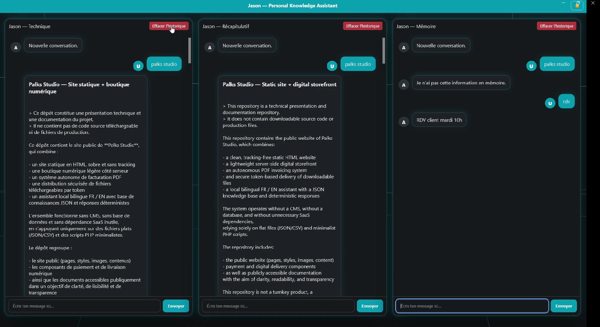

<p align="center">
  
</p>

[](https://www.python.org/)


[← Retour au sommaire](../README.md)

# Architecture d'un chatbot Flask local : d'une API conversationnelle à trois espaces de travail indépendants

Un chatbot n'a pas nécessairement besoin d'un modèle d'intelligence artificielle, d'une base de données distante ou d'une infrastructure complexe pour répondre à des besoins concrets. Une architecture Python avec Flask, une base de connaissances locale et une interface web peuvent constituer un socle suffisant pour construire un assistant conversationnel autonome.

Cet article présente cette architecture et son évolution vers un assistant local organisé autour de trois espaces de conversation indépendants.

---

## 1. L'architecture de base

Le chatbot repose sur une séparation entre le serveur HTTP, la logique conversationnelle, les données et l'interface utilisateur.

Cette organisation permet de modifier le fonctionnement interne du chatbot sans avoir à reconstruire son interface, mais également de remplacer sa base de connaissances ou d'ajouter un moteur de réponse externe.

La structure initiale du projet est la suivante :

```text
chatbot-flask/
│
├── app.py
├── main.py
├── passenger_wsgi.py
├── requirements.txt
├── .env.example
├── index.html
│
├── sample_data/
│   └── sample_data.json
│
└── docs/
    ├── INSTALL.md
    └── README.md
```

Le fichier `app.py` constitue le point d'entrée du serveur Flask. Il expose les routes HTTP, reçoit les requêtes du client et transmet les questions à la logique conversationnelle.

Le fichier `main.py` centralise le traitement des questions et la génération des réponses à partir des données locales ou, lorsque cette option est activée, de l'API OpenAI.

L'interface `index.html` utilise HTML et JavaScript natif pour communiquer avec le serveur. Elle ne dépend pas d'un framework front-end.

Enfin, le fichier `sample_data.json` contient la base de connaissances utilisée par le chatbot dans son mode local.

---

## 2. Communication entre l'interface et le serveur

L'interface et le moteur conversationnel communiquent par l'intermédiaire d'une API HTTP.

Le serveur expose notamment deux routes :

| Méthode | Route   | Fonction                                |
| ------- | ------- | --------------------------------------- |
| GET     | `/`     | Vérification du fonctionnement de l'API |
| POST    | `/chat` | Transmission d'une question au chatbot  |

Une interface utilisateur est également accessible depuis la route `/ui`.

Une question est envoyée au serveur sous la forme d'une requête JSON :

```json
{
  "question": "Bonjour"
}
```

Le serveur transmet ensuite cette question à la logique conversationnelle, récupère la réponse et la retourne au client au format JSON.

Le flux général peut être représenté ainsi :

```text
Interface HTML / JavaScript
            │
            ▼
      POST /chat
            │
            ▼
     Serveur Flask
         app.py
            │
            ▼
 Logique conversationnelle
         main.py
            │
            ▼
   Base JSON ou OpenAI
            │
            ▼
      Réponse JSON
```

Cette séparation permet d'utiliser le même serveur avec différentes interfaces, qu'il s'agisse d'une page web, d'une application locale ou d'un autre client capable d'effectuer des requêtes HTTP.

---

## 3. Une base de connaissances sans serveur de base de données

Dans sa configuration locale, le chatbot utilise un fichier JSON pour stocker ses connaissances.

Ce choix évite d'introduire un serveur SQL ou une base vectorielle lorsque le volume de données et les besoins fonctionnels ne le justifient pas.

Le fichier peut être modifié directement, sauvegardé ou versionné avec Git. La structure des données reste accessible et indépendante d'un service externe.

Cette approche présente néanmoins des limites. Un fichier JSON devient moins adapté lorsque le volume de données augmente fortement, lorsque plusieurs processus doivent effectuer des écritures concurrentes ou lorsque des recherches complexes sont nécessaires.

Pour une base de connaissances de taille modérée, il constitue cependant une solution simple à maintenir.

---

## 4. Un moteur de réponse avec ou sans intelligence artificielle

L'intégration d'OpenAI est facultative. Le chatbot peut fonctionner sans connexion Internet en utilisant uniquement sa base de connaissances locale.

L'activation du service externe repose sur une variable d'environnement :

```env
OPENAI_API_KEY=your_api_key
```

La clé est conservée dans un fichier `.env` et ne doit pas être intégrée directement au code source.

Lorsque l'accès à OpenAI est disponible et configuré, le chatbot peut utiliser ce service pour produire ses réponses. Dans le cas contraire, il continue de fonctionner à partir des données JSON locales.

```text
       Question utilisateur
                │
                ▼
       Moteur conversationnel
                │
       ┌────────┴────────┐
       ▼                 ▼
   Mode local       Mode OpenAI
   Fichier JSON     API distante
       │                 │
       └────────┬────────┘
                ▼
             Réponse
```

Il convient de distinguer le fonctionnement local de l'application et le traitement local des données. Lorsque l'API OpenAI est activée, les informations nécessaires à la requête sont transmises à un service distant. Le fonctionnement entièrement hors ligne correspond donc au mode utilisant exclusivement les données locales.

---

## 5. Faire évoluer le chatbot vers plusieurs espaces conversationnels

Une interface conversationnelle unique devient moins pratique lorsque plusieurs catégories d'informations doivent être consultées simultanément.

Dans un environnement de développement, une conversation peut contenir des informations générales sur un projet, des détails d'implémentation, des configurations techniques ou des notes de travail. Mélanger ces éléments dans un seul historique complique la séparation des contextes.

Le chatbot reprend le socle du chatbot Flask et fait évoluer son interface vers trois espaces conversationnels distincts.

Chaque espace est associé à une fonction :

- **Overview** : présentation générale et résumés des projets
- **Technical** : configurations, documentation et informations techniques
- **Memory** : notes, rendez-vous et rappels

L'organisation générale devient la suivante :

```text
┌────────────┐ ┌────────────┐ ┌────────────┐
│  Overview  │ │ Technical  │ │   Memory   │
│            │ │            │ │            │
│ Historique │ │ Historique │ │ Historique │
│ indépendant│ │ indépendant│ │ indépendant│
└────────────┘ └────────────┘ └────────────┘
```

L'objectif n'est pas de multiplier les modèles d'intelligence artificielle, mais de séparer les usages et les historiques de conversation.

Les trois espaces restent accessibles simultanément. Une question technique peut ainsi être traitée sans interrompre une consultation des informations générales ou une conversation consacrée aux notes de travail.

---

## 6. Séparer l'interface ne suffit pas à isoler les conversations

Dans une architecture multiconversationnelle, la séparation visuelle des fenêtres ne garantit pas, à elle seule, l'indépendance des contextes.

Chaque conversation doit disposer de son propre historique. Si toutes les fenêtres transmettent leurs messages vers un état partagé sans distinction, le serveur risque de mélanger les informations malgré la séparation de l'interface.

Une implémentation possible consiste à associer un identifiant à chaque conversation :

```json
{
  "conversation_id": "technical",
  "question": "Quels sont les paramètres de configuration ?"
}
```

Le serveur peut alors utiliser cet identifiant pour sélectionner l'historique correspondant avant de traiter la question.

Cette organisation permet de conserver une logique conversationnelle commune tout en maintenant des états distincts.

Il s'agit ici d'un exemple de conception applicable à une architecture Flask multiconversationnelle. La séparation peut également être réalisée au moyen de plusieurs instances indépendantes du chatbot.

Dans les deux cas, le principe reste le même : chaque conversation doit conserver son contexte sans modifier celui des autres.

---

## 7. Exécution locale et déploiement

Le chatbot de base peut être exécuté avec Python 3.10 ou une version supérieure.

Après la création d'un environnement virtuel, les dépendances sont installées à partir du fichier `requirements.txt` :

```bash
python -m venv venv
```

Sous Windows :

```powershell
.\venv\Scripts\Activate.ps1
```

Sous Linux ou macOS :

```bash
source venv/bin/activate
```

Le serveur peut ensuite être démarré :

```bash
pip install -r requirements.txt
python app.py
```

L'interface est alors accessible à l'adresse suivante :

```text
http://localhost:5000/ui
```

L'architecture prévoit également un déploiement sur un hébergement mutualisé compatible Passenger et WSGI. Le fichier `passenger_wsgi.py` fournit le point d'entrée nécessaire à ce mode d'exécution.

Dans sa version locale à trois espaces, le chatbot peut rester disponible en arrière-plan et être lancé au démarrage du système.

Un déploiement distant nécessite toutefois des précautions supplémentaires, notamment concernant l'authentification, les accès aux données, la configuration CORS et la protection des clés API.

---

## Conclusion

Le passage d'un chatbot Flask à une interface multiconversationnelle illustre l'intérêt de séparer les composants d'une application dès sa conception.

Le serveur HTTP, la logique de réponse, les données et l'interface peuvent évoluer indépendamment. Une architecture initialement destinée à une seule conversation peut ainsi servir de base à un assistant organisé autour de plusieurs usages.

La difficulté principale ne réside pas nécessairement dans la génération des réponses, mais dans la gestion des contextes, des historiques et des données associées à chaque conversation.

Cette approche permet de construire des assistants spécialisés sans imposer systématiquement une infrastructure complexe ou une dépendance à un service d'intelligence artificielle distant.

---

## Pour aller plus loin

Retrouvez également cet article technique en anglais sur DEV.to, consacré à la conception d'un assistant personnel fonctionnant en local, à la séparation des contextes de conversation, à la gestion d'une base de connaissances structurée et aux choix techniques permettant de conserver la maîtrise de ses données et de ses outils de travail sans dépendre d'une plateforme SaaS.

👉 [Local Flask Chatbot Architecture: From a Conversational API to Three Independent Workspaces](https://dev.to/palks_studio/building-a-local-personal-assistant-instead-of-using-saas-tools-3fpn) (DEV.to, en anglais)

---

https://palks-studio.com
