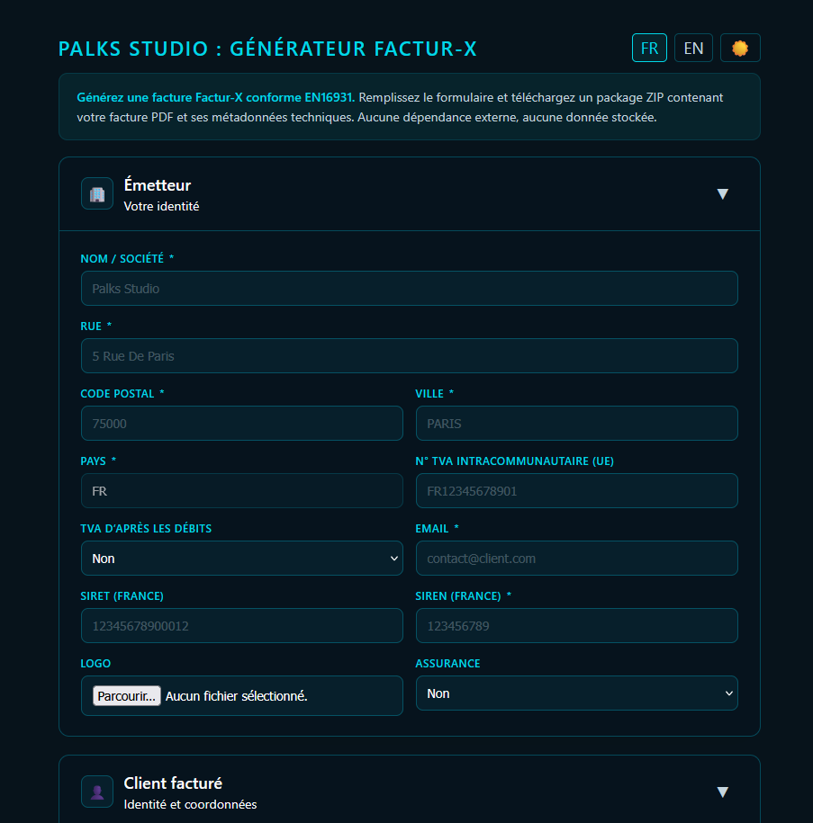

<p align="center">
  
</p>


[← Retour au sommaire](../README.md)

# Concevoir un générateur Factur-X EN16931 : du modèle de données au PDF hybride

La facturation électronique est souvent présentée comme un changement de format. Il suffirait de remplacer une facture PDF classique par un document contenant un fichier XML structuré.

En pratique, la difficulté se situe ailleurs.

Comment garantir que les montants visibles dans le PDF correspondent exactement aux données du XML ? Comment déterminer les mentions fiscales applicables sans laisser l'utilisateur saisir manuellement des informations potentiellement incohérentes ? Comment produire un document conforme sans dépendre d'une plateforme externe pour sa génération ?

Ces questions relèvent davantage de l'architecture logicielle que de la génération documentaire.

Cet article présente l'approche technique adoptée pour concevoir un générateur Factur-X gratuit, développé par Palks Studio, capable de produire des factures hybrides au profil EN16931.

L'objectif n'est pas de présenter une bibliothèque de génération PDF ou XML, mais de montrer comment la conformité documentaire peut être intégrée directement dans la conception d'un système de facturation.

---

## 1. Factur-X : un document, deux représentations

Une facture Factur-X repose sur un principe simple : réunir dans un même fichier une représentation lisible par un humain et une représentation structurée exploitable par un logiciel.

Le document final contient :

- Un PDF au format PDF/A-3  
- Un fichier XML structuré embarqué dans ce PDF  
- Des métadonnées permettant d'identifier le document et son profil Factur-X

Le PDF conserve la présentation traditionnelle de la facture, tandis que le XML contient les informations nécessaires à son traitement automatisé.

```text
Facture Factur-X
│
├── PDF/A-3
│   ├── Informations de l'émetteur
│   ├── Informations du client
│   ├── Lignes de facturation
│   ├── TVA et totaux
│   └── Mentions légales
│
└── XML embarqué
    ├── Identification des parties
    ├── Données de facturation
    ├── Lignes structurées
    ├── Informations fiscales
    └── Totaux monétaires
```

Le profil EN16931, également appelé Comfort dans la terminologie historique de Factur-X, permet de représenter les informations nécessaires à une facture électronique conforme au modèle sémantique européen.

L'intérêt du format ne réside donc pas uniquement dans la présence d'un XML à l'intérieur d'un PDF.

Il réside dans la capacité des deux représentations à décrire une seule et même opération économique.

---

## 2. La conformité commence dans le modèle de données

Une approche possible consiste à générer d'abord une facture PDF, puis à reconstruire les données nécessaires à la création du XML.

Cette organisation introduit immédiatement un risque : les deux documents peuvent évoluer indépendamment et finir par présenter des informations différentes.

Une modification du calcul de TVA dans le générateur PDF, par exemple, pourrait ne pas être répercutée dans le générateur XML.

L'approche retenue consiste à placer les données métier au centre du processus.

```text
Données de facturation
          │
          ▼
  Traitement contrôlé
          │
          ▼
  Données métier cohérentes
          │
          ├────────────────────┐
          ▼                    ▼
    Représentation PDF    Représentation XML
          │                    │
          └──────────┬─────────┘
                     ▼
              Facture Factur-X
```

Les informations relatives à l'émetteur, au client, aux lignes de facturation, aux montants et aux règles fiscales doivent être établies avant la construction des représentations documentaires.

Le PDF et le XML deviennent alors deux représentations d'un même ensemble de données.

Cette séparation permet notamment de faire évoluer la présentation visuelle de la facture sans modifier sa signification métier.

Elle évite également de faire du PDF une source de données à partir de laquelle le système devrait reconstruire les informations structurées.

---

## 3. La cohérence des lignes, des montants et des totaux

Une facture électronique ne contient pas uniquement des informations descriptives. Elle représente une opération financière dont les différents montants doivent être cohérents.

Considérons un exemple volontairement simple :

```text
Prestation A

Quantité             : 2
Prix unitaire HT     : 100,00 €
Montant HT           : 200,00 €
TVA                  : 20 %
Montant de TVA       : 40,00 €
Total TTC            : 240,00 €
```

Ces informations doivent être présentes de manière cohérente dans le PDF et dans le XML.

Une représentation simplifiée du modèle de données pourrait être la suivante :

```json
{
  "currency": "EUR",
  "lines": [
    {
      "description": "Prestation A",
      "quantity": 2,
      "unit_price": 100.00,
      "net_amount": 200.00,
      "vat_rate": 20.00
    }
  ],
  "totals": {
    "net_amount": 200.00,
    "vat_amount": 40.00,
    "gross_amount": 240.00
  }
}
```

Cet exemple illustre le principe d'un modèle de données commun. Il ne représente pas la structure interne réelle du générateur.

La difficulté augmente lorsque plusieurs lignes sont soumises à des taux de TVA différents.

```text
Prestation A : 200,00 € HT | TVA 20 %
Prestation B : 100,00 € HT | TVA 10 %

Base taxable à 20 % : 200,00 €
TVA à 20 %          :  40,00 €

Base taxable à 10 % : 100,00 €
TVA à 10 %          :  10,00 €

Total HT            : 300,00 €
Total TVA           :  50,00 €
Total TTC           : 350,00 €
```

Le système doit alors conserver non seulement les montants de chaque ligne, mais également leur répartition par catégorie fiscale.

Dans une architecture de facturation, il est préférable de centraliser ces calculs plutôt que de les reproduire dans chaque composant de génération.

Les règles d'arrondi constituent également un point important. Une différence d'un centime entre les totaux du PDF et ceux du XML peut suffire à rendre le document incohérent.

L'enjeu consiste donc à établir une référence monétaire commune, puis à utiliser cette référence pour construire les différentes représentations.

---

## 4. Les mentions fiscales comme règles métier

L'un des aspects les plus importants du générateur concerne la détermination des mentions légales relatives à la TVA.

Dans un système de facturation classique, ces mentions peuvent être saisies manuellement par l'utilisateur.

Cette approche présente plusieurs limites :

- Une mention peut être oubliée  
- Une mention peut être incompatible avec le régime fiscal de l'émetteur  
- Une mention peut être correcte dans le PDF, mais absente du XML  
- Une modification du contexte de facturation peut rendre une ancienne mention inadaptée

Le générateur adopte une approche différente.

La mention fiscale applicable est déterminée automatiquement à partir des données de facturation et des règles configurées dans le système.

Cette décision prend notamment en compte :

- Le régime fiscal de l'émetteur  
- La localisation du client  
- Le statut fiscal du client  
- La nature de l'opération

Le principe peut être représenté ainsi :

```text
Régime fiscal de l'émetteur
             │
Localisation du client
             │
Statut fiscal du client
             │
Nature de l'opération
             │
             ▼
     Règles fiscales
             │
             ▼
    Traitement applicable
             │
             ├─────────────────────┐
             ▼                     ▼
       Mention dans le PDF    Données fiscales XML
```

Le résultat de cette décision est intégré dans les deux représentations de la facture.

L'utilisateur n'a donc pas à reconstruire manuellement la logique fiscale à chaque génération.

### Un exemple : la franchise en base de TVA

Pour une opération relevant effectivement de la franchise en base de TVA en France, la facture peut comporter la mention suivante :

> TVA non applicable, article L. 233-3 du CIBS (ancien article 293 B du CGI).

Dans le PDF, cette mention doit être lisible par le destinataire.

Dans le XML, le traitement fiscal correspondant doit être représenté au moyen des informations structurées prévues par le modèle de facturation, notamment la catégorie fiscale applicable et, lorsque cela est requis, le motif d'exonération.

Il ne suffit donc pas d'ajouter une phrase au bas d'un document.

Le système doit représenter correctement la situation fiscale de l'opération dans les deux formats.

Cette organisation permet également de distinguer une opération exonérée d'une opération simplement soumise à un taux de TVA de 0 %. Ces situations ne sont pas nécessairement équivalentes sur le plan fiscal.

Les règles restent toutefois limitées aux régimes et aux opérations effectivement pris en charge par le système. Une automatisation fiscale ne peut pas se substituer à une configuration adaptée à l'activité de l'émetteur.

---

## 5. Construire le XML à partir des données métier

Le XML embarqué dans une facture Factur-X ne constitue pas une simple copie textuelle du PDF.

Il repose sur une structure normalisée permettant à différents logiciels de comprendre les mêmes informations sans partager nécessairement la même architecture interne.

Dans Factur-X, cette représentation utilise la syntaxe UN/CEFACT Cross Industry Invoice, généralement désignée par CII.

Une facture contient notamment des informations relatives :

- À son identification  
- Aux parties intervenant dans la transaction  
- Aux produits ou prestations facturés  
- Aux conditions de paiement  
- Aux catégories et montants de TVA  
- Aux totaux monétaires

La construction du XML consiste à associer les données métier du générateur aux éléments prévus par cette structure.

```text
Modèle de données métier
           │
           ▼
 Correspondance des données
 avec le modèle EN16931
           │
           ▼
    Construction du XML
           │
           ▼
  Représentation structurée
```

Un montant, une date ou un identifiant ne peut pas être placé arbitrairement dans le XML. Chaque information possède une signification précise et doit être représentée selon les conventions du format.

Cette distinction est importante : un document XML peut être parfaitement lisible par un analyseur syntaxique tout en étant incorrect au regard des règles métier de la facturation électronique.

La validité syntaxique ne suffit donc pas à établir la conformité d'une facture.

---

## 6. Les différents niveaux de validation

La conformité Factur-X implique plusieurs niveaux de contrôle qui ne répondent pas tous au même objectif.

### La validation structurelle

La validation XSD permet de vérifier que le XML respecte la structure attendue.

Elle contrôle notamment les éléments autorisés, leur organisation, leurs types de données et certaines contraintes de présence.

Un élément obligatoire absent ou une valeur incompatible avec son type peut ainsi entraîner une erreur de validation.

### La validation des règles métier

Les règles Schematron permettent d'effectuer des contrôles qui dépassent la seule structure du document.

Elles peuvent notamment vérifier les relations entre différentes informations, la cohérence des montants ou la présence de données exigées dans certaines situations fiscales.

Un XML structurellement valide peut donc échouer à une validation métier.

### La conformité du document hybride

La dernière dimension concerne le document Factur-X lui-même.

Le PDF doit respecter les contraintes du format PDF/A-3, contenir le XML associé et disposer des métadonnées et informations d'intégration attendues.

```text
XML structuré
      │
      ▼
Validation structurelle
      │
      ▼
Validation des règles métier
      │
      ▼
Intégration dans le PDF/A-3
      │
      ▼
Contrôle du document hybride
```

Ce schéma représente les différents niveaux de contrôle nécessaires à une démarche de conformité Factur-X. Il ne décrit pas le pipeline interne de validation du générateur.

Ces contrôles doivent être distingués de la cohérence entre le contenu visible du PDF et les données du XML.

En effet, même si un XML respecte ses schémas et ses règles métier, cela ne garantit pas automatiquement que les informations affichées dans le PDF correspondent à celles qu'il contient.

C'est précisément l'intérêt d'une architecture fondée sur un modèle de données commun.

---

## 7. Générer le PDF/A-3 et intégrer le XML

Le PDF/A-3 est un format conçu pour la conservation à long terme des documents électroniques. Contrairement aux versions antérieures de PDF/A, il autorise également l'intégration de fichiers embarqués de différents types.

Factur-X utilise cette capacité pour réunir le document visuel et les données structurées.

Le processus peut être représenté ainsi :

```text
Données de facturation
          │
          ├────────────────────┐
          ▼                    ▼
    Génération PDF       Génération XML
          │                    │
          │                    ▼
          │              XML Factur-X
          │                    │
          └──────────┬─────────┘
                     ▼
               XML embarqué
                     │
                     ▼
           Document PDF/A-3
                     │
                     ▼
              Facture Factur-X
```

L'intégration du XML ne doit pas être confondue avec l'ajout d'une pièce jointe quelconque à un PDF classique.

Le document hybride doit respecter les conventions propres à Factur-X, notamment concernant le fichier embarqué, son association au document et les métadonnées d'identification du format.

Le résultat attendu est un fichier unique qui conserve la présentation habituelle d'une facture tout en permettant son exploitation automatique.

Le destinataire peut ouvrir le PDF dans un lecteur compatible, tandis qu'un logiciel de traitement de factures peut extraire les informations structurées.

Cette organisation permet de conserver une continuité entre les usages humains et les traitements automatisés.

---

## 8. Pourquoi ne pas séparer la génération Factur-X du système de facturation ?

Une architecture pourrait consister à produire une facture classique, puis à transmettre ce document à un service chargé de le convertir au format Factur-X.

Cette approche peut répondre à certains besoins d'intégration, notamment lorsqu'un système existant ne peut pas être modifié.

Elle introduit cependant une étape supplémentaire dans la chaîne de traitement.

```text
Système de facturation
          │
          ▼
     Facture PDF
          │
          ▼
Service de conversion
          │
          ▼
   Facture Factur-X
```

Si le service de conversion ne reçoit pas les données métier originales, il peut être nécessaire de reconstruire les informations structurées à partir du document visible.

Cette reconstruction ajoute une difficulté qui n'existe pas lorsque les données sont disponibles dès le départ.

L'approche retenue pour le générateur consiste à intégrer la production Factur-X directement dans le processus de facturation.

```text
Système de facturation
          │
          ▼
Données métier contrôlées
          │
          ▼
Génération Factur-X native
          │
          ▼
   Document hybride
```

La conformité devient ainsi une propriété du système de génération, plutôt qu'une transformation appliquée après la production du document.

Cela permet de conserver la maîtrise des données utilisées, des règles fiscales et des informations transmises aux différentes représentations.

Le format final est alors le résultat du processus métier, et non une correction apportée à un document déjà produit.

---

## 9. Une génération autonome, sans dépendance à un SaaS

Le générateur a été conçu sans dépendance externe critique pour la production des factures Factur-X.

L'objectif n'est pas de supprimer toute bibliothèque ou tout composant logiciel externe. Utiliser une bibliothèque intégrée à une application ne constitue pas la même forme de dépendance que confier chaque opération de génération à un service distant.

Dans une architecture reposant sur une API de conversion externe, la disponibilité du service peut conditionner directement la production des factures.

```text
Données de facturation
          │
          ▼
     API externe
          │
          ▼
   Facture Factur-X
```

Une interruption du service, une modification de son API ou un changement de ses conditions d'utilisation peut alors affecter le fonctionnement du système.

Une génération maîtrisée au sein de sa propre infrastructure permet de réduire cette dépendance.

Elle présente plusieurs avantages :

- La maîtrise du processus de génération  
- La possibilité de faire évoluer les règles métier  
- La limitation des échanges de données avec des services tiers  
- Une meilleure compréhension des composants nécessaires au fonctionnement du système

Cette autonomie implique néanmoins une responsabilité supplémentaire : les bibliothèques, les règles fiscales, les schémas XML et les exigences documentaires doivent être maintenus dans le temps.

L'absence de dépendance à un SaaS ne signifie pas l'absence de maintenance.

---

## 10. Générer une facture conforme ne signifie pas l'avoir transmise

Cette distinction est particulièrement importante dans le contexte de la réforme française de la facturation électronique.

La génération d'une facture Factur-X et sa transmission dans un circuit réglementaire constituent deux responsabilités différentes.

Un générateur produit un document structuré.

Un système de transmission doit également prendre en charge les échanges avec les acteurs du dispositif, les informations de routage et les statuts associés au cycle de vie de la facture.

```text
Générateur Factur-X
          │
          ▼
 Document électronique
          │
          ▼
 Couche de transmission
          │
          ▼
 Circuit réglementaire
```

Le fait de produire un document au format Factur-X ne signifie donc pas que toutes les obligations liées à la facturation électronique sont automatiquement remplies.

Cette séparation permet de concevoir le générateur comme un composant autonome, susceptible d'être intégré à des systèmes métier plus larges.

La génération documentaire peut évoluer indépendamment des mécanismes de transmission, à condition que les interfaces entre les différentes couches restent cohérentes.

Il s'agit d'un principe classique de séparation des responsabilités, appliqué ici à la facturation électronique.

---

## 11. Un générateur gratuit comme démonstration d'architecture

Le générateur présenté dans cet article est destiné à illustrer une approche concrète de la production de factures électroniques Factur-X.

Son périmètre couvre la génération du document hybride, la cohérence des données de facturation et l'application des règles fiscales prises en charge.

Il permet notamment de montrer qu'un système de génération peut être conçu autour d'un processus déterministe :

```text
Données de facturation
          │
          ▼
Application des règles métier
          │
          ▼
Calculs et données fiscales
          │
          ▼
Production PDF et XML
          │
          ▼
Facture Factur-X
```

Cette organisation facilite la compréhension du fonctionnement général du système et de ses responsabilités.

Elle constitue également une base de réflexion pour des intégrations plus larges : outils de facturation internes, systèmes métier spécifiques ou processus automatisés de génération documentaire.

Le générateur ne cherche pas à reproduire toutes les fonctionnalités d'un logiciel de gestion commerciale.

Son intérêt réside dans la maîtrise d'une opération précise : transformer des données de facturation en un document électronique hybride cohérent.

---

## Conclusion

Concevoir un générateur Factur-X ne consiste pas simplement à produire un PDF et à y intégrer un fichier XML.

La difficulté réside dans la manière dont le système établit les données métier, applique les règles fiscales, maintient la cohérence des montants et construit les différentes représentations de la facture.

Une architecture fondée sur des données communes permet de traiter ces questions en amont de la génération documentaire.

Le PDF devient la représentation destinée à la lecture humaine. Le XML devient la représentation destinée aux traitements automatisés. Les deux décrivent la même opération économique.

Cette approche permet également de distinguer la conformité documentaire des autres responsabilités d'un système de facturation, notamment la transmission réglementaire, le suivi des paiements et la gestion comptable.

L'objectif n'est pas de multiplier les composants ou les dépendances, mais de construire un processus compréhensible, maîtrisé et capable d'évoluer.

Dans cette perspective, Factur-X n'est plus un simple format d'export. Il devient le résultat d'une architecture de facturation pensée pour produire des données cohérentes dès leur origine.

---

## Pour aller plus loin

Retrouvez également cet article technique en anglais sur DEV.to, consacré à la conception d'un générateur de factures Factur-X EN16931, à son architecture fondée sur un modèle de données commun, à la gestion des règles fiscales et aux choix techniques permettant de produire des factures hybrides PDF/XML conformes, sans dépendance à une plateforme SaaS.

👉 [Designing a Factur-X EN16931 Generator: From Business Data to a Hybrid PDF](https://dev.to/palks_studio/designing-a-factur-x-en16931-generator-from-business-data-to-a-hybrid-pdf-2ec5) (DEV.to, en anglais)

---

https://palks-studio.com