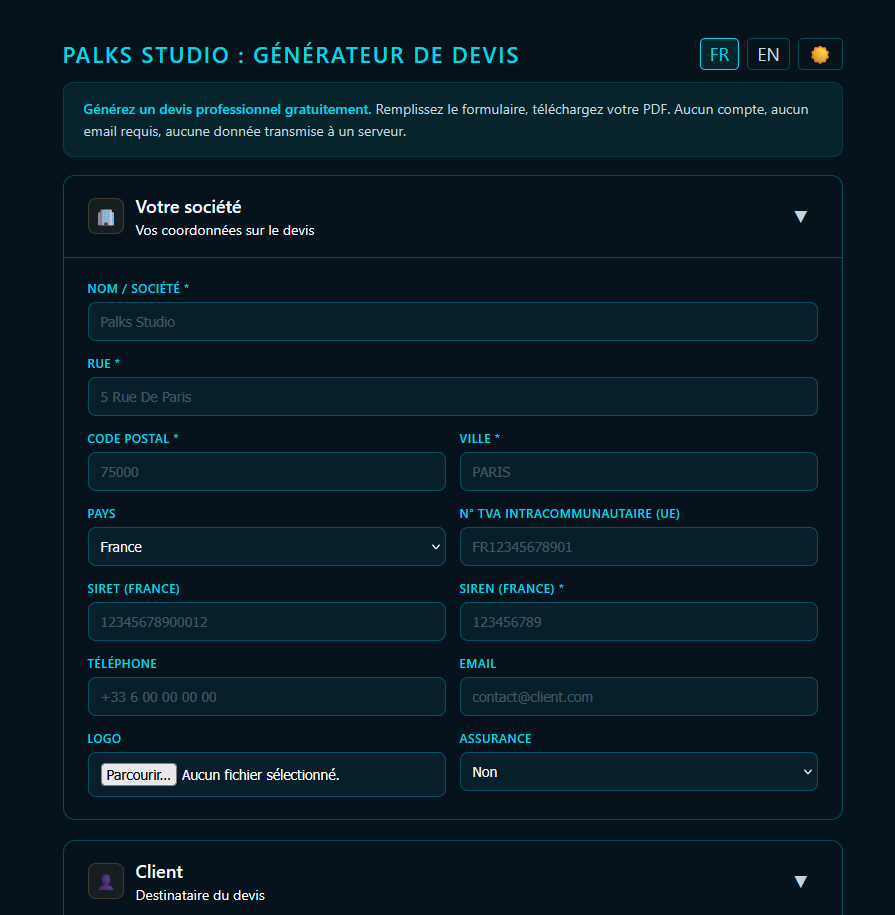

<p align="center">
  
</p>


[← Retour au sommaire](../README.md)

# Architecture d'un générateur de devis 100 % client-side en JavaScript : PDF, fiscalité internationale et confidentialité

Un générateur de devis n'a pas nécessairement besoin d'un backend, d'une base de données ou d'un système d'authentification.

Lorsque son objectif consiste à collecter des informations, appliquer des règles métier, calculer des montants et produire un document PDF, l'ensemble du traitement peut être réalisé directement dans le navigateur.

Cette approche devient particulièrement intéressante lorsque l'application doit prendre en charge plusieurs systèmes fiscaux, des devises différentes, des opérations internationales et des documents bilingues, sans transmettre les données de l'utilisateur à un serveur.

Cet article présente l'architecture d'un générateur de devis destiné aux entreprises et indépendants établis en France et aux États-Unis, développé en HTML, CSS et JavaScript vanilla, avec génération PDF côté client.

---

## 1. Une architecture sans backend

L'application repose sur un fichier HTML unique regroupant l'interface, les styles, la logique métier et la génération documentaire.

```text
index.html
│
├── Interface utilisateur
├── Styles CSS
├── Logique JavaScript
├── Règles fiscales
├── Calculs des montants
└── Génération PDF
```

Il ne s'agit pas de six fichiers distincts, mais des différentes responsabilités regroupées au sein de la même page.

La stack technique reste volontairement limitée :

| Technologie        | Responsabilité                           |
|--------------------|------------------------------------------|
| HTML               | Structure du formulaire                  |
| CSS                | Présentation et mise en page             |
| JavaScript vanilla | Traitement des données et logique métier |
| jsPDF              | Génération du document PDF               |
| DM Sans / DM Mono  | Typographie                              |

Aucun framework JavaScript, aucune installation NPM et aucune étape de compilation ne sont nécessaires.

Le serveur web sert uniquement à distribuer l'application. Il ne participe ni aux calculs ni à la génération des devis.

```text
Serveur web
     │
     │ Chargement de la page
     ▼
Navigateur
     │
     ├── Saisie des données
     ├── Calculs
     ├── Règles fiscales
     └── Génération PDF
              │
              ▼
       Téléchargement local
```

Le navigateur constitue ainsi l'environnement d'exécution complet de l'application.

---

## 2. Gestion des données et calculs dynamiques

L'interface permet de renseigner les informations de l'émetteur, celles du client, les prestations, les quantités, les prix et les paramètres fiscaux.

Les lignes de prestations sont dynamiques. L'utilisateur peut en ajouter ou en supprimer, tandis que JavaScript recalcule les montants correspondants.

La logique de calcul doit rester cohérente entre l'interface et le document final.

Un modèle conceptuel de données pourrait être représenté ainsi :

```javascript
const quote = {
    issuer: {
        country: "FR"
    },
    client: {
        country: "FR",
        type: "business"
    },
    currency: "EUR",
    language: "fr",
    items: [
        {
            description: "Development services",
            quantity: 2,
            unitPrice: 500
        }
    ]
};
```

Cet exemple illustre les différentes catégories de données nécessaires au traitement. Il ne constitue pas un extrait du code source de l'application.

Le calcul d'une ligne repose notamment sur la quantité et le prix unitaire :

```javascript
const quantity = 2;
const unitPrice = 500;
const taxRate = 20;

const subtotal = quantity * unitPrice;
const tax = subtotal * taxRate / 100;
const total = subtotal + tax;
```

Dans cet exemple, le montant hors taxes est de 1 000 €, la taxe de 200 € et le total de 1 200 €.

Ce calcul élémentaire ne représente toutefois qu'une partie de la logique métier. Avant de calculer une taxe, le système doit déterminer si elle est applicable au contexte de l'opération.

La gestion des montants monétaires impose également une attention particulière aux arrondis. JavaScript utilise des nombres à virgule flottante, ce qui peut introduire des écarts de précision.

Une architecture financière doit donc définir une politique d'arrondi cohérente, notamment entre les montants affichés, les totaux calculés et le PDF généré.

---

## 3. Deux pays émetteurs, plusieurs contextes fiscaux

La principale complexité du générateur ne réside pas dans la production du PDF, mais dans l'adaptation du document au contexte métier.

L'application prend en charge deux pays d'établissement pour l'émetteur :

- La France
- Les États-Unis

Le pays du client peut être différent de celui de l'émetteur. Le générateur doit donc distinguer le pays d'établissement, la destination de l'opération, le type de client et la nature de la prestation.

```text
Pays de l'émetteur
         │
         ▼
Pays et type du client
         │
         ▼
Nature de l'opération
         │
         ▼
Contexte fiscal
         │
         ├── Taxe applicable
         ├── Taux à utiliser
         └── Mentions à afficher
```

Ces informations influencent aussi bien les calculs que le contenu du document.

Le pays de l'émetteur ne doit pas être confondu avec la langue de l'interface ou la devise du devis. Ces paramètres représentent des responsabilités distinctes.

---

## 4. Gestion des émetteurs français

Pour un émetteur établi en France, le générateur adapte les champs d'identification et les règles fiscales au contexte sélectionné.

Il prend notamment en charge :

- Les identifiants SIREN, SIRET et TVA intracommunautaire
- La TVA française
- La franchise en base de TVA
- Les opérations intracommunautaires
- L'autoliquidation lorsque les conditions applicables sont réunies
- Les opérations avec des clients situés hors de l'Union européenne

La logique fiscale ne consiste donc pas simplement à ajouter un pourcentage au montant hors taxes.

Une prestation domestique soumise à la TVA et une prestation B2B intracommunautaire relevant de l'autoliquidation peuvent produire des documents dont les montants et les mentions diffèrent.

Dans le second cas, l'absence de TVA facturée par l'émetteur doit être accompagnée de la mention correspondant au traitement fiscal retenu.

Le moteur doit ainsi produire un résultat cohérent entre plusieurs éléments :

```text
Contexte de facturation
          │
          ├── Identification de l'émetteur
          ├── Identification du client
          ├── Montant hors taxes
          ├── Traitement de la TVA
          └── Mentions fiscales
```

La prise en charge de la franchise en base nécessite également une logique distincte de celle d'une opération internationale non soumise à la TVA française.

Même lorsque deux devis présentent un montant de taxe identique, leur justification fiscale peut être différente.

---

## 5. Gestion des émetteurs américains

Pour un émetteur établi aux États-Unis, le générateur adapte les informations d'identification et le traitement des taxes.

L'identification repose notamment sur l'EIN, tandis que la facturation peut être réalisée en dollars américains.

La principale différence avec le système français concerne la Sales Tax.

Contrairement à une TVA nationale, les obligations et les taux de Sales Tax peuvent dépendre de plusieurs niveaux de juridiction, notamment l'État et les collectivités locales.

Le générateur ne cherche pas à déterminer automatiquement ces taux.

Pour les opérations domestiques prises en charge, l'utilisateur indique si l'émetteur est enregistré pour la Sales Tax et renseigne le taux applicable lorsque nécessaire.

Un exemple conceptuel de calcul pourrait être :

```javascript
const subtotal = 1000;
const salesTaxRate = 8.25;

const salesTax = subtotal * salesTaxRate / 100;
const total = subtotal + salesTax;
```

Résultat :

```text
Subtotal   : $1,000.00
Sales Tax  :    $82.50
Total      : $1,082.50
```

Le taux de 8,25 % est utilisé uniquement à titre d'exemple. Il ne correspond pas à un taux universel applicable aux États-Unis.

Cette séparation entre la détermination du taux et son application permet de conserver une architecture entièrement client-side, sans intégrer de service externe de recherche fiscale.

Le générateur prend également en charge certains contextes internationaux, notamment les prestations B2B vers l'Union européenne avec identification TVA.

L'objectif n'est pas de reproduire l'intégralité de la fiscalité américaine, mais de fournir les mécanismes nécessaires aux scénarios documentés, en laissant à l'utilisateur la responsabilité de renseigner les paramètres applicables.

---

## 6. Séparer la fiscalité, la langue et la devise

Une application internationale doit éviter de confondre trois dimensions différentes : le contexte fiscal, la langue et la devise.

Le générateur propose une interface et des documents PDF en français et en anglais, ainsi que cinq devises :

```text
EUR  Euro
USD  Dollar américain
GBP  Livre sterling
CHF  Franc suisse
CAD  Dollar canadien
```

Un émetteur français peut, par exemple, préparer un devis en anglais destiné à un client américain et exprimé en dollars.

```text
Émetteur : France
Client   : États-Unis
Langue   : Anglais
Devise   : USD
```

La langue détermine les libellés du document, tandis que la devise détermine la présentation des montants. Le traitement fiscal dépend du contexte de l'opération.

Le formatage des montants peut être réalisé à l'aide des fonctionnalités natives de JavaScript.

```javascript
const amount = 1250.50;

const formatted = new Intl.NumberFormat("en-US", {
    style: "currency",
    currency: "USD"
}).format(amount);

console.log(formatted);
```

Résultat :

```text
$1,250.50
```

Cet exemple illustre une fonctionnalité native du navigateur adaptée à ce type d'architecture.

Le choix d'une devise ne signifie pas qu'une conversion monétaire est effectuée. Le générateur permet d'exprimer les montants dans différentes devises, sans dépendre d'une API de taux de change.

---

## 7. Génération du PDF directement dans le navigateur

La génération documentaire repose sur jsPDF.

Cette bibliothèque permet de construire un document PDF à partir des données traitées en JavaScript, sans envoyer de requête à un moteur de rendu distant.

Le document final peut intégrer les informations de l'émetteur et du client, les prestations, les montants, les taxes, les mentions applicables et un bloc de signature « Bon pour accord ».

Le générateur permet également d'ajouter un logo personnalisé à partir de plusieurs formats d'image, notamment PNG, JPEG, SVG et WebP.

Le flux documentaire est le suivant :

```text
Données du formulaire
          │
          ▼
Calculs et règles métier
          │
          ▼
Préparation du document
          │
          ▼
        jsPDF
          │
          ▼
Document PDF généré
          │
          ▼
Téléchargement local
```

Un exemple minimal d'utilisation de jsPDF permet d'illustrer le principe :

```javascript
const { jsPDF } = window.jspdf;

const doc = new jsPDF();

doc.setFontSize(18);
doc.text("Quote", 20, 20);

doc.setFontSize(12);
doc.text("Development services", 20, 40);
doc.text("Total: EUR 1,200.00", 20, 50);

doc.save("quote.pdf");
```

Cet exemple suppose que la bibliothèque jsPDF est déjà chargée. Il illustre uniquement le mécanisme de génération locale, sans reproduire l'implémentation complète du générateur.

La construction d'un devis professionnel implique des contraintes supplémentaires : gestion des longueurs de texte, positionnement des éléments, pagination lorsque nécessaire, présentation des montants et cohérence des mentions fiscales.

La bibliothèque PDF intervient à la fin du traitement. Elle ne détermine pas les règles métier et ne calcule pas les taxes.

Cette séparation permet de faire évoluer la présentation du document sans modifier les règles fiscales.

---

## 8. Confidentialité par conception

L'absence de backend de traitement modifie directement le modèle de confidentialité.

Dans une application traditionnelle, les données d'un devis peuvent être transmises à un serveur pour être enregistrées, calculées ou converties en PDF.

Dans cette architecture, elles restent dans l'environnement du navigateur pendant leur traitement.

Le générateur ne nécessite aucune inscription, aucun compte utilisateur et aucun système d'authentification.

Il ne conserve pas les données du devis dans une base de données et n'utilise pas `localStorage` pour mémoriser les informations saisies.

```text
Saisie utilisateur
        │
        ▼
Mémoire du navigateur
        │
        ▼
Traitement JavaScript
        │
        ▼
Génération PDF
        │
        ▼
Téléchargement
        │
        ▼
Réinitialisation du formulaire
```

Après le téléchargement, le formulaire est automatiquement réinitialisé.

L'application ne conserve donc pas volontairement un historique des devis, des clients ou des tarifs.

Il faut néanmoins distinguer la confidentialité des données métier de la sécurité générale d'une application web.

Le chargement initial de la page et de ses ressources peut nécessiter des requêtes réseau. Une architecture client-side ne garantit pas, à elle seule, l'absence de toute communication externe.

La propriété essentielle du générateur est que les informations saisies pour construire le devis ne sont pas envoyées à un backend de traitement.

Cette approche réduit la quantité de données sensibles qu'un serveur doit recevoir, stocker et protéger.

---

## 9. Les avantages et les limites d'une application sans backend

Le choix d'une architecture entièrement client-side est adapté lorsque les opérations peuvent être réalisées localement et qu'aucune persistance distante n'est nécessaire.

Dans ce contexte, l'application évite plusieurs composants :

- Un serveur applicatif chargé de traiter les devis
- Une base de données clients
- Un système de comptes et de sessions
- Un moteur de génération PDF distant
- Une infrastructure de stockage des documents

Le déploiement peut reposer sur un hébergement statique, sans environnement d'exécution PHP, Node.js ou Python côté serveur.

Cette simplicité d'infrastructure ne signifie pas que la logique métier est simple. Les règles fiscales, les calculs, les devises et la génération documentaire restent des composants qui doivent être maintenus et testés.

Le choix présente également des limites.

Le générateur ne fournit pas d'historique des devis, de système de numérotation comptable centralisé, d'intégration avec un logiciel de facturation, de paiement ou de signature électronique.

Il ne détermine pas automatiquement les taux de Sales Tax selon l'État, le comté ou la juridiction américaine.

Enfin, la génération d'un devis ne constitue pas une validation fiscale ou juridique automatique de l'opération.

Ces fonctionnalités relèvent d'autres responsabilités et peuvent nécessiter une architecture différente, notamment lorsqu'il faut partager des données entre plusieurs utilisateurs ou conserver un état durable.

---

## Conclusion

Une application web peut intégrer une logique métier conséquente sans nécessiter de backend de traitement.

La prise en charge de deux pays émetteurs, de plusieurs contextes fiscaux, de cinq devises, de documents bilingues et de la génération PDF locale illustre ce que les navigateurs modernes permettent de réaliser avec JavaScript.

L'intérêt de cette architecture ne réside pas uniquement dans la réduction de l'infrastructure. Il réside également dans la séparation entre les règles métier, la présentation et la génération documentaire, tout en évitant de collecter des données qui n'ont pas besoin d'être transmises.

Pour un outil dont la responsabilité principale est de produire un document à partir de données saisies localement, le navigateur peut constituer à lui seul un environnement d'exécution suffisant.

---

## Démonstration et documentation technique

Le générateur est accessible directement dans le navigateur, sans inscription ni installation.

[Tester le générateur de devis](https://palks-studio.com/fr/generateur-devis)

## Pour aller plus loin

Retrouvez également cet article technique en anglais sur DEV.to, consacré à l'architecture d'un générateur de devis en JavaScript, à la génération de PDF côté navigateur, à la gestion des règles fiscales internationales et aux choix techniques permettant de préserver la confidentialité des données sans backend.

👉 [Client-Side Quote Generator Architecture in JavaScript: PDF Generation, International Tax Rules, and Privacy](https://dev.to/palks_studio/building-a-free-quote-generator-with-no-backend-pdf-generated-in-the-browser-4f5m) (DEV.to, en anglais)

---

https://palks-studio.com