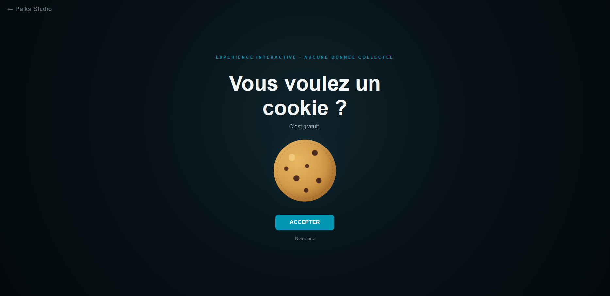

<p align="center">
  
</p>


[← Retour au sommaire](../README.md)

# Concevoir des expériences interactives en JavaScript natif pour comprendre les systèmes techniques

Une interface utilisateur montre généralement le résultat d'une action, mais rarement tout ce qui se passe derrière.

Un clic sur un bouton de connexion peut déclencher plusieurs contrôles de sécurité. Une requête API peut nécessiter des validations, des transformations et une gestion des erreurs. Une facture électronique peut contenir des données structurées invisibles dans sa représentation PDF.

Pour comprendre ces mécanismes, une documentation technique est utile, mais elle ne permet pas toujours de suivre facilement l'enchaînement des opérations.

Une autre approche consiste à représenter ces processus sous forme d'expériences interactives.

L'utilisateur déclenche une action, observe les différentes étapes et découvre progressivement les mécanismes techniques associés.

Cet article présente l'architecture d'une collection de six expériences interactives développées avec HTML, CSS et JavaScript natifs, sans framework frontend.

---

## 1. Rendre visible un processus normalement invisible

Prenons un exemple simple : une authentification.

Du point de vue de l'utilisateur, le processus peut se résumer à trois actions :

```text
Saisir ses identifiants
         │
         ▼
Cliquer sur « Connexion »
         │
         ▼
Accéder à son espace
```

Du point de vue du système, cette même opération peut impliquer plusieurs mécanismes supplémentaires :

```text
Requête d'authentification
         │
         ▼
Validation des données
         │
         ▼
Vérification des identifiants
         │
         ▼
Contrôles de sécurité
         │
         ▼
Création ou renouvellement de session
         │
         ▼
Réponse à l'utilisateur
```

L'objectif d'une expérience interactive est de rendre ces étapes compréhensibles sans imposer à l'utilisateur la lecture préalable de toute l'architecture.

Il ne s'agit pas nécessairement de reproduire un système réel, mais de représenter les opérations qui peuvent intervenir dans son fonctionnement.

Cette distinction permet de créer des simulations légères tout en conservant une explication techniquement pertinente.

---

## 2. Une architecture frontend sans framework

Les expériences reposent sur trois technologies natives du navigateur :

| Technologie | Responsabilité                         |
|-------------|----------------------------------------|
| HTML        | Structure et contenu de l'expérience   |
| CSS         | Présentation et états visuels          |
| JavaScript  | Interactions et évolution du parcours  |

Le projet ne nécessite pas de framework frontend.

Chaque expérience possède sa propre interface et sa propre logique interactive, tout en partageant un socle visuel commun.

La structure publique documentée est la suivante :

```text
interactive-experiences/
│
├── README.md
├── LICENSE
│
├── assets/
│   └── interactive.css
│
├── fr/
│   ├── cookies.html
│   ├── automatisation.html
│   ├── securite.html
│   ├── facturx.html
│   ├── from-scratch.html
│   └── api-interactive.html
│
└── en/
    ├── cookies.html
    ├── automation.html
    ├── security.html
    ├── facturx.html
    ├── from-scratch.html
    └── api-interactive.html
```

Cette organisation sépare les expériences et les langues, tout en mutualisant la présentation visuelle.

La documentation publique décrit l'architecture du projet, mais ne distribue pas les fichiers de production.

---

## 3. Représenter une expérience comme une succession d'états

Une expérience interactive peut être modélisée comme une succession d'états.

Chaque état représente une étape du processus étudié.

Par exemple, une simulation de requête API pourrait suivre cette progression :

```text
État initial
     │
     ▼
Requête envoyée
     │
     ▼
Données validées
     │
     ▼
Traitement effectué
     │
     ▼
Réponse reçue
```

Une représentation JavaScript simplifiée pourrait prendre cette forme :

```javascript
const steps = [
    {
        id: "request",
        title: "Envoi de la requête",
        description: "Le client transmet les données."
    },
    {
        id: "validation",
        title: "Validation",
        description: "Le serveur contrôle les données."
    },
    {
        id: "processing",
        title: "Traitement",
        description: "La logique métier est exécutée."
    },
    {
        id: "response",
        title: "Réponse",
        description: "Le serveur retourne un résultat."
    }
];
```

Ces données décrivent les étapes indépendamment de leur représentation visuelle.

Une fonction peut ensuite afficher l'étape courante :

```javascript
let currentStep = 0;

function renderStep() {
    const step = steps[currentStep];

    document.querySelector("#step-title").textContent =
        step.title;

    document.querySelector("#step-description").textContent =
        step.description;
}
```

Un bouton permet de passer à l'étape suivante :

```javascript
document.querySelector("#next")
    .addEventListener("click", () => {
        if (currentStep < steps.length - 1) {
            currentStep++;
            renderStep();
        }
    });
```

Cet exemple est pédagogique. Il illustre une manière de construire un parcours interactif en JavaScript natif, sans reproduire le code de production des expériences.

L'intérêt de cette approche est de séparer le contenu explicatif, l'état courant et la mise à jour de l'interface.

---

## 4. From scratch ou préconstruit : visualiser les compromis architecturaux

La première expérience compare deux manières de répondre à un même besoin : construire un système à partir de composants natifs ou utiliser une solution préconstruite.

Ces deux approches peuvent produire un résultat fonctionnel comparable, mais elles ne répartissent pas la complexité de la même manière.

```text
Même besoin
     │
     ├── Construction sur mesure
     │       ├── Choix des composants
     │       ├── Implémentation des règles
     │       └── Maintenance directe
     │
     └── Solution préconstruite
             ├── Fonctionnalités existantes
             ├── Configuration
             └── Adaptation aux contraintes
```

Une expérience interactive permet de comparer les deux parcours en révélant progressivement leurs implications.

| Critère      | Sur mesure              | Préconstruit              |
|--------------|-------------------------|---------------------------|
| Démarrage    | Construction du système | Fonctionnalités initiales |
| Architecture | Choix des composants    | Structure existante       |
| Évolution    | Adaptation directe      | Extensions possibles      |
| Maintenance  | Responsabilité interne  | Dépendances à maintenir   |

L'objectif n'est pas de présenter une approche comme systématiquement supérieure à l'autre.

Une solution préconstruite peut réduire considérablement le temps de développement. Une construction sur mesure peut offrir davantage de liberté lorsque les besoins sont spécifiques.

Dans les deux cas, la complexité existe. Elle se trouve simplement à des endroits différents.

---

## 5. API et intégration : suivre une requête entre deux systèmes

Une API est souvent présentée à travers un exemple très court :

```javascript
const response = await fetch("/api/example");
const data = await response.json();
```

Pourtant, ces deux lignes peuvent masquer une succession d'opérations.

```text
Client
  │
  ├── Construction de la requête
  ├── Envoi des données
  │
  ▼
Serveur
  │
  ├── Authentification éventuelle
  ├── Validation
  ├── Autorisation
  ├── Traitement métier
  │
  ▼
Réponse HTTP
  │
  ├── Code de statut
  ├── Données
  └── Gestion des erreurs
```

L'expérience consacrée aux API et à l'intégration permet de suivre ce type de parcours et de comprendre les opérations qui peuvent intervenir entre deux systèmes.

### Introduire des chemins alternatifs

Un processus technique ne suit pas toujours un chemin linéaire.

Une requête peut être refusée, contenir des données invalides ou échouer pendant son traitement.

Une simulation peut représenter ces situations avec plusieurs branches :

```text
Requête reçue
      │
      ▼
Données valides ?
      │
      ├── Non → Réponse 400
      │
      └── Oui
            │
            ▼
       Traitement
            │
            ├── Échec → Réponse 500
            │
            └── Succès → Réponse 200
```

Les codes HTTP présentés ici constituent des exemples génériques.

Leur utilisation réelle dépend de la nature de la requête et de l'erreur rencontrée.

Cette représentation permet de montrer qu'une intégration ne consiste pas uniquement à transmettre des données. Elle implique aussi de définir le comportement des systèmes lorsque les opérations ne se déroulent pas comme prévu.

---

## 6. Automatisation : décomposer une tâche en opérations techniques

Une tâche automatisée peut sembler simple lorsqu'elle est décrite par son résultat.

Par exemple :

```text
Générer automatiquement un document
```

Mais une implémentation réelle peut nécessiter plusieurs opérations :

```text
Récupérer les données
         │
         ▼
Vérifier les informations
         │
         ▼
Appliquer les règles métier
         │
         ▼
Générer le document
         │
         ▼
Contrôler le résultat
         │
         ▼
Enregistrer ou transmettre
```

L'expérience sur l'automatisation expose cette différence entre la tâche visible et le processus nécessaire pour l'exécuter.

Un scénario interactif peut également montrer ce qui se passe lorsqu'une condition n'est pas remplie.

```javascript
function validateInput(data) {
    if (!data.reference) {
        return {
            valid: false,
            reason: "Référence manquante"
        };
    }

    return {
        valid: true
    };
}
```

Cet exemple illustre une validation élémentaire.

Dans un système réel, les règles peuvent être beaucoup plus nombreuses et dépendre du contexte métier.

L'intérêt pédagogique est de montrer que l'automatisation ne consiste pas simplement à remplacer une action manuelle par un script.

Elle implique de formaliser les conditions d'exécution, les validations, les erreurs possibles et les résultats attendus.

---

## 7. Sécurité applicative : les mécanismes derrière une authentification

Une interface de connexion est généralement composée de quelques champs et d'un bouton.

La sécurité de l'application dépend pourtant de mécanismes qui ne sont pas directement visibles dans cette interface.

Une expérience interactive peut représenter plusieurs couches de contrôle.

| Mécanisme             | Responsabilité                         |
|-----------------------|----------------------------------------|
| Validation            | Contrôler les données reçues           |
| Authentification      | Vérifier les identifiants              |
| Limitation des essais | Réduire les tentatives abusives        |
| Gestion de session    | Maintenir un état authentifié          |
| Autorisation          | Contrôler les opérations accessibles   |

L'expérience consacrée à la sécurité applicative permet de découvrir les contrôles qui peuvent intervenir derrière une authentification.

### Authentification et autorisation

Ces deux notions sont souvent confondues.

L'authentification répond à la question :

```text
Qui est l'utilisateur ?
```

L'autorisation répond à une autre question :

```text
Quelles opérations peut-il effectuer ?
```

Un utilisateur correctement authentifié ne doit pas nécessairement avoir accès à toutes les ressources de l'application.

Une représentation interactive permet de rendre cette distinction visible en séparant les étapes.

```text
Identité vérifiée
       │
       ▼
Accès demandé
       │
       ▼
Permission suffisante ?
       │
       ├── Non → Accès refusé
       │
       └── Oui → Accès autorisé
```

Il s'agit ici d'une représentation pédagogique.

Une simulation exécutée dans le navigateur ne remplace pas les contrôles de sécurité qui doivent être appliqués côté serveur dans une application réelle.

---

## 8. Cookies et données personnelles : représenter les échanges invisibles

L'acceptation d'un cookie est une action simple du point de vue de l'utilisateur.

Cependant, les mécanismes associés peuvent varier considérablement selon le type de cookie, sa finalité et les services utilisés.

Un cookie peut servir à maintenir une session, mémoriser une préférence ou associer plusieurs interactions à un identifiant.

L'expérience consacrée aux cookies et aux données personnelles permet de suivre ce qui peut se produire après une acceptation, notamment lorsque des mécanismes de collecte, d'analyse ou de profilage sont impliqués.

Un parcours conceptuel peut être représenté ainsi :

```text
Action de l'utilisateur
         │
         ▼
Cookie ou identifiant
         │
         ▼
Association à des interactions
         │
         ▼
Analyse éventuelle
         │
         ▼
Profilage éventuel
```

Ce parcours ne signifie pas que tous les cookies déclenchent systématiquement ces opérations.

Les finalités, les informations collectées et les traitements dépendent de l'implémentation réelle.

### Distinguer le stockage du traitement

Un cookie n'est pas nécessairement un profil complet.

Il peut contenir un identifiant permettant à un système de retrouver des informations conservées ailleurs.

Par exemple :

```text
Cookie dans le navigateur
         │
         └── Identifiant : example-042
                         │
                         ▼
                 Système distant
                         │
                         └── Données associées
```

Cette distinction est importante pour comprendre pourquoi la taille ou le contenu apparent d'un cookie ne suffit pas à déterminer l'étendue d'un traitement de données.

L'expérience représente ces mécanismes sans avoir besoin de réaliser elle-même un véritable profilage de l'utilisateur.

---

## 9. Factur-X : explorer les deux représentations d'une facture

Une facture Factur-X constitue un autre exemple de mécanisme technique qui reste largement invisible à l'utilisateur.

Le document associe une représentation PDF/A-3 destinée à la lecture humaine et un fichier XML embarqué contenant des données structurées.

```text
Facture Factur-X
       │
       ├── PDF/A-3
       │       └── Représentation lisible
       │
       └── XML embarqué
               └── Données structurées
```

L'expérience Factur-X permet de découvrir cette double représentation et de comprendre pourquoi les informations doivent rester cohérentes.

Prenons un exemple simplifié.

Représentation visible :

```text
Quantité : 2
Prix unitaire HT : 100,00 €
Total HT : 200,00 €
```

Représentation XML illustrative :

```xml
<invoice>
    <quantity>2</quantity>
    <unitPrice>100.00</unitPrice>
    <total>200.00</total>
</invoice>
```

Ce fragment ne constitue pas un fichier XML Factur-X valide. Il représente uniquement le principe de données structurées associées à une facture.

### Visualiser une incohérence

Une expérience interactive peut montrer ce qui se produit lorsque les deux représentations ne contiennent pas les mêmes valeurs.

```text
PDF : Total HT = 200,00 €
XML : Total HT = 250,00 €
```

Les deux valeurs sont individuellement lisibles, mais elles décrivent différemment la même transaction.

La cohérence entre les représentations constitue donc un contrôle distinct de leur validité syntaxique.

| Contrôle             | Objectif                            |
|----------------------|-------------------------------------|
| Structure XML        | Vérifier le format des données      |
| Règles métier        | Contrôler les relations entre champs|
| Cohérence PDF / XML  | Comparer les informations communes  |
| Profil Factur-X      | Respecter les exigences applicables |

Une véritable validation Factur-X nécessite les spécifications et les outils adaptés au profil utilisé.

L'expérience interactive permet d'en comprendre le principe sans prétendre remplacer un moteur de validation complet.

---

## 10. Mutualiser la présentation sans uniformiser les expériences

Les six expériences abordent des sujets différents, mais elles peuvent partager des composants visuels communs.

Une étape d'authentification et une étape de validation de facture peuvent être représentées avec une structure similaire.

```html
<section class="experience-step">
    <h2>Validation</h2>

    <p>
        Le système contrôle les données reçues.
    </p>

    <button type="button">
        Étape suivante
    </button>
</section>
```

Une feuille CSS commune peut définir les éléments réutilisables :

```css
.experience-step {
    padding: 1.5rem;
    border: 1px solid #d1d5db;
    border-radius: 8px;
}

.experience-step h2 {
    margin-top: 0;
}

.experience-step button {
    padding: 0.75rem 1rem;
    cursor: pointer;
}
```

Ces exemples illustrent le principe de mutualisation visuelle, sans reproduire la feuille de style du projet.

Le partage d'une base CSS permet de conserver une cohérence entre les expériences sans imposer une logique JavaScript identique à tous les sujets.

Une expérience peut suivre un parcours linéaire, tandis qu'une autre peut proposer plusieurs choix, des comparaisons ou des résultats différents selon les actions de l'utilisateur.

---

## 11. Concevoir une interface bilingue

La collection propose des versions françaises et anglaises.

L'organisation du projet distingue les pages par langue tout en partageant la feuille de style.

```text
assets/
    └── interactive.css

fr/
    └── securite.html

en/
    └── security.html
```

Cette approche permet d'adapter les explications et les libellés sans reconstruire toute la présentation.

Pour une expérience interactive, la traduction ne concerne pas uniquement les titres.

Elle peut également concerner :

- Les instructions données à l'utilisateur
- Les descriptions des étapes
- Les messages d'erreur
- Les résultats affichés
- Les libellés des actions

Il est important que les deux versions conservent la même logique pédagogique.

Une étape traduite ne doit pas introduire un comportement technique différent simplement parce que son texte a été adapté.

---

## 12. Simulation pédagogique et système réel

Une distinction doit rester claire tout au long de la conception : une expérience interactive représente un mécanisme, mais ne l'exécute pas nécessairement dans des conditions réelles.

| Expérience          | Système réel correspondant       |
|---------------------|----------------------------------|
| Requête API simulée | Communication client-serveur     |
| Connexion simulée   | Authentification et sessions     |
| Cookie illustré     | Stockage et traitement de données|
| Facture explorée    | Génération et validation Factur-X|
| Tâche automatisée   | Exécution de règles métier       |

Une simulation peut afficher une réponse HTTP sans contacter de serveur.

Elle peut représenter un contrôle d'authentification sans gérer de véritables identifiants.

Elle peut montrer un processus de profilage sans collecter les données personnelles de l'utilisateur.

Cette séparation permet de construire des expériences légères et accessibles directement dans le navigateur.

Elle impose cependant une exigence de précision : les explications doivent indiquer ce qui relève de la représentation pédagogique et ce qui correspond aux contraintes d'une implémentation réelle.

---

## Conclusion

Les expériences interactives constituent une manière complémentaire d'expliquer les architectures et les mécanismes techniques.

En décomposant une opération en étapes, elles permettent de rendre visibles les validations, les échanges, les décisions et les erreurs qui restent habituellement derrière une interface.

HTML, CSS et JavaScript natifs suffisent à construire ce type de parcours sans introduire un framework frontend.

La difficulté principale ne réside pas nécessairement dans la technologie utilisée, mais dans la capacité à représenter correctement le processus étudié.

Une bonne expérience interactive ne doit pas seulement montrer ce qui se passe lorsque tout fonctionne. Elle doit aussi permettre de comprendre pourquoi certaines étapes sont nécessaires, quelles conditions peuvent modifier le résultat et où se situent les limites de la simulation.

C'est cette distinction entre l'action visible et les mécanismes sous-jacents qui rend l'approche particulièrement utile pour comprendre les systèmes techniques.

---

## Pour aller plus loin

Retrouvez également cet article technique en anglais sur DEV.to, consacré à la conception d'expériences interactives en JavaScript vanilla et aux choix techniques permettant de rendre des systèmes complexes plus accessibles et compréhensibles grâce à l'interactivité.

👉 [Building Interactive Experiences with Vanilla JavaScript to Explain Technical Systems](https://dev.to/palks_studio/building-interactive-experiences-with-vanilla-javascript-to-explain-technical-systems-3kj7) (DEV.to, en anglais)

---

https://palks-studio.com