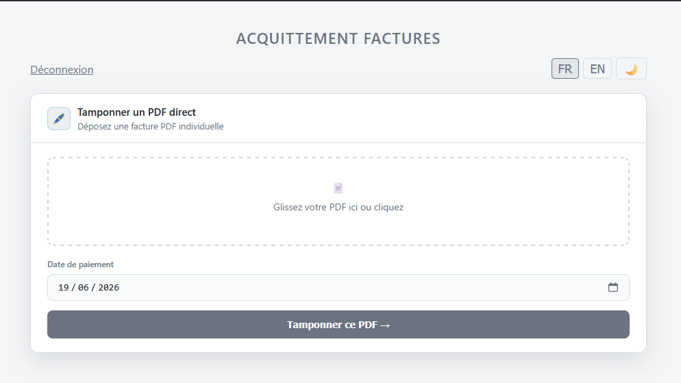

<p align="center">
  
</p>

[](https://www.php.net/)


[← Retour au sommaire](../README.md)

# Architecture d'un moteur d'acquittement de factures PDF en PHP : FPDI, traitement par lots et préservation des originaux

Une facture PDF représente généralement un document déjà généré, transmis et éventuellement archivé.

Lorsqu'un paiement intervient, il peut être nécessaire de produire une version acquittée de cette facture, avec une mention indiquant que le règlement a été effectué et la date correspondante.

Une approche consiste à modifier directement le document existant. Une autre consiste à générer un nouveau PDF à partir de l'original, en y superposant les informations d'acquittement.

Cette seconde approche permet de préserver le document initial tout en produisant un justificatif visuel distinct.

Cet article présente l'architecture d'un moteur d'acquittement de factures PDF développé en PHP, utilisant FPDI et FPDF pour le traitement des documents, avec prise en charge des fichiers individuels, des archives ZIP et de l'archivage local sans base de données.

---

## 1. Séparer la facture originale de son justificatif d'acquittement

Le premier principe architectural consiste à ne jamais modifier le fichier original.

Une facture reçue peut être conservée dans un système comptable, associée à une référence ou intégrée à un processus de facturation électronique.

Modifier directement ce document peut introduire plusieurs problèmes :

- Perte de la version initiale
- Modification d'un document déjà archivé
- Altération éventuelle de signatures ou de métadonnées
- Perte de certaines données embarquées

Le moteur repose donc sur une séparation entre le document source et le document généré.

```text
Facture originale
       │
       ▼
Importation du PDF
       │
       ▼
Génération d'une copie
       │
       ▼
Superposition du tampon
       │
       ▼
Facture acquittée
```

Le fichier original reste inchangé.

Le nouveau document contient une représentation visuelle de la facture, complétée par un tampon rouge « ACQUITTEE » et une date de paiement.

Cette séparation est particulièrement importante lorsqu'un PDF contient des données structurées ou des éléments qui ne sont pas visibles dans sa représentation graphique.

---

## 2. Architecture générale du moteur

Le moteur est conçu pour être déployé directement dans l'environnement du client.

Il repose sur une interface web protégée, un moteur PHP et des bibliothèques spécialisées dans le traitement des PDF.

Aucune base de données n'est nécessaire pour conserver les documents.

```text
Navigateur
    │
    ▼
Interface web protégée
    │
    ▼
Moteur PHP
    │
    ├── Authentification
    ├── Traitement des fichiers
    ├── Extraction des ZIP
    ├── Génération des PDF
    └── Archivage facultatif
    │
    ▼
Téléchargement du résultat
```

Les documents sont traités temporairement, puis téléchargés immédiatement.

Selon la configuration du déploiement, une copie acquittée peut également être conservée dans un dossier d'archivage local.

Le moteur constitue un module complémentaire à un système de facturation batch Factur-X EN16931, mais il peut fonctionner indépendamment du service principal après son installation.

---

## 3. Structure du projet

La structure publique documentée distingue l'interface, le moteur interne, les dépendances et les différents espaces de stockage.

```text
invoice-stamper/
│
├── temp_runtime/
│   └── .htaccess
│
├── dependencies/
├── paid_archives/
├── direct_archives/
├── logs/
│
├── access.php
├── stamper-engine.php
├── .htaccess
├── LICENCE.md
│
└── docs/
    └── README_FR.md
```

Chaque élément possède une responsabilité distincte.

| Élément               | Responsabilité                         |
|-----------------------|----------------------------------------|
| `access.php`          | Point d'entrée de l'interface web      |
| `stamper-engine.php`  | Authentification et traitement PDF     |
| `temp_runtime/`       | Fichiers temporaires de traitement     |
| `dependencies/`       | Bibliothèques Composer                 |
| `paid_archives/`      | Archives des factures du mode batch    |
| `direct_archives/`    | Archives des PDF du mode direct        |
| `logs/`               | Journaux d'erreurs                     |
| `.htaccess`           | Protection des ressources internes     |

Cette organisation sépare les fichiers nécessaires à l'exécution du moteur des documents manipulés pendant les traitements.

Elle distingue également les fichiers temporaires des archives destinées à être conservées.

La documentation publique présente cette architecture, mais ne distribue pas les fichiers de production.

---

## 4. FPDI et FPDF : importer puis reconstruire un document

Le traitement PDF repose sur deux bibliothèques complémentaires.

| Bibliothèque | Responsabilité                         |
|--------------|----------------------------------------|
| FPDI         | Importer les pages d'un PDF existant   |
| FPDF         | Générer un nouveau document PDF        |

FPDI permet d'importer les pages d'un document existant et de les utiliser comme modèles dans un nouveau PDF.

FPDF permet ensuite d'ajouter du texte, des formes et d'autres éléments graphiques.

Le principe est donc le suivant :

```text
PDF original
     │
     ▼
FPDI : importation des pages
     │
     ▼
FPDF : création du nouveau document
     │
     ▼
Ajout des informations d'acquittement
     │
     ▼
PDF généré
```

Il ne s'agit pas simplement d'ouvrir un fichier PDF pour modifier quelques octets.

Le moteur construit un nouveau document à partir du contenu graphique importé.

Cette distinction explique pourquoi certaines propriétés du PDF original peuvent ne pas être conservées dans le résultat.

---

## 5. Exemple pédagogique de superposition d'un tampon

Un exemple simplifié permet d'illustrer le fonctionnement de FPDI et FPDF.

```php
<?php

require 'vendor/autoload.php';

use setasign\Fpdi\Fpdi;

$pdf = new Fpdi();

$pageCount = $pdf->setSourceFile('invoice.pdf');

for ($page = 1; $page <= $pageCount; $page++) {
    $template = $pdf->importPage($page);
    $size = $pdf->getTemplateSize($template);

    $pdf->AddPage(
        $size['orientation'],
        [$size['width'], $size['height']]
    );

    $pdf->useTemplate($template);

    if ($page === 1) {
        $pdf->SetFont('Helvetica', 'B', 16);
        $pdf->SetTextColor(200, 0, 0);

        $pdf->SetXY(15, 15);
        $pdf->Cell(0, 8, 'ACQUITTEE');

        $pdf->SetFont('Helvetica', '', 10);
        $pdf->SetXY(15, 25);
        $pdf->Cell(0, 6, 'Paiement : 15/11/2026');
    }
}

$pdf->Output('F', 'invoice_paid.pdf');
```

Cet exemple est pédagogique. Il ne reproduit pas le moteur de production, ses chemins internes ni le positionnement exact de son tampon.

Il illustre plusieurs opérations importantes :

- Importer chaque page du document source
- Récupérer ses dimensions et son orientation
- Reproduire la page dans un nouveau document
- Ajouter une information graphique
- Enregistrer le résultat dans un fichier distinct

Dans cet exemple, le tampon est appliqué uniquement sur la première page.

Une implémentation réelle doit notamment tenir compte de la disposition du document pour éviter de superposer le tampon à des informations importantes.

Le fichier `invoice.pdf` n'est jamais réécrit. Seul le fichier `invoice_paid.pdf` est généré.

---

## 6. Préserver les dimensions et l'orientation des pages

Tous les documents PDF n'utilisent pas nécessairement le format A4 en orientation portrait.

Une facture peut comporter plusieurs pages, des dimensions différentes ou une orientation paysage.

Il est donc préférable de récupérer les caractéristiques de chaque page importée.

```php
$template = $pdf->importPage($page);

$size = $pdf->getTemplateSize($template);

$pdf->AddPage(
    $size['orientation'],
    [$size['width'], $size['height']]
);
```

Cette approche évite d'imposer arbitrairement un format de page au document généré.

Le positionnement du tampon constitue une autre question.

Un emplacement fixe peut convenir à une facture produite par un moteur connu, mais devenir problématique avec un document provenant d'un autre système.

Dans un moteur acceptant des PDF externes, plusieurs contraintes doivent être prises en compte :

| Contrainte       | Risque                                 |
|------------------|----------------------------------------|
| Format de page   | Décalage ou redimensionnement          |
| Orientation      | Positionnement incorrect du tampon     |
| Contenu existant | Superposition sur une donnée importante|
| Nombre de pages  | Application sur une page non pertinente|

Ces considérations illustrent les contraintes générales du traitement PDF. Elles ne supposent pas l'existence d'un algorithme automatique de détection des zones libres dans le moteur présenté.

---

## 7. Deux modes de traitement : direct et batch

Le moteur propose deux modes de fonctionnement.

Le premier traite directement un document PDF individuel.

Le second traite une archive mensuelle contenant plusieurs factures.

```text
Moteur d'acquittement
          │
          ├── Mode direct
          │       └── PDF individuel
          │
          └── Mode batch
                  ├── ZIP mensuel
                  ├── Liste des factures
                  ├── Acquittement individuel
                  └── Acquittement groupé
```

Les deux modes utilisent le même principe de génération PDF, mais ils ne manipulent pas les documents de la même manière.

### Mode direct

L'utilisateur dépose un fichier PDF, renseigne une date de paiement et télécharge le document acquitté.

```text
Dépôt du PDF
      │
      ▼
Saisie de la date de paiement
      │
      ▼
Validation
      │
      ▼
Génération du PDF acquitté
      │
      ▼
Téléchargement
```

Ce mode n'est pas limité aux factures produites par le système de facturation batch.

Il accepte des PDF provenant d'autres systèmes, sous réserve que leurs caractéristiques soient compatibles avec les bibliothèques utilisées.

### Mode batch

Le mode batch commence par le dépôt d'une archive ZIP mensuelle.

Le moteur détecte les factures et présente une liste contenant notamment le client, la référence de facture et la période.

L'utilisateur peut ensuite acquitter une facture individuellement ou sélectionner plusieurs documents.

Cette distinction permet de conserver un parcours simple pour les traitements ponctuels, tout en prenant en charge des volumes de documents plus importants.

---

## 8. Traitement d'une archive ZIP mensuelle

Le traitement batch ajoute une couche d'orchestration autour du moteur PDF.

```text
Archive ZIP mensuelle
          │
          ▼
Extraction temporaire
          │
          ▼
Détection des factures
          │
          ▼
Présentation de la liste
          │
          ▼
Sélection des documents
          │
          ▼
Génération des PDF acquittés
          │
          ▼
Construction de l'archive de sortie
```

L'archive d'entrée n'est pas nécessairement identique à l'archive de sortie.

Le résultat ne contient que les documents sélectionnés et acquittés, organisés par référence client.

La structure de sortie documentée est la suivante :

```text
factures_acquittees.zip
│
└── clientRef/
    ├── F-2025-001_ACQUITTEE.pdf
    └── F-2025-002_ACQUITTEE.pdf
```

Cette organisation facilite la transmission des documents au système de facturation batch.

Elle permet également de conserver une association lisible entre chaque facture et son client, sans nécessiter de base de données supplémentaire.

---

## 9. Extraction ZIP et sécurité des fichiers

L'extraction d'une archive fournie par un utilisateur constitue une opération sensible.

Une archive peut contenir des fichiers inattendus, des chemins relatifs ou des volumes de données très importants.

Par exemple, une entrée ZIP pourrait porter un nom comme :

```text
../../outside.php
```

Une extraction insuffisamment contrôlée pourrait permettre d'écrire un fichier en dehors du répertoire prévu. Cette catégorie de vulnérabilité est généralement appelée Zip Slip.

Une stratégie consiste à contrôler chaque entrée avant son extraction.

```php
function isSafeZipEntry(string $name): bool
{
    $name = str_replace('\\', '/', $name);

    if (
        str_starts_with($name, '/') ||
        preg_match('/^[a-zA-Z]:/', $name)
    ) {
        return false;
    }

    $parts = explode('/', $name);

    return !in_array('..', $parts, true);
}
```

Cet exemple illustre un contrôle élémentaire des chemins.

Il ne constitue pas une protection complète et ne reproduit pas les contrôles internes du moteur.

Une implémentation robuste doit également considérer les types d'entrées, les liens symboliques, les limites de taille, le nombre de fichiers et la taille totale après décompression.

Le moteur documenté utilise un espace temporaire dédié à l'extraction et à la génération des documents, avec une protection contre les accès directs depuis le web.

---

## 10. Acquittement individuel et sélection multiple

Le mode batch permet de traiter une facture à la fois ou plusieurs documents avec une date commune.

D'un point de vue architectural, il est possible de séparer le traitement d'un document de l'orchestration du lot.

```text
Sélection des factures
          │
          ▼
Validation de la date
          │
          ▼
Pour chaque facture
          │
          ├── Importation du PDF
          ├── Génération du tampon
          └── Création du document
          │
          ▼
Préparation du résultat
```

Un modèle conceptuel de sélection pourrait être représenté ainsi :

```json
{
    "payment_date": "2026-11-15",
    "invoices": [
        {
            "reference": "F-2026-001",
            "client": "CLIENT-A"
        },
        {
            "reference": "F-2026-002",
            "client": "CLIENT-A"
        }
    ]
}
```

Ce JSON est illustratif. Il ne correspond pas à un format d'échange public du moteur.

La date commune est utilisée pour les documents sélectionnés.

Dans une application réelle, les références reçues depuis le navigateur doivent être vérifiées côté serveur afin de s'assurer qu'elles correspondent effectivement aux documents accessibles dans le lot en cours.

Une référence fournie par le client ne doit pas être interprétée directement comme un chemin de fichier.

---

## 11. Génération de l'archive ZIP côté navigateur

Le projet utilise également JSZip pour la génération de l'archive ZIP côté client.

Cette bibliothèque permet de construire une archive directement dans le navigateur à partir de fichiers déjà disponibles.

Un exemple pédagogique pourrait prendre cette forme :

```javascript
const zip = new JSZip();

const clientFolder = zip.folder("CLIENT-A");

clientFolder.file(
    "F-2026-001_ACQUITTEE.pdf",
    firstPdfBlob
);

clientFolder.file(
    "F-2026-002_ACQUITTEE.pdf",
    secondPdfBlob
);

const archive = await zip.generateAsync({
    type: "blob"
});
```

Le résultat peut ensuite être proposé au téléchargement :

```javascript
const url = URL.createObjectURL(archive);

const link = document.createElement("a");

link.href = url;
link.download = "factures_acquittees.zip";

document.body.appendChild(link);
link.click();
link.remove();

setTimeout(() => {
    URL.revokeObjectURL(url);
}, 1000);
```

Ces exemples supposent que les documents PDF générés sont déjà disponibles sous forme de `Blob`.

Ils illustrent le principe de création d'une archive côté navigateur, sans reproduire le protocole utilisé par le moteur pour transmettre les documents.

Cette approche distingue deux responsabilités :

```text
Serveur PHP
    └── Génération des PDF acquittés

Navigateur
    └── Assemblage de l'archive ZIP
```

La génération côté client ne signifie pas que l'ensemble du traitement PDF est réalisé localement dans le navigateur. Les PDF sont traités par le moteur PHP dans l'environnement du client.

JSZip est chargé depuis un CDN dans l'architecture documentée. Le fonctionnement de cette dépendance peut donc nécessiter un accès réseau, sauf si elle est hébergée localement dans une autre configuration.

---

## 12. Factur-X : préserver l'original ne signifie pas préserver le XML dans la copie

Le moteur est initialement conçu comme un complément à un système de facturation batch Factur-X EN16931.

Cette particularité introduit une contrainte importante.

Une facture Factur-X associe deux représentations :

```text
Facture Factur-X originale
          │
          ├── PDF/A-3
          │       └── Document lisible
          │
          └── XML embarqué
                  └── Données structurées
```

Lorsqu'un moteur importe les pages du PDF pour générer un nouveau document, il peut reproduire leur apparence sans conserver l'ensemble des éléments internes du fichier original.

```text
Factur-X originale
          │
          ▼
Importation des pages PDF
          │
          ▼
Reconstruction graphique
          │
          ▼
PDF acquitté
```

Le document généré peut donc conserver l'apparence de la facture sans conserver son XML embarqué.

Il peut également ne plus satisfaire aux exigences PDF/A-3 du document source.

Le moteur ne garantit pas la conservation des données XML Factur-X dans les PDF retraités.

Cette limite doit rester explicite.

| Document          | Rôle                                   |
|-------------------|----------------------------------------|
| Factur-X originale| Facture et données structurées         |
| PDF acquitté      | Justificatif visuel de paiement        |

Le PDF acquitté ne doit donc pas être présenté automatiquement comme une nouvelle facture Factur-X conforme.

Pour produire un véritable document Factur-X modifié, il faudrait notamment préserver ou reconstruire les éléments requis, vérifier la cohérence des données et valider le résultat selon les spécifications applicables.

Ce n'est pas l'objectif du moteur d'acquittement présenté ici.

---

## 13. Fichiers temporaires et archivage local

Le moteur distingue deux catégories de stockage.

Les fichiers temporaires sont nécessaires pendant l'extraction des archives et la génération des documents.

Les archives acquittées correspondent aux copies conservées lorsque l'archivage est activé.

```text
Stockage local
     │
     ├── temp_runtime/
     │       ├── Extraction ZIP
     │       └── Génération PDF
     │
     ├── paid_archives/
     │       └── Documents du mode batch
     │
     └── direct_archives/
             └── Documents du mode direct
```

Les fichiers temporaires sont supprimés après traitement.

L'archivage éventuel reste séparé de cet espace de travail.

Cette séparation évite de confondre les documents nécessaires à une opération en cours avec ceux qui doivent être conservés durablement.

### Isoler les traitements

Dans un moteur manipulant plusieurs documents, l'utilisation d'un espace de travail distinct pour chaque traitement constitue une approche possible.

Par exemple :

```php
$jobId = bin2hex(random_bytes(16));

$workDir = sys_get_temp_dir()
    . DIRECTORY_SEPARATOR
    . 'invoice-' . $jobId;

if (!mkdir($workDir, 0700)) {
    throw new RuntimeException(
        'Impossible de créer le dossier temporaire.'
    );
}
```

Cet exemple illustre une stratégie générique d'isolation des traitements.

Il ne décrit pas le mécanisme exact utilisé dans `temp_runtime/`.

L'isolation peut limiter les collisions de noms entre deux traitements simultanés et faciliter la suppression des fichiers associés à une opération particulière.

Un nettoyage fiable doit également tenir compte des erreurs et des interruptions de traitement.

---

## 14. Fonctionnement sans base de données

Le moteur n'utilise pas de base de données pour conserver les documents.

Les fichiers PDF et les archives ZIP constituent les principaux éléments manipulés.

```text
Entrées
    ├── PDF individuel
    └── Archive ZIP

Traitement
    ├── Fichiers temporaires
    ├── Informations de paiement
    └── Génération PDF

Sorties
    ├── PDF acquitté
    ├── ZIP structuré
    └── Archive locale facultative
```

Cette architecture convient à un outil dont la responsabilité principale est de transformer des documents existants.

Elle évite d'introduire une couche de stockage relationnel uniquement pour conserver des fichiers.

Cependant, une architecture sans base de données ne signifie pas une absence de gestion d'état.

L'authentification, les sessions, les fichiers temporaires et les traitements en cours nécessitent toujours des mécanismes adaptés.

Si le périmètre évoluait vers un suivi complet des paiements, des recherches complexes ou un historique transactionnel partagé, les besoins de stockage pourraient devenir différents.

Le choix architectural dépend donc de la responsabilité réelle du moteur.

---

## 15. Authentification et protection des ressources internes

L'interface est protégée par mot de passe.

Le moteur documente plusieurs mécanismes de sécurité :

- Protection contre les tentatives de brute force
- Gestion sécurisée des sessions
- Protection contre les accès non autorisés aux fichiers
- Validation des données de paiement
- Suppression des fichiers temporaires
- Contrôle des réponses HTTP

La séparation entre le point d'entrée public et le moteur interne constitue une autre mesure architecturale.

```text
Navigateur
    │
    ▼
access.php
    │
    ▼
Moteur interne
    │
    ├── Dépendances
    ├── Fichiers temporaires
    └── Archives
```

Les règles `.htaccess` permettent notamment de bloquer les accès directs aux ressources internes dans un environnement Apache correctement configuré.

Une protection par mot de passe ne suffit pas si les fichiers traités restent accessibles directement par leur URL.

Les contrôles doivent donc s'appliquer aussi bien à l'interface qu'aux ressources manipulées.

### Validation de la date de paiement

Une date reçue depuis un formulaire doit être validée côté serveur.

Un exemple générique en PHP pourrait être :

```php
function validatePaymentDate(string $value): bool
{
    $date = DateTimeImmutable::createFromFormat(
        '!Y-m-d',
        $value
    );

    return $date !== false
        && $date->format('Y-m-d') === $value;
}
```

Cette vérification contrôle le format et la validité calendaire de la date.

Elle ne suffit pas à établir qu'un paiement a réellement été effectué.

Les règles métier, comme l'acceptation ou non d'une date future, doivent être définies séparément selon les besoins du système.

---

## 16. Un tampon d'acquittement n'est pas une confirmation bancaire

Le moteur produit un document portant une mention d'acquittement à partir d'une date renseignée par l'utilisateur.

Cette opération doit être distinguée d'un système de vérification automatique des paiements.

```text
Paiement effectué
        │
        ▼
Date renseignée par l'utilisateur
        │
        ▼
Génération du justificatif visuel
```

Le moteur ne vérifie pas nécessairement l'existence d'une transaction bancaire.

Il ne réalise pas non plus, par cette seule opération, un rapprochement comptable ou une confirmation indépendante du règlement.

| Opération            | Responsabilité                         |
|----------------------|----------------------------------------|
| Vérification bancaire| Établir la réalité du paiement         |
| Rapprochement        | Associer le paiement à une facture     |
| Acquittement visuel  | Produire un document portant la mention|
| Archivage            | Conserver le document généré           |

Cette distinction permet de définir précisément le périmètre de l'outil.

Le moteur transforme un document à partir d'une information de paiement fournie. Il ne constitue pas à lui seul un système complet de gestion financière.

---

## 17. Dépendances et environnement d'exécution

Le moteur repose sur PHP 8.0 ou supérieur.

Les prérequis documentés comprennent :

| Composant | Utilisation                            |
|-----------|----------------------------------------|
| PHP 8.0+  | Exécution du moteur                    |
| `zip`     | Manipulation des archives ZIP          |
| `mbstring`| Traitement des chaînes multioctets     |
| Composer  | Gestion des dépendances PHP            |
| FPDI      | Importation des pages PDF              |
| FPDF      | Génération des documents PDF           |
| JSZip     | Construction des ZIP côté navigateur   |

Le moteur est conçu pour être installé dans l'environnement du client.

Il ne nécessite pas de base de données ni de connexion permanente au service de facturation principal après installation.

Les dépendances PHP sont conservées dans un dossier dédié.

La documentation publique présente les composants et les principes de fonctionnement, sans fournir de procédure d'installation publique ni les fichiers de production.

---

## Conclusion

Un moteur d'acquittement de factures PDF ne se résume pas à l'ajout d'un texte rouge sur un document.

Il doit distinguer le fichier original de la copie générée, importer correctement les pages, traiter les documents individuels et les archives, contrôler les données reçues et gérer le cycle de vie des fichiers temporaires.

FPDI et FPDF permettent de construire une architecture relativement légère autour de la reconstruction PDF. JSZip complète le traitement par lots en permettant l'assemblage d'une archive côté navigateur.

L'absence de base de données reste cohérente avec un moteur spécialisé dans la transformation de documents et leur archivage local facultatif.

La limite concernant Factur-X demeure essentielle : préserver la facture originale ne signifie pas que la copie acquittée conserve automatiquement ses données XML ou sa conformité PDF/A-3.

La responsabilité du moteur est donc clairement définie : produire un justificatif visuel d'acquittement distinct, sans modifier le document source.

---

## Pour aller plus loin

Retrouvez également cet article technique en anglais sur DEV.to, consacré à l'architecture d'un moteur d'acquittement de factures en PHP, à l'utilisation de FPDI, au traitement individuel et par lots des documents PDF, ainsi qu'aux choix techniques permettant de préserver les factures originales lors de l'ajout d'une mention de paiement.

👉 [PHP Invoice Payment Stamping Engine Architecture: FPDI, Batch Processing, and Original Document Preservation](https://dev.to/palks_studio/php-invoice-payment-stamping-engine-architecture-fpdi-batch-processing-and-original-document-28a5) (DEV.to, en anglais)

---

https://palks-studio.com
