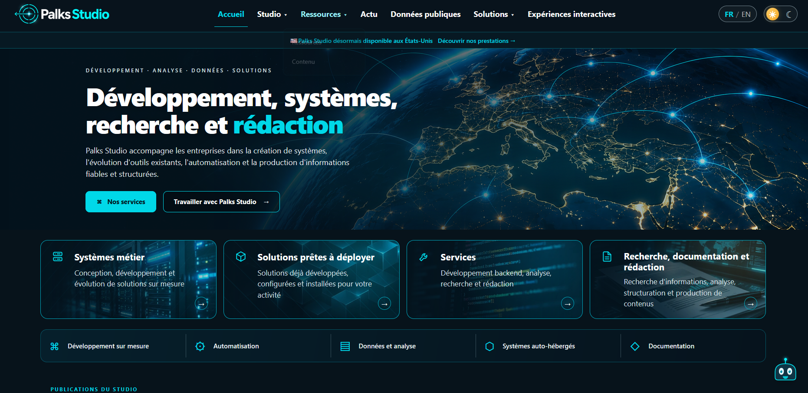

<p align="center">
  
</p>


[← Retour au sommaire](../README.md)

# Développer sans framework à l'ère de l'IA : liberté architecturale, rigueur et sécurité

Les frameworks occupent une place centrale dans le développement moderne. Ils proposent des structures prédéfinies, des conventions, des composants réutilisables et des mécanismes permettant d'accélérer la construction d'applications.

Mais sont-ils indispensables à tous les projets ?

À l'heure où l'intelligence artificielle transforme les méthodes de développement, cette question mérite d'être posée autrement. Il ne s'agit plus uniquement de comparer le temps nécessaire pour développer une fonctionnalité avec ou sans framework, mais également de réfléchir à la maîtrise du code, à la maintenance, aux dépendances et à la sécurité applicative.

L'écosystème technique de Palks Studio constitue un exemple de cette approche. Son site, ses outils et ses systèmes reposent principalement sur des technologies natives, des composants spécialisés et des dépendances sélectionnées selon les besoins.

Ce choix ne consiste pas à rejeter les frameworks. Il consiste à ne pas les considérer comme un point de départ obligatoire.

---

## 1. Un framework n'est pas une architecture

Un framework fournit un cadre de développement. Il peut organiser le routage, les contrôleurs, les modèles, les accès aux données, l'authentification et de nombreuses autres fonctionnalités.

Une architecture définit quant à elle la manière dont les composants d'un système interagissent, leurs responsabilités, leurs dépendances et les frontières entre les différentes couches.

Ces deux notions ne sont pas équivalentes.

Une application construite sans framework peut disposer d'une architecture rigoureuse, tandis qu'une application utilisant un framework reconnu peut présenter une mauvaise séparation des responsabilités.

Le choix d'un framework ne dispense donc pas de concevoir une architecture.

Dans le cas de Palks Studio, le principe repose sur une séparation entre :

- Les interfaces publiques
- Les traitements côté navigateur
- Les points d'entrée serveur
- Les moteurs métier
- Les données persistantes
- Les services et bibliothèques spécialisés

Cette organisation permet d'utiliser différentes technologies au sein d'un même écosystème, sans imposer une structure applicative unique à l'ensemble.

---

## 2. Construire un écosystème avec des technologies natives

Le site public repose principalement sur HTML, CSS et JavaScript natif. Les traitements nécessitant un backend sont pris en charge par des scripts PHP, tandis que certains moteurs spécialisés utilisent Python.

Le stockage est adapté à chaque besoin : fichiers JSON, journaux CSV ou bases SQLite lorsque la conservation et l'interrogation d'un historique deviennent nécessaires.

L'architecture générale peut être représentée ainsi :

```text
                    Navigateur
                        │
                        ▼
              HTML / CSS / JavaScript
                        │
          ┌─────────────┴─────────────┐
          │                           │
          ▼                           ▼
  Traitements locaux           Endpoints PHP
          │                           │
          ▼                           ▼
  Outils interactifs           Moteurs métier
                                      │
                        ┌─────────────┼─────────────┐
                        │             │             │
                        ▼             ▼             ▼
                      JSON           CSV          SQLite
                                      │
                                      ▼
                           Composants spécialisés
                              PHP / Python
```

Les pages publiques ne nécessitent pas systématiquement un moteur de rendu côté serveur. Les opérations sensibles ou persistantes sont déléguées aux composants qui en ont réellement besoin.

Cette approche ne supprime pas la complexité. Elle permet de déterminer précisément où celle-ci doit se trouver.

---

## 3. Des outils indépendants plutôt qu'une application monolithique

Plusieurs systèmes coexistent au sein de cet écosystème.

| Composant                   | Technologies et architecture               |
|-----------------------------|--------------------------------------------|
| Site public                 | HTML, CSS, JavaScript, endpoints PHP       |
| Générateur de devis         | JavaScript natif et jsPDF                  |
| Génération Factur-X         | PHP, Python et bibliothèques documentaires |
| Facturation automatisée     | PHP, CLI, cron et fichiers structurés      |
| Radars de données publiques | Collecteurs, PHP et SQLite                 |
| Assistant du site           | Python, JSON et logique déterministe       |
| Distribution numérique      | PHP, jetons d'accès et stockage fichier    |

Chaque composant possède ses propres contraintes.

Un générateur de devis exécuté entièrement dans le navigateur n'a pas besoin de la même infrastructure qu'un système financier conservant des factures et des paiements.

Un radar exploitant plusieurs années de données historiques nécessite des mécanismes de stockage et d'interrogation différents de ceux d'un assistant utilisant une base de connaissances JSON.

L'objectif n'est donc pas de tout construire avec la même technologie, mais d'éviter qu'une dépendance commune soit imposée à des composants qui n'en ont pas besoin.

### Sans framework ne signifie pas sans bibliothèque

Cette distinction est importante.

Une bibliothèque spécialisée répond généralement à un besoin précis. Un framework impose plus largement une structure et un cycle de fonctionnement à l'application.

Utiliser jsPDF pour produire un document, mPDF pour générer un PDF côté serveur ou un SDK pour communiquer avec un prestataire de paiement ne remet pas en cause une architecture sans framework applicatif.

Il ne serait d'ailleurs pas raisonnable de réimplémenter systématiquement des fonctionnalités complexes déjà couvertes par des bibliothèques éprouvées.

Le principe consiste à sélectionner les dépendances selon leur utilité réelle, plutôt que d'adopter un environnement complet par défaut.

---

## 4. JavaScript natif : davantage de contrôle sur le comportement

Une interface interactive n'a pas nécessairement besoin d'un framework JavaScript.

Les API natives du navigateur permettent déjà de gérer les événements, les formulaires, les requêtes HTTP, les modifications du DOM et une partie importante de l'état applicatif.

Un exemple simple de calcul dynamique dans un formulaire :

```javascript
const quantity = document.querySelector('#quantity');
const price = document.querySelector('#price');
const total = document.querySelector('#total');

function updateTotal() {
    const amount =
        Number(quantity.value) * Number(price.value);

    total.textContent = new Intl.NumberFormat('fr-FR', {
        style: 'currency',
        currency: 'EUR'
    }).format(amount);
}

quantity.addEventListener('input', updateTotal);
price.addEventListener('input', updateTotal);
```

Cette fonctionnalité ne nécessite ni système de compilation, ni gestionnaire d'état externe, ni moteur de rendu supplémentaire.

Pour une interface simple, le comportement reste directement observable dans le code.

Cependant, lorsque les interactions deviennent nombreuses, les composants interdépendants ou les états complexes, JavaScript natif exige davantage de discipline.

Il devient nécessaire de structurer les modules, de limiter les responsabilités de chaque fonction et de définir clairement la manière dont les données circulent.

L'absence de framework ne doit pas conduire à accumuler des scripts indépendants sans organisation.

---

## 5. PHP natif : construire uniquement le backend nécessaire

Une page HTML peut communiquer avec un endpoint PHP sans nécessiter un framework backend complet.

```text
Formulaire HTML
       │
       ▼
Requête HTTP
       │
       ▼
Endpoint PHP
       │
       ├── Contrôle de la méthode
       ├── Validation des données
       ├── Contrôle des autorisations
       ├── Traitement métier
       └── Réponse HTTP
```

Cette approche permet de créer des traitements serveur ciblés, notamment pour la génération de documents, les téléchargements sécurisés ou l'enregistrement de données.

Un exemple pédagogique d'endpoint JSON :

```php
<?php

declare(strict_types=1);

header('Content-Type: application/json; charset=utf-8');

if ($_SERVER['REQUEST_METHOD'] !== 'POST') {
    header('Allow: POST');
    http_response_code(405);

    echo json_encode([
        'error' => 'Method not allowed'
    ]);

    exit;
}

try {
    $data = json_decode(
        file_get_contents('php://input'),
        true,
        512,
        JSON_THROW_ON_ERROR
    );
} catch (JsonException $e) {
    http_response_code(400);

    echo json_encode([
        'error' => 'Invalid JSON'
    ]);

    exit;
}

if (!is_array($data)
    || !isset($data['quantity'])
    || !is_int($data['quantity'])
    || $data['quantity'] < 1
    || $data['quantity'] > 1000) {

    http_response_code(422);

    echo json_encode([
        'error' => 'Invalid quantity'
    ]);

    exit;
}

echo json_encode([
    'quantity' => $data['quantity'],
    'status' => 'validated'
]);
```

Cet exemple illustre uniquement la réception et la validation d'une requête. Il ne constitue pas un endpoint de production complet.

Selon la fonctionnalité, il faudrait également intégrer des contrôles d'authentification, d'autorisation, de taille des requêtes, de limitation des accès ou de protection CSRF.

C'est précisément l'un des enjeux du développement sans framework : les responsabilités ne disparaissent pas. Elles doivent être prises en charge explicitement.

---

## 6. La sécurité applicative : la contrepartie de cette liberté

Les frameworks modernes fournissent souvent des mécanismes de protection intégrés ou des conventions qui facilitent leur mise en œuvre.

Sans framework, ces mécanismes doivent être sélectionnés, implémentés, configurés et vérifiés directement.

| Risque                      | Mesure à prendre en charge                        |
|-----------------------------|---------------------------------------------------|
| Injection SQL               | Requêtes préparées et validation des données      |
| XSS                         | Encodage adapté au contexte de sortie             |
| CSRF                        | Protection des opérations authentifiées sensibles |
| Accès non autorisé          | Contrôles d'autorisation côté serveur             |
| Brute force                 | Limitation des tentatives et journalisation       |
| Téléversements malveillants | Contrôle du contenu, des tailles et du stockage   |
| Fuite de secrets            | Configuration privée et séparation des accès      |
| Écritures concurrentes      | Verrouillage et gestion de la cohérence           |
| Dépendances vulnérables     | Veille, mises à jour et contrôle des versions     |

Le développeur doit également s'assurer que ces protections sont appliquées de manière cohérente dans l'ensemble du système.

### Exemple : les requêtes préparées avec SQLite

Une application PHP utilisant SQLite peut effectuer ses requêtes via PDO, sans ORM.

```php
$stmt = $pdo->prepare(
    'SELECT date, value
     FROM measurements
     WHERE source = :source
     ORDER BY date DESC
     LIMIT 100'
);

$stmt->execute([
    'source' => $source
]);

$rows = $stmt->fetchAll(PDO::FETCH_ASSOC);
```

L'utilisation d'une requête préparée évite de concaténer directement une valeur utilisateur dans la requête SQL.

Cela ne dispense pas de contrôler les paramètres reçus ni de vérifier que l'utilisateur est autorisé à accéder aux données demandées.

### Exemple : génération d'un jeton d'accès

Un téléchargement sécurisé peut reposer sur un jeton généré côté serveur :

```php
$token = bin2hex(random_bytes(32));
$tokenHash = hash('sha256', $token);
```

Mais la génération du jeton ne représente qu'une partie du mécanisme.

Il faut également gérer sa durée de validité, son association à une ressource précise, sa consommation, les tentatives d'accès et les conditions de révocation.

Dans un système à usage unique, deux requêtes simultanées ne doivent pas pouvoir consommer le même jeton.

L'absence de framework impose donc de réfléchir à l'ensemble du cycle de sécurité, et pas uniquement à la fonction qui produit le jeton.

---

## 7. La sécurité doit être une couche commune, pas une succession de correctifs

L'un des risques d'une architecture sans framework est de reproduire les mêmes contrôles dans chaque script.

Un endpoint peut correctement vérifier les autorisations, tandis qu'un autre oublie cette vérification. Un formulaire peut être protégé contre les soumissions multiples, tandis qu'un autre ne l'est pas.

Une architecture rigoureuse doit éviter cette dispersion.

Les mécanismes transverses peuvent être regroupés dans des composants communs :

```text
Endpoints applicatifs
          │
          ▼
    Couche commune
          │
          ├── Authentification
          ├── Autorisations
          ├── Validation
          ├── Limitation des requêtes
          ├── Journalisation
          └── Gestion des erreurs
          │
          ▼
    Traitements métier
```

Cette structure est un exemple de principe architectural, et non une reproduction du code interne de Palks Studio.

L'idée est de conserver des mécanismes de sécurité réutilisables sans nécessairement adopter un framework complet.

Il faut également distinguer la sécurité applicative de la sécurité de l'infrastructure.

La protection des sessions, la validation des formulaires ou les requêtes préparées ne remplacent pas les mises à jour de PHP, la configuration du serveur web, les permissions des fichiers ou les sauvegardes.

Un système léger n'est pas automatiquement un système sécurisé.

---

## 8. Stockage : choisir selon les besoins plutôt que par convention

Le stockage constitue un autre exemple de cette liberté architecturale.

Toutes les applications n'ont pas besoin d'un serveur de base de données, mais toutes ne peuvent pas non plus fonctionner efficacement avec de simples fichiers.

Dans l'écosystème présenté, plusieurs modèles coexistent :

```text
JSON
  → Configuration, connaissances, métadonnées

CSV
  → Journaux financiers, exports, données structurées

SQLite
  → Historiques, recherches, agrégations

PDF
  → Documents générés et archives
```

Les radars de données publiques utilisent SQLite lorsque les données doivent être conservées et interrogées sur des périodes étendues.

Les moteurs de facturation peuvent exploiter des fichiers structurés pour conserver les documents, les compteurs et les journaux financiers.

Ce choix dépend du volume, de la fréquence des écritures, des relations entre les données et des exigences de cohérence.

Les fichiers plats peuvent convenir à certains traitements, mais ils ne fournissent pas automatiquement les garanties transactionnelles d'une base de données.

À l'inverse, introduire une base de données distante pour un outil qui ne conserve aucune donnée n'apporterait pas nécessairement de valeur.

L'architecture doit répondre aux besoins réels du système.

---

## 9. L'intelligence artificielle change l'équilibre du développement

Pendant longtemps, l'un des principaux arguments en faveur des frameworks était le gain de temps.

Construire une fonctionnalité à partir de technologies natives pouvait nécessiter davantage de recherches, de documentation et de développement manuel.

L'intelligence artificielle modifie progressivement cet équilibre.

Elle peut notamment aider à :

- Générer une première implémentation à partir d'un besoin précis
- Comprendre et documenter du code existant
- Refactoriser des composants
- Identifier des incohérences et des cas limites
- Préparer des tests
- Examiner les risques de sécurité
- Maintenir des interfaces et documentations bilingues

Ces capacités rendent certaines architectures personnalisées plus accessibles et moins coûteuses à faire évoluer.

Elles permettent également de travailler directement avec des technologies natives sans devoir systématiquement adopter une abstraction supplémentaire.

Cependant, l'IA ne supprime pas les contraintes d'ingénierie.

Un code généré peut être fonctionnel dans un scénario de démonstration tout en présentant une faille de sécurité, un problème de concurrence ou un comportement incorrect dans un cas métier particulier.

Une fonction qui semble correcte ne garantit pas la cohérence du système auquel elle appartient.

L'IA peut accélérer la production du code. Elle ne garantit ni sa qualité, ni sa sécurité, ni sa maintenabilité.

---

## 10. L'IA ne doit pas devenir un framework invisible

Le développement assisté par IA introduit également un risque particulier : accumuler des fonctionnalités générées sans comprendre leur organisation.

Une succession de demandes peut produire une application fonctionnelle en apparence, mais dont les composants suivent des conventions différentes, répètent les mêmes traitements ou introduisent des dépendances inutiles.

```text
Besoin fonctionnel
        │
        ▼
Code généré
        │
        ▼
Analyse et intégration
        │
        ▼
Tests et contrôles de sécurité
        │
        ▼
Validation de l'architecture
        │
        ▼
Documentation et maintenance
```

La génération du code ne représente qu'une étape de ce processus.

Le développeur doit conserver une vision globale de l'application, de ses données, de ses frontières de confiance et de ses responsabilités.

Sans cette maîtrise, l'IA peut accélérer la création de dette technique aussi facilement qu'elle accélère le développement.

Dans une architecture sans framework, cette exigence devient encore plus importante. Il n'existe pas nécessairement de conventions prédéfinies pour guider automatiquement les nouvelles fonctionnalités.

Ces conventions doivent être établies et maintenues au niveau du projet.

---

## 11. Performance, dépendances et maintenance

Une architecture utilisant principalement des technologies natives peut réduire certaines couches d'exécution et certains coûts de maintenance.

Un site HTML, CSS et JavaScript peut être déployé sans pipeline de compilation complexe. Un endpoint PHP peut traiter une opération ciblée sans charger une application complète. Un moteur Python peut être exécuté ponctuellement sans nécessiter un serveur applicatif permanent.

C'est notamment le cas de l'assistant intégré au site Palks Studio, dont le moteur repose sur Python, une base de connaissances JSON et une logique déterministe.

Mais ces avantages ne sont pas automatiques.

Une interface JavaScript mal organisée peut être plus difficile à maintenir qu'une interface construite avec un framework. Des scripts PHP redondants peuvent devenir plus coûteux qu'une architecture reposant sur des composants éprouvés.

De même, une architecture sans framework peut finir par reconstruire progressivement son propre framework interne.

Le nombre de dépendances n'est donc pas un indicateur suffisant de qualité.

Il faut également considérer leur utilité, leur maturité, leur coût de maintenance et les responsabilités que leur suppression reporte sur le projet.

---

## 12. Quand un framework reste le meilleur choix

Il existe de nombreuses situations dans lesquelles un framework apporte une réelle valeur.

Une application collaborative complexe, une interface comportant de nombreux états interdépendants ou un projet développé par plusieurs équipes peuvent bénéficier de conventions communes et de composants standardisés.

Un framework peut également faciliter l'intégration de nouveaux développeurs et éviter de réimplémenter des mécanismes déjà largement éprouvés.

Le choix doit donc être évalué selon plusieurs critères :

| Critère                  | Question à poser                                                            |
|--------------------------|-----------------------------------------------------------------------------|
| Complexité fonctionnelle | L'application nécessite-t-elle de nombreuses interactions et relations ?    |
| Taille de l'équipe       | Des conventions communes sont-elles indispensables ?                        |
| Sécurité                 | Les protections peuvent-elles être correctement maintenues sans framework ? |
| Maintenance              | Le système restera-t-il compréhensible dans plusieurs années ?              |
| Dépendances              | Le framework apporte-t-il suffisamment de valeur pour justifier son coût ?  |
| Évolution                | L'architecture peut-elle accompagner la croissance du projet ?              |

Dans certains cas, les technologies natives constituent le meilleur compromis. Dans d'autres, un framework permet de réduire considérablement les risques et les coûts.

L'intelligence artificielle ne rend pas cette décision obsolète. Elle ajoute de nouvelles possibilités, mais les contraintes du projet restent déterminantes.

---

## Conclusion

Développer sans framework est une manière de conserver une liberté importante dans la construction d'un système.

Il devient possible de choisir les technologies, les structures de données, les composants et les mécanismes d'exécution selon les besoins réels de chaque fonctionnalité.

L'écosystème de Palks Studio illustre cette approche à travers des interfaces web natives, des moteurs PHP et Python, des outils exécutés dans le navigateur et des stockages adaptés à leurs usages.

Mais cette liberté implique une responsabilité supplémentaire.

Les gains obtenus en réduisant les dépendances doivent être mis en balance avec le travail nécessaire pour maintenir une architecture cohérente, sécuriser les traitements et garantir la qualité du code.

La sécurité ne doit jamais devenir la variable d'ajustement de cette démarche. Elle doit bénéficier d'au moins autant d'attention, voire davantage, lorsque les protections habituellement fournies par un framework sont prises en charge directement.

À l'ère de l'intelligence artificielle, construire sans framework devient une option de plus en plus accessible. Cela ne signifie pas qu'il faut systématiquement s'en passer.

L'enjeu reste de construire des systèmes dont les choix techniques sont compris, maîtrisés et justifiés, plutôt que de suivre une architecture imposée par habitude.

---

## Pour aller plus loin

Retrouvez également cet article technique en anglais sur DEV.to, consacré à l'architecture des sites web statiques, à la séparation entre les interfaces publiques et les traitements backend, ainsi qu'aux choix techniques permettant d'intégrer des fonctionnalités avancées sans recourir à un CMS ni à une plateforme SaaS.

👉 [Building Without Frameworks in the AI Era: Architectural Freedom, Engineering Discipline, and Security](https://dev.to/palks_studio/static-websites-dont-limit-features-they-redefine-where-complexity-lives-37kh) (DEV.to, en anglais)

---

https://palks-studio.com