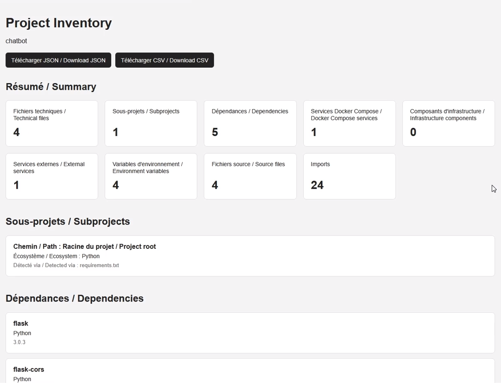

<p align="center">
  
</p>

[](https://www.python.org/)


[← Retour au sommaire](../README.md)

# Architecture d'un scanner de projets en Python : analyse statique, dépendances multi-écosystèmes et cartographie technique

Reprendre un projet logiciel existant commence souvent par les mêmes questions.

Quelles technologies utilise-t-il ? De quelles bibliothèques dépend-il ? Quels services externes sont intégrés ? Comment les différents composants communiquent-ils entre eux ?

Dans un projet récent et bien documenté, les réponses peuvent être relativement accessibles. Dans un projet hérité, un monorepo ou une application composée de plusieurs services, elles sont souvent dispersées entre les fichiers de configuration, les manifestes de dépendances, les Dockerfiles et le code source.

L'analyse manuelle devient alors une tâche à part entière.

Une autre approche consiste à construire un inventaire technique directement à partir du système de fichiers, sans exécuter le projet analysé.

Cet article présente l'architecture de Project Inventory, un moteur d'analyse statique développé en Python 3.11+, capable d'inventorier les dépendances de dix écosystèmes, d'identifier les sous-projets, d'analyser les configurations Docker et de cartographier les relations entre composants.

---

## 1. Analyser un projet sans l'exécuter

Le premier principe architectural consiste à travailler uniquement à partir des éléments observables dans le projet.

```text
Projet logiciel
       │
       ▼
Exploration du système de fichiers
       │
       ▼
Détection des fichiers techniques
       │
       ▼
Analyse des manifestes et configurations
       │
       ▼
Analyse des références dans le code
       │
       ▼
Consolidation et cartographie
       │
       ▼
Rapports HTML, JSON et CSV
```

Le scanner n'a pas besoin de démarrer l'application, d'installer ses dépendances ou de lancer ses conteneurs Docker.

Il construit une représentation technique à partir des fichiers disponibles.

Cette distinction est importante : un inventaire statique décrit ce qui peut être observé dans le projet, mais ne démontre pas nécessairement son comportement réel à l'exécution.

Un service peut être déclaré dans Docker Compose sans être démarré. Une bibliothèque peut être installée sans être directement importée. Une variable d'environnement peut être présente sans être utilisée.

Le rapport doit conserver ces nuances.

---

## 2. Une architecture modulaire

Le moteur sépare les responsabilités entre plusieurs catégories de composants.

```text
project-inventory/
│
├── scanner/
│   ├── __init__.py
│   ├── filesystem.py
│   └── project_scanner.py
│
├── detectors/
│   ├── __init__.py
│   ├── environment.py
│   ├── infrastructure.py
│   ├── languages.py
│   ├── packages.py
│   ├── projects.py
│   └── services.py
│
├── analyzers/
│   ├── __init__.py
│   ├── dependencies.py
│   └── relationships.py
│
├── exporters/
│   ├── __init__.py
│   ├── csv_export.py
│   ├── html_export.py
│   └── json_export.py
│
├── docs/
├── output/
│   └── .gitkeep
│
├── LICENCE.md
├── LICENSE.md
└── app.py
```

Cette organisation correspond à la structure publique documentée du projet.

| Composant    | Responsabilité                        |
|--------------|---------------------------------------|
| `scanner/`   | Exploration et orchestration          |
| `detectors/` | Extraction des informations           |
| `analyzers/` | Consolidation et relations            |
| `exporters/` | Génération des rapports               |
| `output/`    | Stockage des résultats                |
| `app.py`     | Point d'entrée de l'application       |

La séparation entre détection et analyse constitue un élément central de cette architecture.

Un détecteur peut identifier un package, un fichier d'environnement ou un service Docker. Un analyseur peut ensuite rapprocher ces informations pour établir des relations entre les composants.

Cela évite de mélanger la découverte des données avec leur interprétation.

---

## 3. Exploration récursive du système de fichiers

La première étape consiste à parcourir le dossier sélectionné et ses sous-dossiers.

Cependant, tous les fichiers présents dans un projet ne sont pas pertinents pour son inventaire technique.

Les répertoires contenant des dépendances installées, des fichiers générés ou des données internes aux outils de développement peuvent considérablement augmenter le volume à analyser.

Le scanner ignore notamment :

```text
.git
.idea
.vscode
__pycache__
node_modules
vendor
.venv
venv
dist
build
coverage
```

Une approche pédagogique utilisant la bibliothèque standard Python pourrait prendre cette forme :

```python
import os
from pathlib import Path

EXCLUDED_DIRS = {
    ".git",
    ".idea",
    ".vscode",
    "__pycache__",
    "node_modules",
    "vendor",
    ".venv",
    "venv",
    "dist",
    "build",
    "coverage",
}


def walk_project(root: Path):
    for current, directories, files in os.walk(root):
        directories[:] = [
            directory
            for directory in directories
            if directory not in EXCLUDED_DIRS
        ]

        for filename in files:
            yield Path(current) / filename
```

Cet exemple illustre le principe du parcours récursif et des exclusions. Il ne reproduit pas le code de production de Project Inventory.

Modifier la liste `directories` directement permet d'empêcher `os.walk()` de descendre dans les répertoires exclus.

Cette approche est particulièrement utile lorsqu'un projet contient un dossier `node_modules` ou un environnement virtuel Python volumineux.

L'objectif n'est pas d'analyser chaque fichier installé, mais d'identifier les éléments qui décrivent l'architecture du projet.

---

## 4. Détecter les fichiers techniques par nom et extension

Un scanner multi-écosystèmes doit reconnaître plusieurs formats de fichiers.

Certains possèdent un nom conventionnel, comme `package.json` ou `requirements.txt`. D'autres sont identifiés par leur extension, comme les fichiers `.csproj`.

Une représentation simplifiée des règles de détection pourrait être :

```python
KNOWN_FILES = {
    "requirements.txt": "python",
    "pyproject.toml": "python",
    "package.json": "node",
    "composer.json": "php",
    "go.mod": "go",
    "Cargo.toml": "rust",
    "Gemfile": "ruby",
    "pom.xml": "java",
    "pubspec.yaml": "dart",
    "mix.exs": "elixir",
}


def detect_ecosystem(path):
    if path.name in KNOWN_FILES:
        return KNOWN_FILES[path.name]

    if path.suffix == ".csproj":
        return "dotnet"

    return None
```

Cet exemple est volontairement partiel. Le moteur documenté prend également en charge les fichiers de verrouillage et d'autres formats de configuration.

La détection du type de fichier permet ensuite de sélectionner le traitement adapté.

Un fichier JSON, un fichier TOML, un document XML ou un fichier de configuration Gradle ne peuvent pas nécessairement être interprétés avec le même parseur.

Le rôle du scanner est donc d'identifier les fichiers pertinents avant de transmettre leur contenu aux détecteurs spécialisés.

---

## 5. Inventorier les dépendances de dix écosystèmes

Project Inventory prend actuellement en charge dix écosystèmes.

| Écosystème     | Manifestes et fichiers pris en charge                                |
|----------------|----------------------------------------------------------------------|
| Python         | requirements.txt, pyproject.toml, poetry.lock, Pipfile, Pipfile.lock |
| Node.js        | package.json, package-lock.json, yarn.lock, pnpm-lock.yaml           |
| PHP            | composer.json, composer.lock                                         |
| Go             | go.mod, go.sum                                                       |
| Rust           | Cargo.toml, Cargo.lock                                               |
| Ruby           | Gemfile, Gemfile.lock                                                |
| Java / JVM     | pom.xml, build.gradle, build.gradle.kts                              |
| .NET           | *.csproj                                                             |
| Dart / Flutter | pubspec.yaml, pubspec.lock                                           |
| Elixir         | mix.exs, mix.lock                                                    |

Cette diversité implique de distinguer le format d'un fichier de la signification des informations qu'il contient.

Un manifeste décrit généralement les dépendances demandées par le projet.

Un fichier de verrouillage peut préciser les versions résolues et inclure des dépendances transitives.

Cependant, tous les fichiers n'ont pas exactement la même fonction. Par exemple, `go.sum` contient des sommes de contrôle de modules et ne doit pas être interprété comme un lock file classique représentant à lui seul l'ensemble des dépendances actives.

L'analyse doit donc tenir compte de la sémantique propre à chaque écosystème.

### Exemple : manifeste Node.js

```json
{
    "dependencies": {
        "express": "^4.18.2",
        "axios": "^1.7.0"
    },
    "devDependencies": {
        "vite": "^5.0.0"
    }
}
```

Ce fichier déclare des contraintes de versions.

La présence de `express` dans le manifeste ne signifie pas nécessairement que la version installée est exactement `4.18.2`.

Un fichier de verrouillage peut fournir une version résolue plus précise.

Cette distinction doit être conservée dans l'inventaire plutôt que remplacée par une seule valeur.

---

## 6. Consolider les dépendances sans perdre leurs sources

Une même dépendance peut apparaître dans plusieurs fichiers techniques.

Dans un projet Dart, par exemple, un package peut être déclaré dans `pubspec.yaml` et verrouillé dans `pubspec.lock`.

Le moteur consolide les informations par écosystème et par package.

Exemple issu de la documentation :

```text
dio
    pubspec.lock         ==5.7.0 [verrouillée / locked]
    pubspec.yaml         ^5.7.0
```

Le package apparaît une seule fois, mais ses différentes sources restent visibles.

Cette approche évite deux problèmes :

- Compter plusieurs fois une même dépendance
- Perdre la distinction entre version déclarée et version verrouillée

Une représentation conceptuelle pourrait prendre cette forme :

```json
{
    "ecosystem": "dart",
    "package": "dio",
    "sources": [
        {
            "file": "pubspec.yaml",
            "version": "^5.7.0",
            "type": "declared"
        },
        {
            "file": "pubspec.lock",
            "version": "5.7.0",
            "type": "locked"
        }
    ]
}
```

Ce JSON illustre le principe de consolidation. Il ne correspond pas nécessairement au schéma exact des exports du moteur.

Une dépendance découverte uniquement dans un fichier de verrouillage reste également présente dans l'inventaire.

Cela permet de faire apparaître des packages transitifs qui ne sont pas directement déclarés dans le manifeste principal.

### Ne pas fusionner les écosystèmes

Deux packages portant le même nom dans des écosystèmes différents ne représentent pas nécessairement la même bibliothèque.

Une clé de consolidation conceptuelle pourrait donc être :

```python
key = (ecosystem, package_name)
```

Cette distinction empêche de fusionner arbitrairement un package Python et un package Node.js portant un nom identique.

Dans un projet contenant plusieurs sous-projets, les fichiers sources et leurs emplacements restent également importants pour identifier le contexte de chaque dépendance.

---

## 7. Identifier les sous-projets dans une même arborescence

Un dépôt logiciel peut contenir plusieurs applications ou composants indépendants.

Par exemple :

```text
application/
│
├── backend/
│   ├── requirements.txt
│   └── app.py
│
├── frontend/
│   ├── package.json
│   └── src/
│
├── worker/
│   ├── pyproject.toml
│   └── worker.py
│
└── docker-compose.yml
```

Un inventaire global des dépendances ne suffit pas à décrire correctement cette architecture.

Il faut également identifier les différents sous-projets.

```text
application
    │
    ├── backend
    │       └── Python
    │
    ├── frontend
    │       └── Node.js
    │
    └── worker
            └── Python
```

Project Inventory identifie les sous-projets à partir des manifestes et fichiers de configuration détectés.

Chaque sous-projet peut être associé à un ou plusieurs écosystèmes ainsi qu'aux fichiers techniques ayant permis son identification.

Cette étape permet ensuite de rattacher les dépendances et certaines relations d'infrastructure à leur contexte technique.

Un manifeste constitue toutefois un indice architectural. Sa présence ne suffit pas toujours à établir qu'un dossier correspond à une application autonome.

---

## 8. Analyser l'infrastructure Docker Compose

Les dépendances applicatives ne représentent qu'une partie de l'architecture.

Une application peut également dépendre d'une base de données, d'un cache, d'un broker de messages ou d'autres services.

Les fichiers Docker Compose fournissent une source d'information particulièrement utile.

Le moteur reconnaît les quatre noms conventionnels suivants :

```text
docker-compose.yml
docker-compose.yaml
compose.yml
compose.yaml
```

Pour chaque service détecté, il peut notamment extraire l'image, la configuration de build, les ports, les volumes, les fichiers d'environnement et les dépendances entre services.

Prenons un exemple pédagogique :

```yaml
services:
    backend:
        build: ./backend
        ports:
            - "5000:5000"
        env_file:
            - .env
        depends_on:
            - database

    database:
        image: postgres:16
        volumes:
            - postgres_data:/var/lib/postgresql/data

volumes:
    postgres_data:
```

Ce fichier permet d'observer plusieurs éléments :

```text
backend
    ├── build : ./backend
    ├── port : 5000:5000
    ├── env_file : .env
    └── depends_on : database

database
    ├── image : postgres:16
    └── volume : postgres_data
```

Ces informations sont obtenues sans démarrer les conteneurs.

Il faut néanmoins distinguer la configuration déclarée de l'état réel de l'infrastructure.

La présence d'un port dans Docker Compose ne démontre pas qu'il est actuellement accessible. De même, `depends_on` décrit une relation déclarée entre services, mais ne garantit pas à lui seul que le service dépendant est prêt à répondre.

---

## 9. Enrichir les services avec des signatures d'infrastructure

Une image Docker peut fournir un indice supplémentaire sur la fonction d'un service.

Par exemple :

```text
postgres:16
    → PostgreSQL

redis:7
    → Redis

rabbitmq:3-management
    → RabbitMQ
```

Le moteur dispose de signatures permettant d'identifier certains composants connus :

- PostgreSQL
- Redis
- MySQL
- MariaDB
- MongoDB
- RabbitMQ

Ces signatures enrichissent les informations découvertes.

Elles ne remplacent pas l'analyse des fichiers Docker Compose.

Un service utilisant une image inconnue doit rester présent dans l'inventaire, même si aucun composant d'infrastructure connu ne peut lui être associé.

Cette distinction évite de limiter la découverte aux technologies déjà présentes dans un catalogue.

---

## 10. Analyser les Dockerfiles

Un Dockerfile apporte d'autres informations sur la construction et le démarrage d'un composant.

Le moteur extrait notamment les instructions suivantes :

| Instruction  | Information obtenue                  |
|--------------|--------------------------------------|
| `FROM`       | Image de base                        |
| `WORKDIR`    | Répertoire de travail                |
| `EXPOSE`     | Port déclaré                         |
| `CMD`        | Commande par défaut                  |
| `ENTRYPOINT` | Point d'entrée                       |

Exemple :

```dockerfile
FROM python:3.12-slim

WORKDIR /app

EXPOSE 5000

CMD ["gunicorn", "-w", "2", "-b", "0.0.0.0:5000", "app:app"]
```

L'analyse permet notamment d'identifier Python comme environnement de base et Gunicorn comme commande de démarrage déclarée.

Cette information devient particulièrement intéressante lorsqu'elle est rapprochée des dépendances Python.

Gunicorn peut être utilisé pour démarrer une application sans apparaître dans un `import gunicorn` au sein du code source.

L'analyse du code seule pourrait donc manquer une référence pourtant présente dans l'infrastructure.

---

## 11. Extraire les variables d'environnement sans exposer leurs valeurs

Les fichiers d'environnement contiennent souvent des informations importantes pour comprendre les intégrations d'un projet.

Project Inventory analyse notamment :

```text
.env
.env.example
.env.sample
```

Cependant, ces fichiers peuvent contenir des clés API, des mots de passe ou des identifiants sensibles.

Le moteur extrait uniquement les noms des variables.

Exemple de résultat :

```text
OPENAI_API_KEY
ENABLE_PERSISTENCE
MEMORY_MAX_TURNS
STRICT_MODE
```

Les valeurs ne sont pas affichées.

Un exemple pédagogique d'extraction pourrait prendre cette forme :

```python
import re

ENV_NAME = re.compile(
    r"^\s*(?:export\s+)?([A-Za-z_][A-Za-z0-9_]*)\s*="
)


def extract_env_names(content: str):
    names = set()

    for line in content.splitlines():
        match = ENV_NAME.match(line)

        if match:
            names.add(match.group(1))

    return sorted(names)
```

Cette fonction illustre une extraction élémentaire des noms sans conserver les valeurs dans le résultat.

Elle ne constitue pas un parseur complet de tous les formats de fichiers d'environnement.

L'analyse peut ainsi identifier l'existence d'une configuration sans exposer directement son contenu sensible.

Cette précaution doit également s'appliquer aux exports, aux messages d'erreur et aux journaux techniques.

---

## 12. Identifier les services externes à partir de preuves

Les dépendances et variables d'environnement peuvent fournir des indices sur les services externes intégrés à un projet.

Le moteur dispose notamment de signatures pour OpenAI, Stripe, AWS, SendGrid, Twilio et Sentry.

Exemple documenté :

```text
OpenAI
    package    openai
    variable   OPENAI_API_KEY
```

Deux éléments distincts permettent ici de rapprocher le projet du service OpenAI.

Une représentation conceptuelle pourrait être :

```json
{
    "service": "OpenAI",
    "evidence": [
        {
            "type": "package",
            "value": "openai"
        },
        {
            "type": "environment_variable",
            "value": "OPENAI_API_KEY"
        }
    ]
}
```

Le résultat conserve les preuves ayant permis l'identification.

Cette approche est plus informative qu'une simple liste de services externes, car elle permet de comprendre pourquoi un service apparaît dans le rapport.

Elle conserve néanmoins une limite importante : la présence d'un package et d'une variable ne prouve pas qu'une connexion au service est effectivement réalisée.

Le service peut être facultatif, désactivé ou simplement prévu dans la configuration.

---

## 13. Analyser les imports Python avec l'AST

L'analyse des dépendances déclarées ne permet pas toujours de savoir lesquelles sont référencées dans le code.

Pour Python, le moteur utilise l'AST, ou Abstract Syntax Tree.

L'AST représente la structure syntaxique d'un programme sans avoir besoin de l'exécuter.

Prenons ce fichier :

```python
import os
import json

from datetime import datetime
from flask import Flask
from openai import OpenAI

from storage import save_record
```

Une recherche textuelle pourrait retrouver certains imports, mais elle risque également de confondre du code avec des commentaires ou des chaînes de caractères.

L'AST permet d'identifier les véritables instructions d'import présentes dans la syntaxe.

Exemple pédagogique :

```python
import ast


def extract_imports(source: str):
    tree = ast.parse(source)
    imports = set()

    for node in ast.walk(tree):
        if isinstance(node, ast.Import):
            for alias in node.names:
                imports.add(alias.name)

        elif isinstance(node, ast.ImportFrom):
            if node.module:
                imports.add(node.module)

    return sorted(imports)
```

Cette fonction analyse le texte source sans importer ni exécuter les modules concernés.

Elle pourrait produire :

```text
datetime
flask
json
openai
os
storage
```

Une implémentation complète doit également tenir compte des imports relatifs, des sous-modules et des fichiers contenant des erreurs de syntaxe.

Project Inventory classe les imports Python en trois catégories :

```text
STANDARD PYTHON
    os
    json
    datetime

EXTERNES
    flask
    openai

INTERNES
    storage
```

Cette classification permet de distinguer les modules de la bibliothèque standard, les dépendances externes et les modules appartenant au projet.

---

## 14. Dépendance déclarée, verrouillée ou référencée

Une dépendance peut être présente dans un manifeste sans apparaître directement dans le code source.

Inversement, un import peut être détecté alors qu'aucune dépendance correspondante n'est explicitement déclarée dans le manifeste analysé.

Project Inventory rapproche les dépendances Python déclarées des références observées dans le code et, lorsque cela est pertinent, dans Docker.

Exemple :

```text
flask
    RÉFÉRENCÉE
    import flask

gunicorn
    RÉFÉRENCÉE
    Docker ["gunicorn", "-w", "2", ...]
```

Ces deux packages sont référencés de manières différentes.

Flask apparaît dans le code source. Gunicorn apparaît dans une commande Docker.

| État                  | Signification                       |
|-----------------------|-------------------------------------|
| Déclarée              | Présente dans un manifeste          |
| Verrouillée           | Version résolue observée            |
| Référencée            | Référence statique détectée         |
| Référence non détectée| Aucune référence statique retrouvée |

Le dernier état est volontairement différent de « dépendance inutilisée ».

L'absence de référence statique peut avoir plusieurs explications :

- Import dynamique
- Chargement par un système de plugins
- Utilisation indirecte par une autre bibliothèque
- Commande exécutée en dehors du code Python
- Configuration externe au périmètre analysé

Il existe également une différence entre le nom d'un package distribué et le nom utilisé pour l'importer.

Par exemple :

```text
Package : python-dotenv
Import  : dotenv

Package : Pillow
Import  : PIL
```

Une comparaison naïve entre les noms des packages et les imports peut donc produire des résultats incorrects.

Le rapprochement des dépendances doit tenir compte de cette différence lorsqu'elle peut être établie.

L'inventaire fournit des éléments d'analyse, mais ne doit pas être utilisé seul pour décider de supprimer automatiquement une dépendance.

---

## 15. Construire une cartographie des relations entre composants

L'inventaire devient plus utile lorsqu'il ne se limite plus à une liste d'éléments indépendants.

Un projet peut être représenté sous forme de composants et de relations.

```text
Sous-projet backend
    │
    ├── declares → flask
    ├── declares → openai
    └── uses_external_service → OpenAI

Service Docker backend
    │
    ├── builds → Sous-projet backend
    ├── depends_on → Service database
    └── uses_env_file → .env

Service Docker database
    │
    └── mounts → postgres_data
```

Project Inventory représente notamment les relations suivantes :

| Relation                | Signification                             |
|-------------------------|-------------------------------------------|
| `declares`              | Dépendance déclarée par un sous-projet    |
| `depends_on`            | Dépendance entre services Docker          |
| `builds`                | Build associé à un sous-projet            |
| `uses_env_file`         | Utilisation d'un fichier d'environnement  |
| `mounts`                | Montage d'un volume Docker                |
| `uses_external_service` | Utilisation détectée d'un service externe |

Chaque relation conserve son type, les types des composants source et cible ainsi que les preuves ayant permis de l'établir.

Une représentation conceptuelle pourrait prendre cette forme :

```json
{
    "type": "depends_on",
    "source": {
        "type": "docker_service",
        "id": "backend"
    },
    "target": {
        "type": "docker_service",
        "id": "database"
    },
    "evidence": [
        {
            "file": "docker-compose.yml",
            "declaration": "services.backend.depends_on"
        }
    ]
}
```

Cet exemple illustre une relation structurée. Il ne reproduit pas le format interne exact du moteur.

Le principe essentiel est qu'une relation ne doit être créée que lorsqu'elle peut être établie à partir d'un élément effectivement observé.

Une cartographie technique n'a pas vocation à inventer des connexions entre des composants simplement parce qu'ils sont présents dans le même projet.

---

## 16. Séparer découverte et enrichissement

La découverte et l'enrichissement répondent à deux besoins différents.

La découverte consiste à identifier les éléments réellement présents dans les fichiers.

L'enrichissement consiste à interpréter certains éléments à l'aide de signatures connues.

```text
Fichiers du projet
        │
        ▼
Découverte dynamique
        │
        ├── Packages
        ├── Variables
        ├── Services
        └── Imports
        │
        ▼
Enrichissement
        │
        ├── Signatures de services externes
        ├── Signatures d'infrastructure
        └── Relations observables
```

Un scanner n'a pas besoin de connaître à l'avance tous les packages Python, Node.js ou Rust existants pour les inventorier.

Il doit savoir où les chercher et comment interpréter les fichiers qui les déclarent.

Une signature peut ensuite apporter une information supplémentaire.

```text
OPENAI_API_KEY
    → OpenAI

STRIPE_SECRET_KEY
    → Stripe

SENTRY_DSN
    → Sentry
```

Un package inconnu reste visible dans l'inventaire, même lorsqu'aucune signature ne permet de l'enrichir.

Cette séparation permet d'étendre progressivement les capacités d'interprétation sans limiter la découverte à un catalogue prédéfini.

---

## 17. Générer plusieurs représentations d'un même inventaire

Le moteur produit plusieurs formats de sortie à partir de l'analyse.

```text
Résultats consolidés
         │
         ├── Terminal
         │
         ├── HTML
         │
         ├── JSON
         │
         └── CSV
```

Chaque format répond à un besoin différent.

| Format   | Utilisation                           |
|----------|---------------------------------------|
| Terminal | Consultation immédiate                |
| HTML     | Lecture structurée de l'inventaire    |
| JSON     | Exploitation par d'autres outils      |
| CSV      | Analyse tabulaire et traitements      |

Le rapport HTML permet de consulter l'architecture et les informations détectées dans une représentation lisible.

Le JSON conserve les données détaillées dans un format structuré.

Les fichiers CSV fournissent des vues spécialisées de l'inventaire.

La structure de sortie documentée est :

```text
output/
│
├── project-inventory.json
├── project-inventory.html
│
└── csv/
    ├── dependencies.csv
    ├── dependency_usage.csv
    ├── dockerfiles.csv
    ├── environment_variables.csv
    ├── external_services.csv
    ├── imports.csv
    ├── infrastructure_components.csv
    ├── service_relationships.csv
    ├── services.csv
    ├── source_files.csv
    ├── subprojects.csv
    └── technical_files.csv
```

La séparation des exporteurs permet de produire différentes représentations sans réimplémenter l'ensemble de l'analyse pour chaque format.

Dans un outil manipulant des données provenant de projets externes, la génération des rapports doit également tenir compte de leur sécurité.

Un nom de fichier ou une valeur extraite doit être correctement échappé avant d'être inséré dans du HTML. Les exports CSV destinés à des tableurs peuvent également nécessiter une protection contre l'interprétation de certaines cellules comme des formules.

Ces précautions relèvent des contraintes générales de génération de rapports et ne constituent pas une description des protections internes du moteur.

---

## 18. Exécution locale et sur serveur

Project Inventory nécessite Python 3.11 ou une version ultérieure.

Son point d'entrée documenté est :

```bash
python app.py
```

L'application demande ensuite le chemin du projet à analyser.

```text
Chemin du projet à analyser :
```

Les résultats sont affichés dans le terminal et exportés automatiquement dans le dossier `output`.

Le moteur peut fonctionner sur Windows, Linux ou macOS, ainsi que sur un serveur disposant d'un accès direct aux fichiers du projet.

L'analyse repose sur le système de fichiers accessible à l'application.

Aucun code source ni secret n'a besoin d'être transmis à un service externe pour réaliser l'inventaire.

Le projet analysé n'est ni exécuté ni modifié.

Il faut néanmoins distinguer l'analyse en lecture seule du projet et l'écriture des rapports : le moteur génère ses propres fichiers de sortie dans son espace dédié.

---

## 19. Les limites de l'analyse statique

Un inventaire technique ne constitue pas une représentation exhaustive du comportement réel d'un logiciel.

Certaines informations peuvent rester invisibles lorsqu'elles dépendent de l'exécution.

| Observation statique       | Ce qu'elle ne démontre pas             |
|----------------------------|----------------------------------------|
| Package déclaré            | Utilisation effective                  |
| Version verrouillée        | Version réellement installée           |
| Import détecté             | Exécution effective du chemin de code  |
| Service Docker déclaré     | Service actuellement démarré           |
| Variable détectée          | Configuration active                   |
| Service externe identifié  | Communication réseau effective         |

L'analyse statique ne remplace donc pas l'observation des processus, du trafic réseau ou des environnements réellement déployés.

Elle ne constitue pas non plus, à elle seule, un audit de sécurité ou une analyse de vulnérabilités.

Son intérêt est de fournir une base structurée pour comprendre le projet, identifier ses composants et orienter les investigations suivantes.

---

## Conclusion

L'analyse technique d'un projet logiciel ne consiste pas uniquement à lister les fichiers présents dans un dossier.

Elle implique de reconnaître les formats, d'interpréter les manifestes, de consolider les dépendances, d'identifier les sous-projets et de rapprocher les informations provenant du code et de l'infrastructure.

Une architecture modulaire en Python permet de séparer ces responsabilités entre scanner, détecteurs, analyseurs et exporteurs.

La distinction entre découverte et enrichissement permet d'inventorier dynamiquement les éléments présents, puis d'ajouter des informations lorsque des signatures ou des relations peuvent être établies.

Mais le principe le plus important reste la traçabilité des observations.

Une dépendance déclarée n'est pas nécessairement utilisée. Une variable détectée ne prouve pas une connexion. Un service configuré n'est pas nécessairement démarré.

Un inventaire technique fiable doit donc distinguer ce qui est découvert, déclaré, verrouillé, référencé ou interprété, sans transformer une observation statique en affirmation sur le comportement réel du logiciel.

---

## Pour aller plus loin

Retrouvez également cet article technique en anglais sur DEV.to, consacré à l'architecture d'un scanner de projets en Python, à l'analyse statique du code, à la détection des dépendances dans plusieurs écosystèmes techniques et aux choix permettant de produire une cartographie technique d'un projet logiciel.

👉 [Python Project Scanner Architecture: Static Analysis, Multi-Ecosystem Dependencies, and Technical Mapping](https://dev.to/palks_studio/python-project-scanner-architecture-static-analysis-multi-ecosystem-dependencies-and-technical-1a51) (DEV.to, en anglais)

---

https://palks-studio.com