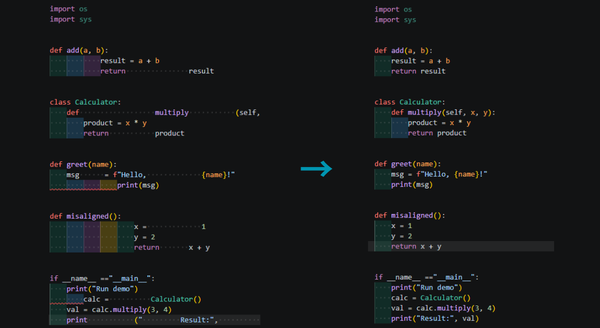

<p align="center">
  
</p>


[](https://www.python.org/)


[← Retour au sommaire](../README.md)

# Architecture d'un environnement VS Code local : scripts Python, tâches explicites et maîtrise des modifications

Un environnement de développement ne se résume pas à un éditeur de code. Il comprend également des formateurs, des outils de maintenance, des mécanismes de sauvegarde, des paramètres propres aux langages et différentes automatisations.

À mesure que ces composants se multiplient, il devient parfois difficile de déterminer quel outil intervient sur un fichier, à quel moment et selon quelles règles.

Une modification peut provenir d'un formateur, d'une extension, d'une action déclenchée à l'enregistrement ou d'un réglage spécifique au projet.

VS Code Environment Pack, développé par Palks Studio, repose sur une approche différente : organiser l'environnement autour de scripts Python indépendants, de tâches explicitement déclenchées et d'une configuration locale au projet.

L'objectif n'est pas de remplacer les outils existants, mais de définir précisément leurs responsabilités, leurs périmètres d'intervention et les conditions dans lesquelles ils peuvent modifier le code.

---

## 1. Architecture générale

Le système repose sur trois couches principales :

- Une couche de configuration propre à Visual Studio Code
- Une couche d'exécution reposant sur des tâches et des scripts Python
- Une couche de stockage local pour les sauvegardes et les fichiers générés

La version 1.2 présente la structure suivante :

```text
vscode_pack_environnement_v1.2/
│
├── .vscode/
│   ├── extensions.json
│   ├── launch.json
│   ├── settings.json
│   ├── keybindings.json
│   └── tasks.json
│
├── clean.py
├── convert.py
├── space.py
├── backup.py
├── create.py
├── tree.py
│
├── LICENCE.md
│
└── docs/
    ├── README_COMMERCIAL.md
    ├── README_TECHNIQUE.md
    ├── INSTALL.md
    └── exemples/
```

Chaque fichier de configuration intervient à un niveau différent.

| Composant          | Responsabilité principale                     |
|--------------------|-----------------------------------------------|
| `settings.json`    | Comportement et configuration de l'éditeur    |
| `tasks.json`       | Définition des tâches exécutables             |
| `launch.json`      | Exécution et débogage du script Python actif  |
| `keybindings.json` | Association des actions aux raccourcis        |
| `extensions.json`  | Recommandations relatives aux extensions      |
| Scripts Python     | Exécution des opérations techniques           |

L'architecture distingue ainsi le comportement de l'éditeur des opérations de maintenance appliquées aux fichiers.

```text
Visual Studio Code
        │
        ├── Configuration de l'éditeur
        ├── Raccourcis clavier
        └── Tâches utilisateur
                  │
                  ▼
            Scripts Python
                  │
                  ├── Analyse
                  ├── Nettoyage
                  ├── Conversion
                  ├── Génération
                  └── Sauvegarde
                  │
                  ▼
             Fichiers locaux
```

Les scripts peuvent également être exécutés directement depuis un terminal.

Cette séparation permet de conserver une partie importante des fonctionnalités indépendamment de Visual Studio Code.

---

## 2. Configuration locale et comportement prévisible

Le fichier `.vscode/settings.json` définit les paramètres propres à l'espace de travail.

Cette configuration permet de partager des conventions communes entre plusieurs projets ou plusieurs développeurs, sans nécessairement modifier les paramètres globaux de l'éditeur.

Les principales conventions documentées sont les suivantes :

| Paramètre                  | Configuration                   |
|----------------------------|---------------------------------|
| Indentation                | 4 espaces                       |
| Largeur de référence       | 100 caractères                  |
| Encodage                   | UTF-8                           |
| Fins de ligne              | LF                              |
| Formatage à l'enregistrement | Désactivé                     |
| Enregistrement automatique | Désactivé                       |
| Retour à la ligne visuel   | Activé                          |

Un extrait pédagogique de configuration permet d'illustrer cette approche :

```json
{
    "editor.formatOnSave": false,
    "editor.tabSize": 4,
    "editor.insertSpaces": true,
    "editor.detectIndentation": false,
    "editor.wordWrap": "on",
    "editor.rulers": [100],
    "files.encoding": "utf8",
    "files.eol": "\n",
    "files.autoSave": "off"
}
```

Le paramètre `editor.detectIndentation` est présenté ici comme une option permettant d'appliquer une convention d'indentation fixe plutôt que de laisser l'éditeur détecter celle du fichier existant.

Cet extrait illustre les principes de configuration. Il ne reproduit pas intégralement le fichier fourni dans le pack.

### Désactiver le formatage automatique

Le réglage central est :

```json
{
    "editor.formatOnSave": false
}
```

Il empêche le déclenchement standard du formatage lors de l'enregistrement.

Cela ne signifie pas que toutes les modifications automatiques sont désactivées.

D'autres paramètres peuvent intervenir, notamment :

```json
{
    "files.trimTrailingWhitespace": true,
    "files.insertFinalNewline": true
}
```

Ces opérations natives suppriment les espaces en fin de ligne et ajoutent un saut de ligne final lorsqu'il est nécessaire.

Le pack distingue donc le formatage complet d'un fichier des opérations élémentaires effectuées par l'éditeur.

Cette distinction est importante pour comprendre précisément ce qui se produit lors d'un enregistrement.

### Les limites de la configuration locale

Les paramètres d'un espace de travail ne constituent pas un mécanisme d'isolation complet.

Des réglages spécifiques à un langage, des extensions actives ou des configurations supplémentaires peuvent modifier le comportement effectif de l'éditeur.

Par exemple, désactiver `editor.formatOnSave` ne désactive pas automatiquement toutes les actions définies dans `editor.codeActionsOnSave`.

Une configuration prévisible nécessite donc également de vérifier les actions à l'enregistrement, les extensions actives et les éventuelles surcharges propres aux langages.

---

## 3. Les tâches VS Code comme couche d'orchestration

Le fichier `tasks.json` permet d'exécuter des commandes depuis Visual Studio Code.

Dans cette architecture, les tâches jouent le rôle d'intermédiaire entre l'éditeur et les scripts Python.

```text
Action utilisateur
        │
        ▼
    tasks.json
        │
        ▼
Commande Python
        │
        ▼
Script de maintenance
        │
        ▼
Analyse ou modification
```

L'utilisateur n'a pas besoin de mémoriser toutes les commandes ou de naviguer manuellement entre les répertoires.

La tâche définit le programme à exécuter, ses arguments et son contexte de travail.

Voici un exemple pédagogique de tâche exécutant le script d'analyse `space.py` :

```json
{
    "version": "2.0.0",
    "tasks": [
        {
            "label": "Analyze whitespace",
            "type": "process",
            "command": "python",
            "args": [
                "${workspaceFolder}/space.py"
            ],
            "options": {
                "cwd": "${workspaceFolder}"
            },
            "problemMatcher": []
        }
    ]
}
```

L'utilisation de `${workspaceFolder}` permet de construire le chemin du script à partir du dossier ouvert dans Visual Studio Code.

Le répertoire de travail est également défini explicitement.

La tâche peut ensuite être exécutée depuis :

```text
Terminal → Exécuter une tâche…
```

Cet exemple utilise une tâche de type `process`, qui permet de transmettre directement les arguments au programme sans dépendre de l'interprétation d'une commande complète par un shell.

Le nom de l'exécutable Python doit toutefois correspondre à l'environnement utilisé. Selon le système, il peut être nécessaire d'utiliser `python3`, un environnement virtuel ou un chemin explicite vers l'interpréteur.

---

## 4. Trois périmètres d'exécution

Les scripts `clean.py`, `convert.py` et `space.py` disposent de trois modes d'exécution.

| Mode                    | Périmètre                              |
|-------------------------|----------------------------------------|
| Global                  | Fichiers pris en charge du projet      |
| Fichier actif           | Fichier actuellement ouvert            |
| Sélection personnalisée | Liste de fichiers définie manuellement |

Cette organisation permet de distinguer la nature d'une opération de son périmètre.

Le même outil peut être utilisé pour analyser un projet complet ou intervenir sur un fichier isolé.

```text
Script de maintenance
         │
         ├── Mode global
         │       └── Projet
         │
         ├── Mode fichier actif
         │       └── Fichier ouvert
         │
         └── Mode personnalisé
                 └── Fichiers sélectionnés
```

Le mode personnalisé repose sur une sélection définie dans `tasks.json`.

### Exemple d'exécution sur le fichier actif

Visual Studio Code fournit la variable `${file}`, qui représente le chemin du fichier actif.

Une tâche pourrait transmettre cette valeur à un script :

```json
{
    "label": "Clean active file",
    "type": "process",
    "command": "python",
    "args": [
        "${workspaceFolder}/clean.py",
        "${file}"
    ],
    "options": {
        "cwd": "${workspaceFolder}"
    },
    "problemMatcher": []
}
```

Cet exemple illustre la transmission d'un fichier cible à un script Python. Les arguments exacts dépendent de l'interface prévue par le script utilisé.

### Pourquoi limiter le périmètre ?

Une opération de nettoyage peut être simple lorsqu'elle concerne un fichier.

Appliquée à plusieurs centaines de fichiers, elle peut produire un nombre important de modifications, compliquer une revue Git et introduire des changements dans des fichiers qui ne devaient pas être concernés.

Le périmètre d'exécution devient donc une composante de la sécurité opérationnelle.

Un outil de maintenance doit pouvoir déterminer précisément :

- Quels fichiers sont autorisés
- Quels répertoires doivent être exclus
- Quelles extensions sont prises en charge
- Si l'opération nécessite réellement une écriture

Le mode global doit rester une décision explicite, et non une conséquence implicite du lancement d'un script.

---

## 5. Séparer l'analyse de la modification

L'une des distinctions importantes du pack concerne les scripts `space.py` et `clean.py`.

Le premier analyse les fichiers. Le second peut les modifier.

| Script     | Fonction principale       | Modification des fichiers |
|------------|---------------------------|---------------------------|
| `space.py` | Détection des anomalies   | Non                       |
| `clean.py` | Nettoyage des espaces     | Oui                       |

Cette séparation permet d'identifier les problèmes avant de décider d'appliquer une correction.

### Analyse avec `space.py`

Le script détecte notamment :

- Les espaces multiples
- Les tabulations
- Les espaces en fin de ligne
- Les lignes vides consécutives excessives

Il peut être exécuté depuis une tâche VS Code ou directement depuis un terminal :

```bash
python space.py
```

Une approche pédagogique de détection des espaces en fin de ligne pourrait être représentée ainsi :

```python
from pathlib import Path


def analyze_file(path):

    content = Path(path).read_text(
        encoding="utf-8"
    )

    issues = []

    for number, line in enumerate(
        content.splitlines(),
        start=1
    ):

        if line.endswith((" ", "\t")):

            issues.append({
                "line": number,
                "type": "trailing_whitespace"
            })

    return issues
```

Exemple de résultat :

```json
[
    {
        "line": 12,
        "type": "trailing_whitespace"
    },
    {
        "line": 28,
        "type": "trailing_whitespace"
    }
]
```

Cette fonction lit le fichier et retourne les anomalies détectées sans effectuer d'écriture.

Elle illustre le principe d'un analyseur en lecture seule, sans reproduire l'implémentation exacte de `space.py`.

### Analyse et correction ne sont pas équivalentes

La présence d'espaces multiples ne signifie pas nécessairement qu'un fichier doit être corrigé.

Dans certains cas, les espaces font partie de la structure ou du contenu :

```python
message = "Name:    Example"
```

Dans d'autres cas, ils peuvent être utilisés pour un alignement volontaire.

Un analyseur peut signaler une situation sans conclure automatiquement qu'elle constitue une erreur.

Cette distinction évite de transformer une règle de présentation en modification systématique du contenu.

---

## 6. Nettoyage des fichiers avec `clean.py`

Le script `clean.py` intervient sur les fichiers pris en charge par le système :

```text
.html
.css
.js
.json
.py
.txt
```

Il est notamment destiné à supprimer les espaces inutiles, les tabulations superflues et à limiter les séries de lignes vides à deux lignes consécutives.

```bash
python clean.py
```

### Transformer le contenu avant de l'écrire

Une architecture de nettoyage peut séparer trois opérations :

```text
Lecture du fichier
        │
        ▼
Transformation du contenu
        │
        ▼
Comparaison avant / après
        │
        ├── Aucun changement → aucune écriture
        │
        └── Changement → écriture du fichier
```

Cette séparation permet de tester les transformations indépendamment des opérations sur le système de fichiers.

Voici un exemple pédagogique de suppression des espaces en fin de ligne :

```python
def clean_trailing_whitespace(content):

    return "".join(
        line.rstrip(" \t\r\n")
        + line[len(line.rstrip("\r\n")):]
        for line in content.splitlines(
            keepends=True
        )
    )
```

Une fonction d'écriture pourrait ensuite comparer le contenu initial au contenu transformé avant de modifier le fichier.

```python
from pathlib import Path


def update_file(path, transform):

    path = Path(path)

    original = path.read_bytes()

    updated = transform(original)

    if updated == original:
        return False

    path.write_bytes(updated)

    return True
```

Cette seconde fonction attend une transformation travaillant sur des octets. Une transformation textuelle nécessite donc une étape explicite de décodage et de réencodage.

Ces exemples illustrent la séparation entre transformation et écriture. Ils ne représentent pas le code source de `clean.py`.

### Préserver la signification du code

Le nettoyage de fichiers sources nécessite davantage de précautions que le nettoyage d'un simple document texte.

Dans Python, l'indentation participe à la structure du programme.

```python
if authorized:
    process_request()
```

Modifier incorrectement cette indentation peut changer le comportement du programme ou rendre le fichier invalide.

Les espaces peuvent également avoir une signification dans :

- Les chaînes multilignes Python
- Les chaînes de caractères JavaScript
- Les éléments HTML `<pre>`
- Les documents Markdown
- Les chaînes contenues dans des fichiers JSON

Un outil générique de nettoyage doit donc tenir compte des formats traités et des contextes dans lesquels les espaces sont significatifs.

Une règle appliquée à l'ensemble des lignes d'un fichier n'est pas automatiquement sûre pour tous les langages.

Le nettoyage doit rester une opération contrôlée, accompagnée d'une vérification des modifications lorsque le contexte l'exige.

---

## 7. Formatage Python et réindentation

Le pack prévoit une tâche dédiée au formatage Python combinant `autopep8` et `clean.py`.

Ces outils répondent à deux besoins différents.

| Outil      | Responsabilité                            |
|------------|-------------------------------------------|
| `autopep8` | Mise en conformité avec des règles PEP 8  |
| `clean.py` | Nettoyage complémentaire des espaces      |

Le formatage Python est déclenché manuellement sur le fichier actif.

Un enchaînement peut être représenté ainsi :

```text
Fichier Python actif
         │
         ▼
      autopep8
         │
         ▼
       clean.py
         │
         ▼
    Fichier traité
```

### Exécution depuis les tâches VS Code

Le pack intègre une tâche dédiée au formatage Python et au nettoyage du fichier actif.

Cette tâche est directement accessible depuis le menu :

```text
Terminal → Exécuter une tâche…
```

Les commandes nécessaires sont déjà configurées dans `tasks.json`. L'utilisateur sélectionne simplement la tâche de formatage Python, sans avoir à saisir de commande dans le terminal.

En arrière-plan, le formatage repose notamment sur une commande de ce type :

```bash
python -m autopep8 --in-place app.py
```

Le fichier cible est automatiquement déterminé à partir du fichier actif dans l'éditeur. Le script `clean.py` intervient ensuite pour effectuer le nettoyage complémentaire.

Cette intégration permet de bénéficier des outils en ligne de commande directement depuis VS Code, tout en conservant un déclenchement manuel et un périmètre d'intervention défini.

La tâche nécessite qu'autopep8 soit installé dans l'environnement Python sélectionné.

### Formatage et correction syntaxique

Un formateur ne peut pas systématiquement déterminer l'intention du développeur lorsqu'un fichier présente une structure incohérente.

Considérons cet exemple :

```python
def process_order(order):
if order:
    validate(order)
    save(order)
```

Plusieurs corrections sont envisageables selon le comportement recherché.

```python
def process_order(order):
    if order:
        validate(order)
        save(order)
```

Ou :

```python
def process_order(order):
    if order:
        validate(order)

    save(order)
```

Les deux versions peuvent être syntaxiquement valides, mais elles ne produisent pas le même comportement.

Dans la première, l'enregistrement dépend de la condition. Dans la seconde, il est exécuté indépendamment de cette condition.

La correction d'une indentation invalide peut donc nécessiter une décision métier.

Un formateur ne remplace pas cette décision.

### Vérifier la syntaxe avant et après

Une vérification syntaxique peut compléter une opération de formatage.

Python permet notamment d'analyser un fichier à l'aide du module `ast`.

```python
import ast

from pathlib import Path


def validate_python(path):

    source = Path(path).read_text(
        encoding="utf-8"
    )

    ast.parse(source)

    return True
```

Cette fonction permet de vérifier que le contenu peut être analysé syntaxiquement.

Une comparaison des arbres syntaxiques avant et après une transformation peut également constituer un contrôle supplémentaire pour certains types de formatage.

Elle ne remplace toutefois pas les tests fonctionnels et ne garantit pas à elle seule l'absence de changement de comportement.

Ces vérifications constituent des pistes de sécurisation, et non des fonctionnalités confirmées du pack actuel.

---

## 8. Normalisation des fins de ligne avec `convert.py`

Les fins de ligne constituent une source fréquente de différences entre environnements de développement.

Deux représentations sont particulièrement courantes :

| Format | Séquence | Environnement historique |
|--------|----------|--------------------------|
| CRLF   | `\r\n`   | Windows                  |
| LF     | `\n`     | Unix, Linux, macOS       |

Un même fichier peut être identique visuellement tout en présentant des différences au niveau de ses octets.

```text
CRLF : 0D 0A
LF   : 0A
```

Ces différences peuvent provoquer des modifications importantes dans Git, des problèmes de compatibilité avec certains scripts ou des incohérences entre systèmes d'exploitation.

Le script `convert.py` normalise les fins de ligne CRLF en LF.

```bash
python convert.py
```

La documentation précise que le script n'écrit dans un fichier que lorsqu'une conversion est nécessaire.

### Exemple de conversion au niveau des octets

Une implémentation pédagogique peut travailler directement sur le contenu binaire du fichier :

```python
from pathlib import Path


def convert_to_lf(path):

    path = Path(path)

    original = path.read_bytes()

    updated = original.replace(
        b"\r\n",
        b"\n"
    )

    if updated == original:
        return False

    path.write_bytes(updated)

    return True
```

Cette approche évite une conversion implicite des fins de ligne par le mode texte de Python.

Elle permet également de conserver les autres octets du fichier.

La fonction doit cependant être limitée aux fichiers texte pris en charge. Appliquer ce remplacement à des fichiers binaires pourrait altérer leur contenu.

Les fichiers utilisant un encodage différent, notamment UTF-16, nécessitent également une stratégie adaptée.

### Une opération idempotente

La conversion CRLF vers LF présente une propriété intéressante : l'idempotence.

Une opération est idempotente lorsque sa répétition ne modifie plus le résultat après la première exécution réussie.

```text
Première exécution :

CRLF → LF

Deuxième exécution :

LF → LF
```

Cette propriété est particulièrement utile pour les scripts de maintenance.

Elle permet de relancer une opération sans provoquer de modifications supplémentaires inutiles.

### Configuration de l'éditeur et fichiers existants

Le réglage suivant définit la convention de fin de ligne de l'éditeur :

```json
{
    "files.eol": "\n"
}
```

Il ne remplace pas nécessairement une opération de normalisation sur l'ensemble des fichiers existants.

Dans un projet collaboratif utilisant Git, un fichier `.gitattributes` peut également définir des règles de normalisation :

```gitattributes
* text=auto

*.py   text eol=lf
*.html text eol=lf
*.css  text eol=lf
*.js   text eol=lf
*.json text eol=lf
```

Cette configuration constitue un complément possible au pack, permettant d'étendre la convention au niveau du dépôt Git.

---

## 9. Génération d'une structure de projet avec `create.py`

La version 1.2 introduit un script permettant de créer automatiquement une arborescence à partir d'un fichier `structure.txt`.

Le principe consiste à décrire une structure de projet avant de la matérialiser sur le système de fichiers.

```text
my_project
    README.md
    app
        app.py
    static
        css
            style.css
```

Le résultat attendu est une arborescence de ce type :

```text
my_project/
├── README.md
├── app/
│   └── app.py
└── static/
    └── css/
        └── style.css
```

Cette approche distingue la description du projet de sa création effective.

```text
structure.txt
      │
      ▼
Analyse de la structure
      │
      ▼
Résolution des chemins
      │
      ▼
Création des répertoires
      │
      ▼
Création des fichiers
```

Le fichier `structure.txt` devient une représentation réutilisable de l'architecture initiale d'un projet.

### Une structure déclarative

Cette approche permet de définir ce qui doit exister, plutôt que de répéter manuellement toutes les opérations nécessaires à sa création.

Un exemple pédagogique utilisant une représentation Python explicite pourrait être :

```python
from pathlib import Path


structure = [
    ("app", "directory"),
    ("app/app.py", "file"),
    ("static/css", "directory"),
    ("static/css/style.css", "file"),
    ("README.md", "file")
]


def create_structure(root, entries):

    root = Path(root)

    for relative_path, entry_type in entries:

        target = root / relative_path

        if entry_type == "directory":

            target.mkdir(
                parents=True,
                exist_ok=True
            )

        elif entry_type == "file":

            target.parent.mkdir(
                parents=True,
                exist_ok=True
            )

            if not target.exists():
                target.touch()
```

Cet exemple représente une étape possible après l'analyse du fichier `structure.txt`.

Il ne reproduit pas le mécanisme exact de lecture et d'interprétation de `create.py`.

### Sécurité des chemins et protection des fichiers existants

La génération automatique de fichiers introduit plusieurs contraintes.

Une structure mal définie peut contenir un chemin absolu, une référence à un répertoire parent ou une destination située en dehors du projet.

Une architecture robuste doit vérifier que les chemins générés restent dans le répertoire autorisé.

Elle doit également définir le comportement à adopter lorsqu'un fichier existe déjà.

Écraser un fichier source existant lors de la régénération d'une structure pourrait entraîner une perte de données.

La création conditionnelle des fichiers, illustrée dans l'exemple précédent, constitue une première protection. Des contrôles supplémentaires restent nécessaires pour les chemins non fiables et les accès concurrents.

L'objectif de ce type d'outil est de préparer une structure, pas de remplacer silencieusement un projet existant.

---

## 10. Documentation de l'architecture avec `tree.py`

Comprendre un projet commence souvent par l'identification de ses composants et de leur organisation.

Le script `tree.py` génère automatiquement un fichier :

```text
PROJECT_TREE.txt
```

Ce fichier représente l'arborescence du projet existant.

```text
my_project/
├── app/
│   ├── app.py
│   └── controllers/
├── static/
│   ├── css/
│   └── js/
├── README.md
└── requirements.txt
```

La génération automatique permet de produire une représentation de l'état du projet au moment de l'exécution.

Elle évite de maintenir manuellement une liste de fichiers susceptible de devenir obsolète.

### Parcours récursif des répertoires

Python fournit plusieurs mécanismes permettant de parcourir une arborescence, notamment `pathlib` et `os.walk()`.

Un exemple pédagogique peut être construit à partir de `pathlib` :

```python
from pathlib import Path


def generate_tree(path, prefix=""):

    path = Path(path)

    entries = sorted(
        path.iterdir(),
        key=lambda entry: (
            not entry.is_dir(),
            entry.name.lower()
        )
    )

    lines = []

    for index, entry in enumerate(entries):

        last = index == len(entries) - 1

        branch = "└── " if last else "├── "

        lines.append(
            prefix + branch + entry.name
        )

        if entry.is_dir() and not entry.is_symlink():

            extension = (
                "    " if last else "│   "
            )

            lines.extend(
                generate_tree(
                    entry,
                    prefix + extension
                )
            )

    return lines
```

Le résultat peut ensuite être enregistré dans un fichier texte :

```python
root = Path("my_project")

lines = [root.name + "/"]

lines.extend(generate_tree(root))

Path("PROJECT_TREE.txt").write_text(
    "\n".join(lines) + "\n",
    encoding="utf-8"
)
```

Cet exemple illustre un parcours récursif avec tri des entrées et représentation visuelle de la hiérarchie.

Il évite de suivre les liens symboliques vers des répertoires, ce qui réduit notamment le risque de parcours récursifs inattendus.

### Définir le périmètre de la documentation

Une arborescence complète peut devenir difficile à exploiter lorsqu'elle contient des milliers de fichiers générés ou des dépendances.

Une stratégie de documentation peut prévoir l'exclusion de certains répertoires :

```text
.git/
node_modules/
__pycache__/
.venv/
.backups/
```

Ces exclusions constituent une approche possible pour produire une représentation plus lisible.

La documentation publique ne précise pas la liste exacte des exclusions appliquées par `tree.py`.

Il faut également distinguer la documentation de la structure du projet de la publication de son contenu.

Même sans afficher le contenu des fichiers, une arborescence peut révéler des noms de configurations, des chemins internes ou l'organisation de composants sensibles.

Une vérification reste donc nécessaire avant de partager un fichier `PROJECT_TREE.txt` publiquement.

---

## 11. Sauvegardes locales horodatées avec `backup.py`

La version 1.2 introduit un système de sauvegarde locale intégré au workflow de développement.

La documentation décrit une sauvegarde déclenchée lors de l'enregistrement du fichier, via une tâche VS Code nommée Auto-Backup.

Les copies sont conservées dans :

```text
.backups/nom_du_fichier/
```

Chaque sauvegarde est horodatée.

Une organisation possible peut être représentée ainsi :

```text
.backups/
└── app.py/
    ├── app_20260701_142501.py
    ├── app_20260701_143212.py
    └── app_20260701_144037.py
```

Les noms de fichiers ci-dessus illustrent le principe d'horodatage. Ils ne reproduisent pas nécessairement la convention exacte utilisée par `backup.py`.

### Enregistrement et sauvegarde

Le système repose sur la distinction entre le fichier de travail et ses copies successives.

```text
Fichier de travail
        │
        ▼
Enregistrement Ctrl + S
        │
        ▼
Tâche Auto-Backup
        │
        ▼
Copie horodatée
        │
        ▼
Dossier .backups/
```

Le script de sauvegarde ne doit pas modifier le contenu du fichier source.

Il produit une copie indépendante qui peut être utilisée pour restaurer une version précédemment enregistrée.

Voici un exemple pédagogique de sauvegarde :

```python
from datetime import datetime
from pathlib import Path
from shutil import copy2


def backup_file(source, backup_root):

    source = Path(source)

    backup_root = Path(backup_root)

    destination = backup_root / source.name

    destination.mkdir(
        parents=True,
        exist_ok=True
    )

    timestamp = datetime.now().strftime(
        "%Y%m%d_%H%M%S_%f"
    )

    backup = destination / (
        f"{source.stem}_{timestamp}"
        f"{source.suffix}"
    )

    copy2(source, backup)

    return backup
```

La fonction crée un répertoire dédié, génère un nom horodaté et copie le fichier.

L'ajout des microsecondes réduit le risque de collision entre deux sauvegardes réalisées au cours de la même seconde.

Cet exemple illustre une stratégie possible, sans reproduire le code source de `backup.py`.

### Une particularité de l'intégration VS Code

Les tâches définies dans `tasks.json` ne disposent pas, à elles seules, d'un déclencheur natif générique exécutant automatiquement une tâche à chaque enregistrement.

Une intégration de sauvegarde peut donc reposer sur une association de commandes, un raccourci personnalisé ou un autre mécanisme reliant l'enregistrement à l'exécution du script.

La documentation du pack décrit une intégration à `Ctrl + S` sans extension externe, mais ne présente pas le mécanisme complet de déclenchement dans le README public.

Il convient également de distinguer une sauvegarde effectuée avant l'enregistrement d'une sauvegarde effectuée après celui-ci.

| Moment de sauvegarde | Contenu conservé                        |
|----------------------|-----------------------------------------|
| Avant enregistrement | Version précédemment présente sur disque|
| Après enregistrement | Nouvelle version enregistrée            |

Dans les deux cas, les versions précédentes peuvent être conservées, mais le comportement de restauration n'est pas exactement le même.

L'ordre des opérations doit donc être défini précisément.

---

## 12. Sauvegardes locales, historique VS Code et Git

Les sauvegardes horodatées ne répondent pas exactement au même besoin qu'un système de gestion de versions.

| Mécanisme       | Responsabilité principale                   |
|-----------------|---------------------------------------------|
| Git             | Historique structuré des versions du projet |
| Local History   | Historique local intégré à VS Code          |
| Hot Exit        | Restauration des modifications non sauvées  |
| `backup.py`     | Copies horodatées des fichiers enregistrés  |

Git permet notamment de conserver des versions cohérentes du projet, de comparer les modifications, de créer des branches et de travailler avec plusieurs développeurs.

Les sauvegardes locales permettent de retrouver des versions intermédiaires qui n'ont pas nécessairement fait l'objet d'un commit.

Hot Exit répond à un autre besoin : retrouver des modifications non enregistrées après la fermeture ou le redémarrage de l'éditeur.

Ces mécanismes peuvent donc être complémentaires.

### Les limites d'une sauvegarde par fichier

Une copie horodatée d'un fichier ne représente pas nécessairement un état cohérent de l'ensemble du projet.

Une modification peut concerner plusieurs fichiers interdépendants.

```text
app.py
config.py
models.py
```

Restaurer uniquement `app.py` à une version précédente peut introduire une incompatibilité avec les autres fichiers.

Une sauvegarde locale par fichier constitue donc un mécanisme de récupération rapide, mais ne remplace pas les commits Git ou les sauvegardes complètes d'un projet.

### Gestion du volume de sauvegardes

La création d'une copie à chaque enregistrement peut également augmenter progressivement l'espace disque utilisé.

Par exemple :

```text
Taille moyenne du fichier : 200 Ko
Nombre de sauvegardes     : 100
Volume total              : environ 20 Mo
```

À l'échelle de plusieurs projets et de plusieurs mois de développement, ce volume peut devenir significatif.

Une stratégie de conservation pourrait envisager une durée maximale, une limite par fichier ou une conservation différenciée selon l'ancienneté.

Ces mécanismes ne sont pas présentés comme des fonctionnalités actuelles du pack. Ils constituent des évolutions possibles pour maîtriser le stockage.

Enfin, des sauvegardes conservées sur le même disque que les fichiers sources ne protègent pas contre une défaillance complète de ce disque.

---

## 13. Exclusions et protection du système de fichiers

Les scripts de maintenance doivent distinguer les fichiers sources des répertoires techniques ou générés.

La documentation prévoit notamment l'exclusion de répertoires courants tels que :

```text
.git/
node_modules/
__pycache__/
```

Les scripts de nettoyage et de conversion ignorent également le dossier :

```text
.backups/
```

Cette dernière exclusion est particulièrement importante.

Une sauvegarde doit conserver le contenu enregistré à un instant donné. Si un nettoyage global modifie également les anciennes copies, celles-ci ne représentent plus fidèlement les versions historiques.

```text
Projet
  │
  ├── Fichiers sources → traitement autorisé
  │
  ├── .git/            → exclusion
  ├── node_modules/    → exclusion
  ├── __pycache__/     → exclusion
  └── .backups/        → exclusion
```

### Filtrage des fichiers

Une approche pédagogique de sélection des fichiers peut être représentée ainsi :

```python
from pathlib import Path


SUPPORTED = {
    ".py",
    ".html",
    ".css",
    ".js",
    ".json",
    ".txt"
}

EXCLUDED = {
    ".git",
    "node_modules",
    "__pycache__",
    ".backups"
}


def is_supported(path, root):

    path = Path(path)

    relative = path.relative_to(root)

    if any(
        part in EXCLUDED
        for part in relative.parts
    ):
        return False

    return (
        path.is_file()
        and path.suffix.lower() in SUPPORTED
    )
```

Ce filtre permet de vérifier l'extension d'un fichier et les composants de son chemin relatif.

Il ne constitue pas à lui seul une protection complète.

Une implémentation robuste doit également tenir compte des liens symboliques, des chemins résolus, des fichiers inaccessibles et des erreurs de permission.

L'exclusion visuelle d'un répertoire dans l'explorateur VS Code ne garantit pas non plus son exclusion par un script Python.

Les règles de sélection doivent être appliquées par le composant qui effectue réellement l'opération.

---

## 14. Écritures, erreurs et intégrité des fichiers

Les scripts de maintenance travaillent directement sur les fichiers du projet.

Une interruption pendant une écriture, un problème de permission ou un manque d'espace disque peut donc affecter leur intégrité.

Une stratégie d'écriture plus robuste consiste à produire un fichier temporaire avant de remplacer le fichier cible.

```text
Fichier original
       │
       ▼
Transformation
       │
       ▼
Fichier temporaire
       │
       ▼
Vérification
       │
       ▼
Remplacement du fichier cible
```

Voici un exemple pédagogique utilisant `tempfile` et `os.replace()` :

```python
import os
import tempfile

from pathlib import Path


def atomic_write(path, content):

    path = Path(path)

    temporary = None

    try:

        with tempfile.NamedTemporaryFile(
            mode="wb",
            dir=path.parent,
            delete=False
        ) as file:

            temporary = Path(file.name)

            file.write(content)

            file.flush()

            os.fsync(file.fileno())

        os.replace(temporary, path)

    finally:

        if temporary and temporary.exists():
            temporary.unlink()
```

Le fichier temporaire est créé dans le même répertoire que la destination, ce qui permet de rester sur le même système de fichiers.

Cette approche réduit le risque de laisser un fichier partiellement écrit lorsque l'opération est interrompue avant le remplacement.

Elle ne garantit toutefois pas une protection complète contre toutes les défaillances.

La conservation des permissions, les modifications concurrentes, les métadonnées et la durabilité après une panne nécessitent des précautions supplémentaires.

Cette stratégie constitue un exemple d'amélioration possible pour des scripts de maintenance. La documentation publique ne confirme pas son utilisation dans le pack actuel.

---

## 15. Compatibilité entre systèmes d'exploitation

Le pack est conçu pour fonctionner sous Windows, macOS et Linux.

Python et Visual Studio Code permettent de partager une grande partie de la configuration entre ces environnements.

Certaines différences restent néanmoins importantes.

| Élément                | Point de vigilance                     |
|------------------------|----------------------------------------|
| Chemins                | Séparateurs et chemins absolus         |
| Interpréteur Python    | Nom et emplacement de l'exécutable     |
| Fins de ligne          | Conventions CRLF et LF                 |
| Permissions            | Droits de lecture et d'écriture        |
| Raccourcis clavier     | Conflits avec le système d'exploitation|
| Sensibilité à la casse | Comportement du système de fichiers    |

L'utilisation de `pathlib` permet notamment de manipuler les chemins sans construire manuellement des chaînes spécifiques à chaque système.

```python
from pathlib import Path


workspace = Path.cwd()

backup_directory = workspace / ".backups"

backup_directory.mkdir(
    parents=True,
    exist_ok=True
)
```

Le même code peut ainsi construire un chemin adapté à l'environnement dans lequel il s'exécute.

### Gestion des raccourcis clavier

Le pack documente deux raccourcis :

| Raccourci | Action                           |
|-----------|----------------------------------|
| `Alt + M` | Afficher ou masquer la minimap   |
| `Alt + R` | Réindenter le fichier actif      |

Visual Studio Code permet d'associer des commandes à des raccourcis dans `keybindings.json`.

Un exemple de configuration est :

```json
[
    {
        "key": "alt+m",
        "command": "editor.action.toggleMinimap"
    },
    {
        "key": "alt+r",
        "command": "editor.action.reindentlines",
        "when": "editorTextFocus"
    }
]
```

La condition `when` permet de limiter l'activation du raccourci à un contexte particulier.

Il faut cependant distinguer les paramètres d'espace de travail des raccourcis utilisateur.

Contrairement à `settings.json` et `tasks.json`, un fichier `keybindings.json` placé dans `.vscode/` n'est pas automatiquement chargé comme configuration native des raccourcis du projet.

Son contenu doit être intégré à la configuration utilisateur de Visual Studio Code ou pris en charge par un mécanisme adapté.

Cette distinction est importante lors du déploiement du pack sur plusieurs postes.

---

## 16. Extensions facultatives et dépendances maîtrisées

Le pack prévoit une configuration compatible avec plusieurs extensions courantes :

- Prettier
- ErrorLens
- Indent-Rainbow
- Auto-Rename-Tag

Ces extensions restent facultatives.

L'objectif est de conserver une séparation entre les outils nécessaires au fonctionnement principal et ceux qui améliorent l'expérience d'édition.

| Composant    | Fonction                                  |
|--------------|-------------------------------------------|
| Python       | Exécution des scripts locaux              |
| VS Code      | Éditeur et orchestration des tâches       |
| autopep8     | Formatage Python via la tâche dédiée      |
| Prettier     | Formatage de langages compatibles         |
| ErrorLens    | Affichage des diagnostics dans l'éditeur  |

La présence d'une configuration Prettier ne signifie pas que le formateur est exécuté automatiquement.

De même, le fichier `.vscode/extensions.json` permet notamment de déclarer des recommandations ou des extensions non souhaitées.

```json
{
    "unwantedRecommendations": [
        "esbenp.prettier-vscode"
    ]
}
```

Ce paramètre ne désactive pas techniquement une extension déjà installée et active.

La désactivation effective d'une extension dans un espace de travail relève de la gestion des extensions de Visual Studio Code.

Il faut donc distinguer trois mécanismes :

- La recommandation ou non-recommandation d'une extension
- Son activation ou sa désactivation dans l'espace de travail
- Les paramètres contrôlant les actions qu'elle peut déclencher

Une configuration cohérente doit prendre en compte ces trois niveaux.

L'absence de dépendance à un service externe ne signifie pas non plus l'absence totale de dépendances logicielles. Python est nécessaire à l'exécution des scripts, et autopep8 doit être disponible pour la tâche de formatage Python.

---

## 17. Un environnement local, sans dépendance à un service distant

Les scripts du pack exécutent leurs opérations directement sur le système de fichiers local.

```text
Poste de développement
         │
         ├── Visual Studio Code
         ├── Interpréteur Python
         ├── Scripts de maintenance
         ├── Fichiers sources
         └── Sauvegardes locales
```

Le nettoyage, la conversion des fins de ligne, la génération de structures et la création de sauvegardes ne nécessitent pas de communication avec un serveur distant.

Cette architecture permet d'utiliser les scripts dans des environnements isolés ou hors ligne, sous réserve que les outils nécessaires soient déjà installés.

Il convient toutefois de distinguer le comportement des scripts de celui de l'environnement de développement complet.

Visual Studio Code, ses extensions, les fonctionnalités de synchronisation et les outils de gestion de dépendances peuvent effectuer des communications réseau indépendamment du pack.

L'exécution locale des scripts ne constitue donc pas une garantie d'absence totale de trafic réseau sur le poste.

Pour un environnement strictement isolé, les paramètres de synchronisation, les extensions actives et les autres composants doivent également être contrôlés.

---

## 18. Un workflow explicite et vérifiable

L'organisation du pack permet de construire un workflow dans lequel les différentes opérations restent identifiables.

```text
Création du projet
        │
        ▼
Développement
        │
        ▼
Enregistrement et sauvegarde
        │
        ▼
Analyse des fichiers
        │
        ▼
Sélection du périmètre
        │
        ▼
Nettoyage ou formatage
        │
        ▼
Vérification des modifications
        │
        ▼
Documentation de la structure
```

Les différentes étapes ne sont pas nécessairement exécutées à chaque session de travail.

Leur intérêt réside dans la possibilité de choisir les opérations adaptées au contexte.

Par exemple, avant une revue de code, un développeur peut analyser les espaces, nettoyer uniquement les fichiers concernés et vérifier les modifications avec Git.

```bash
git diff --stat
```

Puis consulter les changements détaillés :

```bash
git diff
```

La génération d'une arborescence peut intervenir lorsqu'une documentation technique doit être mise à jour.

Les sauvegardes locales restent disponibles indépendamment de ces opérations.

### Une responsabilité par outil

L'ensemble de l'architecture repose sur des composants spécialisés.

| Script       | Responsabilité                     |
|--------------|------------------------------------|
| `create.py`  | Création d'une structure de projet |
| `tree.py`    | Documentation de l'arborescence    |
| `space.py`   | Analyse des espaces et anomalies   |
| `clean.py`   | Nettoyage des fichiers             |
| `convert.py` | Normalisation des fins de ligne    |
| `backup.py`  | Sauvegardes locales horodatées     |

Cette organisation permet de faire évoluer un script sans modifier systématiquement les autres.

Elle facilite également la réutilisation des outils en dehors de Visual Studio Code.

Un script de conversion peut être intégré à un autre workflow. Un générateur d'arborescence peut être utilisé pour documenter un projet indépendant. Un analyseur peut être exécuté depuis un terminal sans charger l'ensemble de l'environnement.

La modularité ne consiste donc pas uniquement à séparer les fichiers. Elle consiste à définir des responsabilités suffisamment précises pour que chaque composant reste compréhensible, testable et réutilisable.

---

## Conclusion

VS Code Environment Pack illustre une approche de l'environnement de développement dans laquelle la configuration de l'éditeur, les opérations de maintenance et les mécanismes de sauvegarde restent distincts.

Les tâches VS Code fournissent une couche d'orchestration, tandis que les scripts Python réalisent les opérations sur les fichiers locaux.

La séparation entre analyse et modification, les trois périmètres d'exécution, la normalisation des fins de ligne et les sauvegardes horodatées permettent de construire un workflow plus prévisible.

Cette architecture ne supprime pas les risques liés aux modifications automatisées. Elle permet de mieux identifier les opérations, de limiter leur portée et de conserver des mécanismes de récupération.

Un environnement de développement maîtrisé ne repose pas nécessairement sur l'absence d'automatisation.

Il repose sur une distinction claire entre les actions automatiques autorisées, les opérations explicitement déclenchées et les transformations qui nécessitent une vérification.

L'objectif est de rendre le comportement des outils aussi compréhensible que le code qu'ils contribuent à maintenir.

---

## Pour aller plus loin

Retrouvez également cet article technique en anglais sur DEV.to, consacré à la conception d'un environnement de développement local avec Visual Studio Code, à l'organisation des outils de travail et aux choix techniques permettant d'automatiser les tâches répétitives et de gagner du temps sur chaque projet.

👉 [Local VS Code Environment Architecture: Python Scripts, Explicit Tasks, and Controlled Code Changes](https://dev.to/palks_studio/i-built-a-local-vs-code-environment-that-saves-me-hours-on-every-project-lpc) (DEV.to, en anglais)

---

https://palks-studio.com